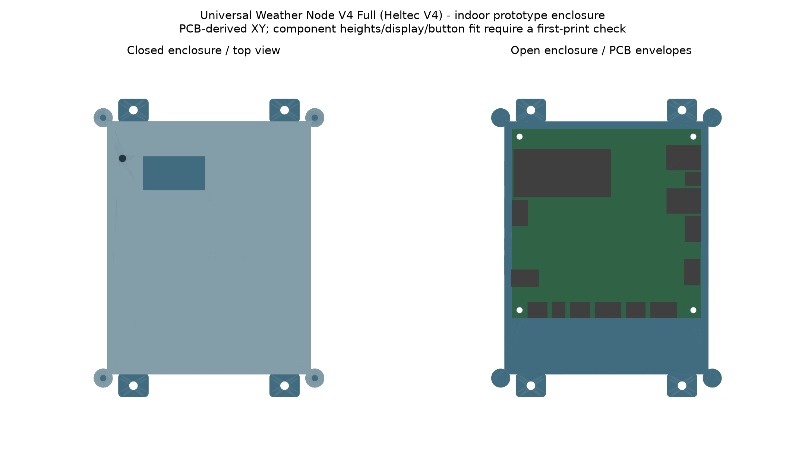

# Enclosure

| PCB revision | Files | Source |
|---|---|---|
| **V4 Full** (formerly v2.0) | [`v4-full/`](v4-full/) for the Heltec **V4**: body, lid, button pin, optional gland blank (STL + STEP), assembly STEP and preview | [`case_v4_full.py`](case_v4_full.py) (build123d; reads the current KiCad PCB) |
| **V4 Light** | [`v4-light/`](v4-light/): body, lid, button pin, gland blank (STL + STEP), assembly STEP and preview | [`case_v4_light.py`](case_v4_light.py) (build123d; reads the current KiCad PCB) |
| **Minimal wireless build** (no PCB) | [`minimal/`](minimal/): body, two lids, PRG/RST pins (STL + STEP), assembly STEP and preview | [`case_minimal.py`](case_minimal.py) (build123d) |

The cases for the Rev 1.2 / 1.3 boards and for a Heltec V3 on the former PCB v2.0 (all V3 only) are in
the [`2.x` branch](https://github.com/franzenhof/universal-weather-node/tree/2.x/3dprint) (firmware 2.x).

## Minimal wireless build enclosure (bare Heltec V4 + BME280, optional GNSS, no PCB)

> **Drawn for the Heltec V4** (51.69 × 25.4 mm, pin 1 3.43 mm from the USB end, PRG button position
> from Heltec's V4 3D model). Not printed yet. Items marked TODO in `case_minimal.py` were not in the
> repo and are placeholders: GNSS module size, RST button and u.FL positions.

For the [Minimal Wireless Build](../docs/minimal-build.md): a bare
**Heltec WiFi LoRa 32 V4** (pin headers soldered, pins pointing down) and a 4-pin
**GY-BME280** module on four female–female jumper wires (firmware 4.x wiring: 3V3 header pins 1 GND,
2 3V3; 5V header pins 13 = GPIO47 SDA, 14 = GPIO48 SCL), plus an optional Heltec **GNSS module**. Wall-mounted, **for a sheltered place** (under a roof or eave) — the louvres
shed rain, but the case is **not waterproof** (no IP rating).


**Size:** case 65.8 × 104.0 × 35.0 mm (W × H × D, closed; 76.6 × 132 mm including the screw lobes and the mounting ears).

**Concept — two chambers, one above the other**

- **Top: electronics chamber with GNSS bay.** Above the Heltec a bay holds the optional Heltec
  **GNSS module** on four posts, patch antenna up, with only the 2.4 mm lid above it (1 mm gap,
  four corner ribs hold it down); the bay has its own louvres and sits furthest from the BME280.
  The **top wall** carries a knock-out for an optional **R-SMA bulkhead** (WiFi antenna, u.FL →
  R-SMA pigtail inside): a Ø6.4 mm hole closed by a 0.6 mm skin with a marking ring on the outside;
  drill / cut it out, push the jack through, fix the nut on the flat inner wall (Ø11 mm clear),
  screw the antenna on outside. The 868 MHz SMA bulkhead stays in the right wall.
- **Electronics chamber (Heltec).** The Heltec sits display-forward, USB-C on the left. It
  needs no screws (it has no mounting holes): four **saddles** carry the pin-header plastic,
  the pins drop into end-capped slots (this locates the board in X and Y), and four ribs on
  the lid end 2.2 mm above the board, just above the soldered pin tips, so it cannot lift off. 21 mm below
  the board leave room for the Dupont housings (2.5 + 14 mm) and the wire bend; the saddles
  avoid the wired pins J3 1, 2, 7, 8. Louvres in the side walls (left: rear half, below the USB opening;
  right: front half, above the SMA nut) — none in the floor, i.e. none towards the sensor.
- **Air gap.** The electronics floor and the sensor chamber ceiling are two separate walls
  with an **8 mm air gap**, open to the front, both sides and (between three narrow bridge
  strips) the back, so wind flushes it. Because the warm chamber is on top, the air in a
  horizontal gap is stably layered — warm air cannot sink into the gap, heat can only cross
  ~8 mm of still air and the thin bridges. (A vertical "chimney" gap would only work with the
  chambers side by side; then rising warm air from the electronics would pass the sensor.)
- **Bottom: BME280 chamber.** 45° louvres falling to the outside on both side walls and
  in the lid, straight slots in the floor. The module lies horizontally in two card guides,
  header at the rear edge with the pins pointing up, ≥ 6 mm from every wall; a finger on the
  lid stops it from sliding out. The **only** connection between the chambers is a
  12.5 × 4.5 mm cable slot (a 1×4 Dupont housing, or four single housings one after another
  beside the wires already threaded, pass through) — **seal it with hot glue or a
  foam plug** after wiring so warm air cannot flow down. `case_minimal.py` checks this: the
  separating walls are solid except for the conduit bore.

**Antenna:** Ø 6.5 mm hole in the right wall for an **SMA bulkhead** with an IPEX (U.FL)
→ SMA pigtail (10–15 cm) and an external **868 MHz** antenna (recommended; a hinged
antenna pointing up). Alternative: the small antenna supplied with the Heltec stuck inside
the electronics chamber (lower range); close the SMA hole with a screw + nut or hot glue.
Never power the Heltec without an antenna.

**Print** (PETG or ASA, 0.2 mm layers, 3–4 perimeters, ≥ 2.4 mm walls, **no supports**):

| Part | Count | Orientation | Notes |
|---|---|---|---|
| [case-body](minimal/universal-weather-node-minimal-case-body.stl) | 1 | back on the bed (as exported) | USB window bridges 13.5 mm; louvres, saddles and card guides are vertical |
| [lid-electronics](minimal/universal-weather-node-minimal-lid-electronics.stl) | 1 | outer face on the bed | window, pusher guides, hold-down ribs |
| [lid-sensor](minimal/universal-weather-node-minimal-lid-sensor.stl) | 1 | outer face on the bed | 45° louvres print without support |
| [button-pin-prg](minimal/universal-weather-node-minimal-button-pin-prg.stl) (9.2 mm) | 1 | foot down | protrudes 1.8 mm |
| [button-pin-rst](minimal/universal-weather-node-minimal-button-pin-rst.stl) (7.7 mm) | 1 | foot down | nearly flush — press with a pen tip, no accidental resets |

STEP files, an [assembly STEP](minimal/universal-weather-node-minimal-assembly.step) (with
Heltec/BME280 clearance envelopes), [validation.json](minimal/validation.json) and a
[display-cover template](minimal/display-cover.svg) are in [`minimal/`](minimal/).

**Hardware**

- 8 × **M3 × 10 (–12) mm screws for plastic** (self-tapping, e.g. ST2.9 × 13 or PT/Delta
  type, pan head) — 4 per lid, into Ø 2.5 mm pilot holes (12 mm deep).
- 2 × wall screws Ø 3.5–4 mm (pan head ≤ 8 mm, head height ≤ 2.4 mm) + plugs: top ear =
  keyhole (hang), bottom ear = Ø 4.4 mm hole (fix).
- SMA female bulkhead with IPEX/U.FL pigtail (thread 1/4"-36, ≥ 5 mm thread length),
  868 MHz antenna.
- Optional: 1 mm clear PETG/acrylic sheet 30.6 × 19.6 mm, glued into the 0.8 mm recess
  behind the display window (recommended outdoors).
- Hot glue or a bit of foam for the cable conduit; optionally 1 mm foam pads on the lid ribs.

**Assembly**

1. Insert both button pins into the lid guides from the inside (foot towards the Heltec).
2. Push the four jumper wires onto the BME280 (VIN, GND, SCL, SDA), feed the free ends one by
   one up through the conduit, slide the module into its card guides from the front (header
   at the back, pins up) until it stops.
3. Plug the wires onto the Heltec: 3V3 header pins 1 (GND), 2 (3V3), 5V header pins 13 (GPIO47 →
   SDA), 14 (GPIO48 → SCL); lay the slack behind the board. Fit the SMA bulkhead and connect the pigtail to the
   Heltec's IPEX socket (press straight down, do not pull on the thin cable).
4. Lower the Heltec onto the saddles (USB-C to the left, display to the front); the pins must
   drop into the saddle slots. Seal the conduit with hot glue / foam.
5. Screw on both lids; check that PRG/RST are not held down and the USB-C plug fits.

**Please check on the first print** (estimates, adjust in `case_minimal.py`): the **GNSS module
size** `GNSS_L` × `GNSS_W` × `GNSS_T` (25 × 25 × 8 mm placeholder, TODO), the V4's **RST button**
position (assumed mirrored to PRG) and **u.FL positions** (envelope only), Heltec PCB
thickness `HT` (1.2 mm assumed), switch height `BTN_H` (2.5 mm) and positions in `BUTTONS`,
OLED `WINDOW`, `USB_OPEN` (13.5 × 9 mm — enough for typical USB-C overmoulds, not for very
bulky ones), and the BME280 size `BME_W` × `BME_L` (10.5 × 13 mm, header on the 10.5 mm
edge — **measure your module**, sizes vary between 10.5 × 13 and 11.5 × 15 mm). Heltec outline
51.69 × 25.4 mm, header layout (22.86 mm row spacing, pin 1 3.43 mm from the USB end) and the PRG
button come from Heltec's V4 3D model (as in the V4 Full case); USB-C is centred, the display window
is the V4 Full window — not measured on a real board.

**Regenerate:** `.venv-cad/bin/python 3dprint/case_minimal.py` (same venv as below). The
script checks single valid solids, watertight STL, part/part collisions, collisions with the
Heltec/USB plug/SMA/BME280/Dupont envelopes, a free cable conduit, the wire bend room and
the chamber separation, then writes `minimal/` and `pictures/case-minimal.png`.

## V4 Light enclosure (indoor)

For the **100 × 80 × 1.6 mm** [V4 Light](../pcb/v4-light/README.md) (M3 holes 30/96 × 4/76 mm), same
construction as the V4 Full case: body with four PCB supports and nut pockets, lid with display
window and captive PRG pin, wall-mount ears. Outline, mounts and connector positions are read from the
KiCad board. USB-C at the top edge, RJ11 jacks and the two screw terminals on the right, a 16 mm
cable bay below the board for J8 / J9 (two M12 gland holes), LoRa SMA (Ø6.5 mm) and an optional
**R-SMA knock-out** (Ø6.4 mm, 0.6 mm skin, marking ring) for the WiFi antenna in the left wall, beyond
the module's end. Overall 122 × 126 mm incl. ears, 36 mm closed. Indoor / sheltered, no IP rating,
**not printed yet**; heights, display window, PRG position and the SMA / R-SMA positions (the V4's
u.FL positions are not in the repo) need the first-print check. Regenerate:
`python 3dprint/case_v4_light.py`. Print and assembly as for the V4 Full.

## V4 Full enclosure (indoor)

Designed for the current **100 × 100 × 1.6 mm** PCB, with four M3 mounts on a
**92 × 92 mm** pattern. It follows the Rev 1.3 concept (body, lid, captive button,
display-cover recess, connector access and wall-mount ears), but is a new
construction for the different board size and layout. Older cases do not fit.

**Indoor/workshop use only.** Open USB, jack and terminal windows mean this is
not rain-, dust- or condensation-proof. Cable glands and a display cover do not
make the remaining openings watertight. No IP rating, physical print fit or
thermal qualification is claimed.



**Heltec V4:** the V4 Full takes only the Heltec V4 (51.7 mm long, sockets J19/J20). The lid's
display window, the PRG button pin and the USB opening follow the module; the V4 button position
comes from Heltec's V4 3D model and the display window is the former V3 window moved with the
rows — check both on the first print. The case for a V3 on the former PCB v2.0 (`v20/`) is in the
`2.x` branch. The files below were generated before the rename and still emboss
`WEATHER NODE v2.0` on the body; regenerating with `case_v4_full.py` writes `V4 FULL`.

### Download / print

| File | Purpose |
|------|---------|
| [Body STL](v4-full/universal-weather-node-v4-full-case-body.stl) / [STEP](v4-full/universal-weather-node-v4-full-case-body.step) | Four PCB supports, connector windows, cable bay, mounting ears and lid screw towers; Ø 10 mm knock-out (0.6 mm outer skin) in the left wall for the optional DC jack J18 — drill or cut it out when J18 is fitted |
| [Lid STL](v4-full/universal-weather-node-v4-full-case-lid.stl) / [STEP](v4-full/universal-weather-node-v4-full-case-lid.step) | Display window, locating lip, button guide and screw holes |
| [Button STL](v4-full/universal-weather-node-v4-full-button-pin.stl) / [STEP](v4-full/universal-weather-node-v4-full-button-pin.step) | Captive push pin for the Heltec PRG button |
| [Gland blank STL](v4-full/universal-weather-node-v4-full-gland-blank.stl) / [STEP](v4-full/universal-weather-node-v4-full-gland-blank.step) | Print up to three if M12 gland openings are unused; glue in place, not a sealing certification |
| [Assembly STEP](v4-full/universal-weather-node-v4-full-assembly.step) | Closed enclosure with PCB/component **clearance envelopes**, not detailed electronic models |
| [Display-cover template](v4-full/display-cover.svg) | 37 × 22 mm clear sheet, print at 100% / verify dimensions |
| [CAD validation](v4-full/validation.json) | Dimensions, PCB mounts, opening positions and exported mesh checks |

Overall footprint including ears/towers is approximately **122 × 158 mm**;
closed height **42.4 mm**, plus about 1.5 mm button protrusion. The rectangular
body is 108 × 134 mm. Walls/floor are 2.4 mm; PCB underside is 8.4 mm above
the outer floor, leaving 6 mm below the PCB for solder tails.

- Six cable windows on the bottom side align with POWER, HEATER, FAN, AUX,
  1-WIRE and I²C. A 27.6 mm-deep internal bay between PCB edge and wall provides
  wire/bend space. Wiring and terminal screws are accessed with the lid removed;
  these windows are not tightly fitted terminal-body cutouts.
- Right-side windows give access to Davis rain/wind jacks, their parallel
  terminals and J17 UV. Left-side windows serve USB and J14 VE.Direct; J15's
  cable exits via the VE.Direct opening. Each Davis jack/parallel-terminal pair
  has a combined opening rather than a fragile narrow dividing bridge.
- Three **Ø12.5 mm** bottom-side holes accept selected M12 cable glands.
  Choose glands with nut envelope **no larger than Ø18 × 4 mm** inside, and
  sufficient threaded length for the 2.4 mm wall. Check the actual gland drawing;
  M12 does not define its flange/nut size or supported cable diameter.
- **R-SMA knock-out** (Ø6.4 mm hole, 0.6 mm outer skin, marking ring, 11 mm nut clearance) in the
  left wall at PCB Y 72 mm for an optional WiFi antenna bulkhead; drill it out when fitted.
- **Ø6.5 mm SMA** opening on the left accepts a suitable bulkhead pigtail.
  Check thread/flange dimensions before ordering; route the thin IPEX lead
  without pulling on the Heltec RF socket.
- Four mounting ears have Ø4.6 mm holes on an **80 × 146 mm** pattern.

Use PETG or ASA, 0.2 mm layers, approximately 4 perimeter lines and 4–5
top/bottom layers. At least 180 × 180 mm usable bed area is recommended.
All STLs are already in print orientation at Z=0:

| Part | Orientation | First-print notes |
|------|-------------|-------------------|
| Body | Floor down | Closed side windows bridge up to about 16 mm; tune bridging or add local supports if your printer needs them |
| Lid | Outer face down, lip/guide up | Keep the display recess and screw holes free of support residue |
| Button | Foot down | Slide freely in Ø3.9 mm guide; lightly deburr if necessary |
| Gland blank | Flange down | Glue optional blanks into unused gland holes |

### Hardware and assembly

1. Fit four **M3 nuts** into the floor's hex pockets (approximately 5.8 mm
   across flats, 2.5 mm deep). Set the unpowered PCB onto the four supports.
   Secure with **M3 × 10 mm screws** and suitable thin washers; check that
   screws engage the nuts without protruding underneath or touching nearby
   joints. Keep washers within the board's ≤7 mm outside-diameter limit.
2. Fit glands/pigtail if used; wire terminals with the lid off. Add strain
   relief so cables cannot load the PCB connectors. Do not route cables over
   hot power components or the display/button.
3. Cut a **37 × 22 × 1 mm** clear acrylic/PETG cover and bond it into the lid's
   0.8 mm-deep inside recess. The remaining 0.2 mm projects into the enclosure.
4. Insert the button from inside, with its wide foot towards the PCB. Close the
   lid using four **M3 × 12 mm screws suitable for plastic** into the Ø2.5 mm
   pilot holes. Do not overtighten; holes may need drilling/fit adjustment for
   the particular screw and material.
5. Test display visibility, PRG movement, USB plug clearance and all sensor
   plugs **before** permanent mounting. On the V4 Full always disconnect external
   supplies and remove JP8 before plugging in USB.

**Mandatory first-print fit check:** PCB outline, mounting pattern and connector
XY are read from the actual KiCad board. Connector/module heights and the
display/button/USB dimensions are estimates carried over from the earlier case
and Heltec pin layout, not measured on an assembled V4 Full board.

The estimated button is **14 mm** tall. It should have a small rest clearance,
not hold PRG down at boot. If it does, shorten it; if travel is insufficient,
adjust `BUTTON_TOP` / `BUTTON_GAP` in the source. Also check the window/guide
position (`DISPLAY`, `BUTTON`), header stack height and USB cable overmould.
Do not force a lid that presses on the module. This is not a measured
mechanical fit guarantee.

### Regenerate / validate

Python 3.11–3.14 is required; the supplied tool versions were tested with
Python 3.14 on macOS. A working build123d/OCP package for your OS is required.

```bash
python3 -m venv .venv-cad
.venv-cad/bin/pip install -r 3dprint/requirements.txt
.venv-cad/bin/python 3dprint/case_v4_full.py              # Heltec V4 -> v4-full/
```

The source reuses the repository's KiCad S-expression reader; KiCad itself is
not needed to generate the case. It refuses an unexpected board size, mounting
pattern or moved key connectors. All four exported print parts are checked for
one valid CAD solid, a watertight single-volume STL, matching CAD/mesh volume
and Z=0 print placement. Body/lid/button intersections, PCB and estimated
component-envelope collisions, M12 nut/lid clearance and support clearance
from through-hole pads are checked too.

Coordinates in `validation.json` use PCB-local X right/Y down; STEP assembly
uses X right/Y up/Z up (`CAD Y = -PCB Y`) so the enclosure is not mirrored
relative to the physical board. Individual lid STEP/STL files are print-oriented;
use the assembly STEP for installed positions. CAD checks are not physical
fit, heat, durability or weatherproofing tests.
