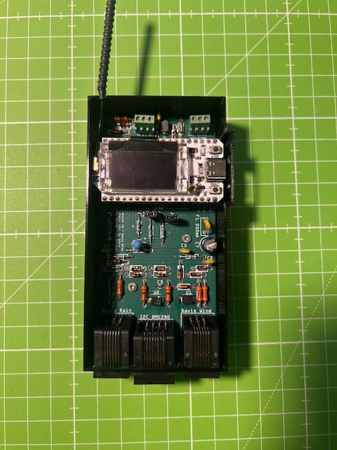

# Universal Weather Node — Wi-Fi Weather Station for Bresser, Ecowitt / Froggit and TFA Sensors

**Turn a €20 ESP32 board into the hub of your weather station.** A **Heltec WiFi LoRa 32 V3** receives your wireless outdoor station **directly on 868 MHz** — no console, no gateway, no Raspberry Pi, no cloud — computes dew point, trends and rain totals, and sends everything to **Home Assistant (MQTT)**, its own **web dashboard**, **weather networks** and, optionally, **LoRaWAN**.

<!-- help:skip -->
<p align="center">
  
</p>
<!-- /help:skip -->

## Quick Start (wireless station, about 15 minutes)

**You need:** a **Heltec WiFi LoRa 32 V3** (or V4, see [installation](docs/installation.md#installing-the-firmware-browser-no-software)) with its **868 MHz antenna**, a USB-C power supply, and a wireless outdoor station — **Bresser** 5/6/7-in-1, **Ecowitt / Froggit** (WS69, WS80, WS85, WS90, WH31 …) or **TFA / LaCrosse IT+**. Recommended: a **BME280** module for the air pressure (four jumper wires, see [Minimal Wireless Build](docs/minimal-build.md)).

1. **Install the firmware in the browser** — Chrome/Edge, [web.esphome.io](https://web.esphome.io), the `-factory.bin` from [`firmware/`](firmware/). Step by step: [Installing the Firmware](docs/installation.md#installing-the-firmware-browser-no-software).
2. **Connect your phone** to the Wi-Fi **`WeatherNode`** and open **http://192.168.4.1** (opens by itself on most phones).
3. **Choose your Wi-Fi** (*Configure WiFi*), save. The node restarts and joins your network.
4. **Done.** The node searches for your wireless station by itself (Bresser, Ecowitt / Froggit, TFA) and locks onto the first one it hears. Open the IP address shown on the display: the dashboard shows live values after one measurement cycle.
5. **Next steps (optional):** set an admin password, then under **Settings** add [MQTT for Home Assistant](docs/mqtt-home-assistant.md), [weather networks](docs/weather-networks.md) (AWEKAS, Weather Underground, Windy …) or your sensor ID if neighbours' stations are in range.

Wired sensors (Davis, reed switches, DS18B20 …) need one of the [custom PCBs](docs/pcb.md#custom-pcb) — see [Hardware](docs/pcb.md#hardware). [LoRaWAN](docs/lorawan.md) is off by default; switch it on for sites without Wi-Fi.

## Features

- 📻 **Wireless sensors received directly** — Bresser 5/6/7-in-1 and other Bresser sensors, Ecowitt / Froggit (Fine Offset) outdoor arrays and sensors, TFA / LaCrosse IT+; type detected automatically. Per value you choose the source (board or wireless, automatic fallback). *(Ecowitt / Froggit and IT+ not yet tested with real sensors.)*
- 🌐 **Built-in web dashboard** with live values, warnings, rain totals (hour … year), wind rose and trend charts — works without internet; plus a REST API
- 🏠 **MQTT + Home Assistant** auto-discovery (TLS-capable) — every value, derived value and warning as an entity; **Loxone** via UDP push or HTTP
- ☁️ **Direct uploads to weather networks** — AWEKAS, Weather Underground, Weathercloud, Wetternetzwerk.pro, Windy, openSenseMap
- 🧮 **Computed on the node:** dew point, feels-like, cloud base, VPD, 3-h pressure tendency with a weather trend, temperature trend, rain last hour / 24 h / today / yesterday / week / month / year, sunshine duration, frost / fog / sultry warnings, WMO wind (3-s gusts, 10-min values)
- 🧩 **Everything runs on the ESP32** — no PC, Raspberry Pi, script or cloud service; sensors are read directly, Wi-Fi is output only
- 🔧 **Set up from your phone** — browser installation, config portal, web settings, firmware updates over Wi-Fi
- 📡 **Optional:** LoRaWAN (ChirpStack / TTN) for sites without Wi-Fi, and a custom PCB for Davis and other wired sensors, heater/fan outputs, UV, Victron VE.Direct

<!-- help:skip -->
<p>
  
  
  
  
</p>
<!-- /help:skip -->

**Current status:** [2.0.0-rc.3](firmware/universal-weather-node-2.0.0-rc.3.bin) ([factory image](firmware/universal-weather-node-2.0.0-rc.3-factory.bin) for the first installation) is the release candidate for 2.0.0.

## Documentation

| I want to … | Read |
|-------------|------|
| install the firmware, open the config portal, update over Wi-Fi | [Installation and First Setup](docs/installation.md) |
| receive my Bresser / Ecowitt / Froggit / TFA station | [Wireless Sensors](docs/wireless-sensors.md) |
| build a station without the custom PCB | [Minimal Wireless Build](docs/minimal-build.md) |
| see the dashboard, status page or REST API | [Web Interface](docs/web-dashboard.md) |
| build my own display / app | [HTTP API for Your Own Display](docs/api.md) — contract, examples, mock server |
| connect Home Assistant (MQTT) | [MQTT and Home Assistant](docs/mqtt-home-assistant.md) |
| upload to AWEKAS, Weather Underground, Windy … | [Weather Networks](docs/weather-networks.md) |
| feed a Loxone Miniserver | [Loxone](docs/loxone.md) |
| use LoRaWAN (ChirpStack / TTN), payload formats, low-power mode | [LoRaWAN](docs/lorawan.md) |
| wire Davis and other sensors with the PCB, order the PCB | [Custom PCB and Wired Sensors](docs/pcb.md) |
| understand measurement, derived values and units | [Measurement, Derived Values and Units](docs/values.md) |
| look up all settings and parameter IDs | [Configuration](docs/settings.md) |
| fix a problem | [Troubleshooting](docs/troubleshooting.md) |
| build from source and run the tests | [Developer Notes](docs/development.md) |
| see what changed between versions | [Changelog](CHANGELOG.md) |

---

## How It Fits Together

The node reads every sensor **directly** — 868 MHz radio decoded by its own LoRa chip, or wired inputs, I²C / 1-Wire on the PCB — processes the values itself and only **sends** them out. It never fetches or receives sensor data over Wi-Fi.

```
 Bresser / Ecowitt / TFA ~ 868 MHz ~┐
 BME280 (I²C, recommended) ─────────┤                      ┌─► Wi-Fi ──► Web dashboard / REST API in your LAN
 PCB only:                          ├──► Weather Node ─────┼─► Wi-Fi ──► MQTT broker ──► Home Assistant, ...
   Davis / generic wind + rain ─────┤    (Heltec V3)       ├─► Wi-Fi ──► AWEKAS, Weather Underground, Windy, ...
   DS18B20, UV, AUX, Victron ───────┘                      └─► LoRaWAN (optional) ──► ChirpStack / TTN ──► Grafana, ...
```

The node runs continuously (no deep sleep). It samples the sensors every few seconds and combines the samples into one measurement per **cycle** (default 300 s), which it then sends out.

## The Project in Pictures

<!-- help:skip -->
<p align="center">
  
</p>

<table>
  <tr>
    <td align="center" width="25%">
      
      <br><strong>3D-printed case (Rev 1.2)</strong>
    </td>
    <td align="center" width="25%">
      
      <br><strong>Davis rain &amp; wind sensor</strong>
    </td>
    <td align="center" width="50%">
      
      <br><strong>Built-in web dashboard</strong>
    </td>
  </tr>
  <tr>
    <td align="center" colspan="3">
      
      <br><strong>Grafana: wind data via LoRaWAN</strong>
    </td>
  </tr>
</table>
<!-- /help:skip -->

*(Pictures are only shown on the project page, not in the device's built-in help.)*

---

## License

This project is fully open source and dual-licensed:

* **Software / firmware:** [MIT License](LICENSE-SOFTWARE) — use, modify and distribute freely.
* **Hardware (schematics, PCB, 3D files):** [CERN-OHL-P v2](LICENSE-HARDWARE) (permissive) — manufacture, modify and distribute freely.

*Developed with 🚜 and 💻 by Gerhard Massenbichler at Franzenhof.*
