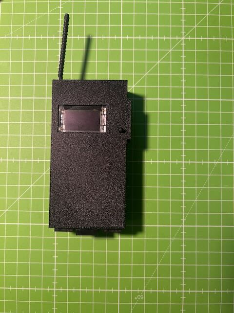
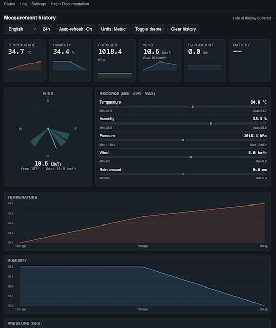
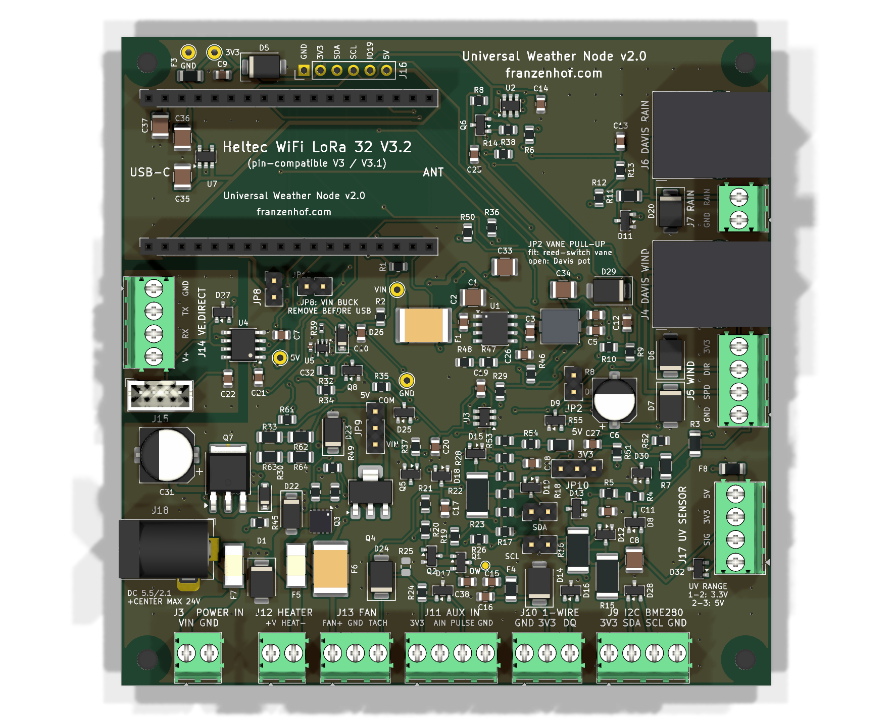
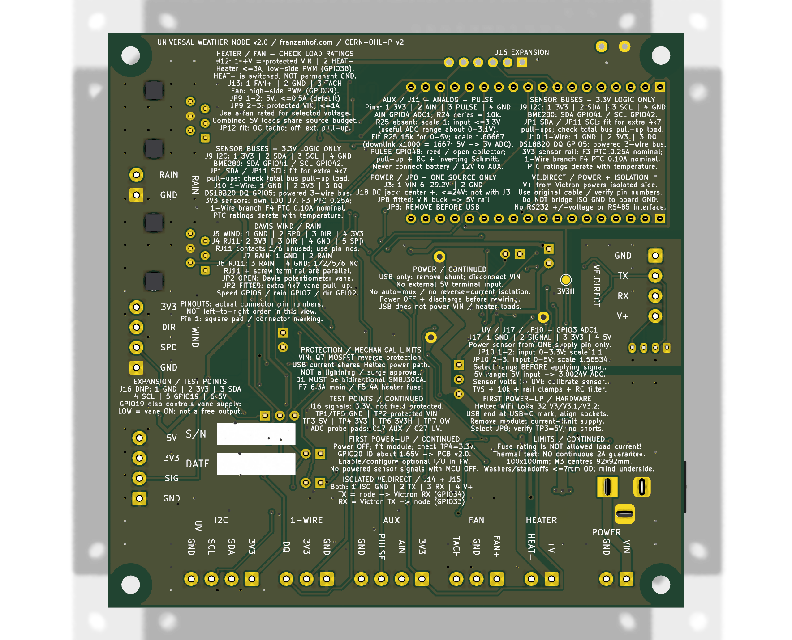
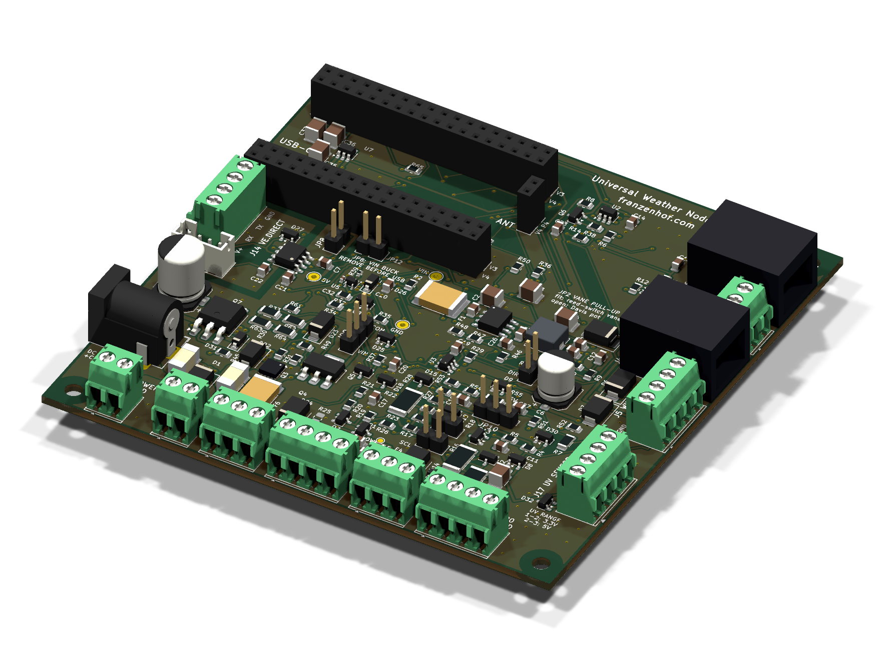
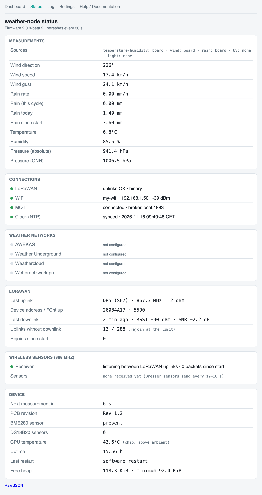
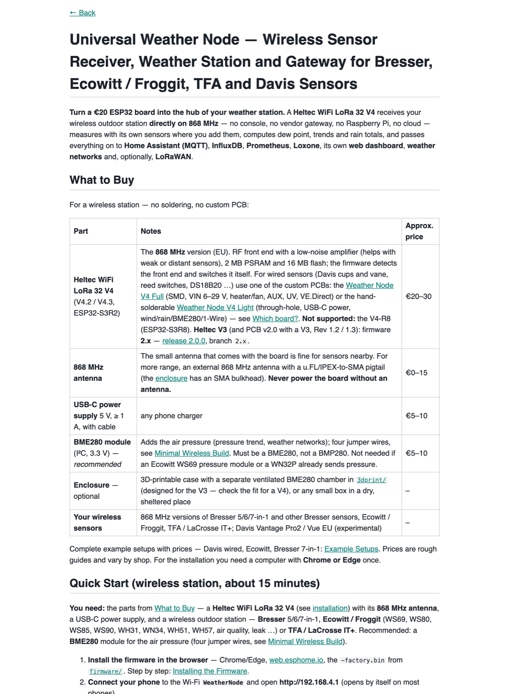

# Universal Weather Node — LoRaWAN + Wi-Fi Weather Station

A DIY weather station on a custom PCB around the **Heltec WiFi LoRa 32 V3** (ESP32-S3). It measures **wind speed, wind direction, rain, temperature, humidity and air pressure** and sends the data wherever you need it — over LoRaWAN, over Wi-Fi, or both at once.

- 📡 **LoRaWAN** to ChirpStack or TTN — compact binary format (default) or CayenneLPP, automatically fitted to the data rate
- 📶 **Wi-Fi + MQTT** (TLS-capable) with **Home Assistant** auto-discovery
- 🌐 **Built-in web dashboard** with live values, trend charts and hover details — works without internet
- ☁️ **Direct uploads to weather networks** — AWEKAS, Weather Underground, Weathercloud, Wetternetzwerk.pro
- 🔧 **Set up from your phone** — config portal on first boot, firmware updates over the air, no rebuild needed

<!-- help:skip -->
<p>
  
  
  
  
</p>
<!-- /help:skip -->

The transports can be enabled independently. Web serving and weather-network uploads run in background tasks; sensor sampling and LoRaWAN share the main loop, so a radio exchange briefly pauses sampling.

**Current status:** [2.0.0-beta.1](firmware/universal-weather-node-2.0.0-beta.1.bin) is the latest prepared firmware. PCB v2.0 fabrication files are ready for **prototypes**, not a hardware-qualified production run. Builds and host tests pass; physical v2.0 qualification and beta field tests on Rev 1.2/1.3 remain open. The photos below show older Rev 1.2 hardware; the v2.0 images are renders.

> **PCB v2.0 power safety:** use **one power source at a time**. JP8 is a two-pin manual buck disconnect, not a power mux. Before connecting USB-C, disconnect VIN and remove the JP8 shunt. J3 has VIN and GND only; there is no external 5 V input. Never select PCB revision `20` on a Rev 1.2/1.3 board.

## Contents

**Getting started**
- [The Project in Pictures](#the-project-in-pictures)
- [How It Fits Together](#how-it-fits-together)
- [Quick Start](#quick-start)
- [Hardware](#hardware)

**Using the node**
- [Configuration](#configuration)
- [Web Interface](#web-interface)
- [Weather Networks](#weather-networks)
- [MQTT and Home Assistant](#mqtt-and-home-assistant)
- [LoRaWAN](#lorawan)
- [Using Other Sensors](#using-other-sensors)
- [Inputs and Outputs (PCB v2.0)](#inputs-and-outputs-pcb-v20) · [Second Wind Sensor](#second-wind-sensor-pcb-v20)
- [Units (Metric/Imperial)](#units-metricimperial)

**Reference**
- [Measurement Principles](#measurement-principles)
- [Payload Formats](#payload-formats)
- [Troubleshooting](#troubleshooting)
- [Build & Flash](#build--flash) · [Tests](#tests)
- [Developer Notes](#developer-notes)
- [Changelog](#changelog)
- [License](#license)

---

## The Project in Pictures

<!-- help:skip -->
<table>
  <tr>
    <td align="center" width="33%">
      
      <br><strong>PCB, empty</strong>
    </td>
    <td align="center" width="33%">
      
      <br><strong>PCB, assembled</strong>
    </td>
    <td align="center" width="33%">
      
      <br><strong>PCB, in operation</strong>
    </td>
  </tr>
</table>

<table>
  <tr>
    <td align="center" width="33%">
      
      <br><strong>3D-printed case, closed</strong>
    </td>
    <td align="center" width="33%">
      
      <br><strong>3D-printed case, open</strong>
    </td>
    <td align="center" width="33%">
      
      <br><strong>Davis rain &amp; wind sensor</strong>
    </td>
  </tr>
</table>

<table>
  <tr>
    <td align="center" width="50%">
      
      <br><strong>Built-in web dashboard</strong>
    </td>
    <td align="center" width="50%">
      
      <br><strong>Grafana: wind data</strong>
    </td>
  </tr>
</table>
<!-- /help:skip -->

*(Pictures are only shown on the project page, not in the device's built-in help.)*

---

## How It Fits Together

```
 Davis wind sensor ─┐
 Davis rain gauge ──┤                      ┌─► LoRaWAN ──► ChirpStack / TTN ──► Grafana, ...
 BME280 (I²C) ──────┼──► Weather Node ─────┤
 DS18B20 × 3 ───────┤    (Heltec V3)       ├─► Wi-Fi ──► MQTT broker ──► Home Assistant, ...
 LiPo (optional) ───┘                      │
                                           ├─► Wi-Fi ──► AWEKAS, Weather Underground, ...
                                           │
                                           └─► Wi-Fi ──► Web dashboard / REST API in your LAN
```

The node runs continuously (no deep sleep). It samples the sensors every few seconds (default 3 s) and combines the samples into one measurement per **cycle** (default 300 s), which it then sends out. Wi-Fi is off by default — useful for battery installs; on mains power it can run alongside or instead of LoRaWAN.

---

## Quick Start

1. **Prepare the hardware** — PCB, Heltec board and sensors (see [Hardware](#hardware)). For v2.0, follow the [assembly and first-power checklist](pcb/v2.0/CHECKLIST.md); connect sensor cables with power off.
2. **Flash once over USB** — install PlatformIO, open a terminal in this repository and run `pio run -t upload` (see [Build & Flash](#build--flash)). On v2.0, disconnect external power and remove JP8 first. Later application updates can use OTA.
3. **Open first-time setup.** While powered by USB, the node opens Wi-Fi **`WeatherNode`**. Connect with your phone and open **http://192.168.4.1**. Do not hold the user button during boot.
4. **Choose your PCB revision and connections.** Select `12` for Rev 1.2 or `13` for Rev 1.3; v2.0 is detected automatically. Disable absent wind/rain sensors and enter your station altitude. Choose the setup below, then *Save*; the node restarts.
5. **Check operation.** The first complete measurement arrives after one cycle (default **5 minutes**). With Wi-Fi/web API enabled, open the IP shown on the display; set an admin password in the portal to use Settings or Log. Add weather-network accounts under **Settings**.

| Setup | Enable | Also required |
|-------|--------|---------------|
| LoRaWAN only | LoRaWAN | Gateway/network account, matching region, OTAA keys and backend decoder |
| Wi-Fi dashboard only | Wi-Fi + web API; disable LoRaWAN | Your Wi-Fi credentials |
| Wi-Fi + Home Assistant | Wi-Fi + MQTT; web API optional | Wi-Fi credentials, MQTT broker and Home Assistant MQTT integration |
| Both transports | LoRaWAN + the desired Wi-Fi services | Both sets of settings above |

For permanent VIN power on v2.0, disconnect USB first, then fit JP8 as described under [Custom PCB](#custom-pcb).

---

## Hardware

| Component | Function |
|-----------|----------|
| Heltec WiFi LoRa 32 V3 | Microcontroller (ESP32-S3), LoRa SX1262, OLED display 128×64 |
| Davis 6410 Anemometer (default) | Wind speed (reed switch) + wind direction (potentiometer 20 kΩ) |
| Davis AeroCone / Standard, typically 6466M (default) | Rainfall (reed switch, 0.2 mm/pulse) |
| BME280 | Temperature / humidity / air pressure (I²C 0x76; Cat5 recommended for longer cables, see [Connectors](#connectors)) |
| DS18B20 | Up to 3 temperature probes (1-Wire, external) |
| LiPo battery | Optional; voltage measured via voltage divider + ADC |
| Custom PCB **v2.0** (default) or Rev 1.2 / 1.3 | Connectors plus ESD protection, pull-ups, RC filters, polyfuses; v2.0 also power supply 6–29.2 V / 5 V and a UV input |

> **Other sensors work too.** Rain gauges and anemometers are just reed-switch pulse counters — any similar sensor works after setting its ratio. See [Using Other Sensors](#using-other-sensors).

### Custom PCB

**Hardware v2.0** is the current design: a KiCad/SMD redesign in [`pcb/v2.0/`](pcb/v2.0/), prepared for JLCPCB SMD assembly. Through-hole connectors/headers, the Heltec module and jumper shunts need separate assembly arrangements. It retains Rev 1.3's main sensor GPIOs and adds its own power supply, screw terminals and AUX/UV inputs. Rev 1.2/1.3's Fritzing design is kept in [`pcb/v1.3/`](pcb/v1.3/).

<!-- help:skip -->
<table>
  <tr>
    <td width="50%"></td>
    <td width="50%"></td>
  </tr>
  <tr>
    <td colspan="2" align="center"></td>
  </tr>
</table>
<!-- /help:skip -->

**Board:** 100 × 100 mm, 2 layers, four M3 mounting holes on a **92 × 92 mm** pattern (centres 4 mm from adjacent edges). With the component side facing you:

- **Top-left:** Heltec WiFi LoRa 32 **V3.2**, pin-compatible with V3/V3.1. Its USB-C connector sits 1.5 mm inside the board edge.
- **Right:** original Davis RJ11 plugs, each with a parallel 3.5 mm screw terminal below it (J7 rain, J5 wind). J17 UV sits further down this edge, with its wire opening facing right.
- **Bottom:** power, heater, fan, AUX, 1-Wire and I²C terminals.
- **Left:** isolated Victron VE.Direct screw terminal and JST-PH connector.

Rev 1.2/1.3's BME280 RJ45 jack is replaced by J9 on v2.0; an existing cable can be wired to J9 or an enclosure-mounted RJ45 keystone. Both sides label connector pins. The back additionally carries a standalone operating reference; see [Connectors](#connectors) for numbered pinouts.

**Power** (manual buck disconnect with JP8):

| Input | Range | Protection | Selection |
|-------|-------|------------|-----------|
| **VIN** (J3) | 6–29.2 V, including an 8s LiFePO4 battery at full charge | Common fused P-channel reverse-polarity protection (Q7), bidirectional TVS SMBJ30CA, separately fused LMR36520 buck (5 V / 2 A nominal) | JP8 pins 1–2 |
| **USB-C** (Heltec) | Regulated USB 5 V; measurement / bench test / flashing | USB VBUS connects to the module 5 V rail; source/cable/Heltec-path limits apply | JP8 removed; VIN disconnected |

J3 is a two-pin terminal: **1 VIN, 2 GND**. The external 5 V branch
(F2/D4/Q9/R56/U6/R57–R60/C28–C30) has been removed. JP8 is now a two-pin
disconnect: fitted for VIN operation, **REMOVE BEFORE USB**. Disconnect power
and discharge the rails before changing it. There is no automatic source
isolation. On the unchanged Heltec module, USB VBUS connects to its 5 V pin.
Disconnect VIN and remove the JP8 shunt before USB programming.
The 3.3 V sensor rail has its own LDO (U7, AP2112K-3.3, 600 mA) fed from the
shared 5 V rail, followed by a 250 mA PTC (F3) and a TVS (SMLVT3V3). Cable
faults, sensor inrush and analog sensor load therefore stay off the Heltec 3.3 V
rail, which now powers only the module (ESP32-S3, LoRa, OLED), the HW-ID
divider and the MCU side of the VE.Direct isolator U4 (so a tripped F3 cannot
leave U4 unpowered while GPIO34 still drives its input). C35/C36 (10 µF each) sit directly at the LDO input/output; C37
(22 µF X7R) adds bulk at the Heltec 3.3 V pins J2.2/J2.3.

The 5 V rail is shared by the Heltec, sensors and the optional 5 V fan; the buck's
nominal 2 A rating is **not** spare
fan capacity. The design target is a fan up to 0.5 A at 5 V. Thermal performance and available supply margin must
be checked on a prototype in the intended enclosure. The reverse-polarity
MOSFET includes a gate-source clamp (D31 12 V with R45 100k: about 0.17 mA
standing current at 29.2 V); it is not an active overvoltage disconnect.

VIN uses a series MOSFET with drain at the input and source at
the protected output. D1 is a **bidirectional** TVS device, so a reversed
input within its normal voltage magnitude does not forward-bias a TVS and force
the fuse to trip. This is
reverse-polarity protection, not reverse-current isolation or a power mux:
disconnect all power and discharge the rails before changing wiring.
Prototype reverse-polarity tests are still required.

USB powers the Heltec, the 3.3 V sensor rail (via U7 from the module's 5 V pin), UV and other measurement interfaces.
A 5 V fan is possible with JP9 pins 1–2, subject to the **combined USB and
Heltec-path current budget**, not a guaranteed additional 0.5 A. The 250 mA
sensor PTC is not a guarantee of available Heltec regulator current.
USB does not power the VIN rail: the heater and a VIN-mode fan require VIN.
VE.Direct's isolated side still needs power from the Victron device.

### Functions by power source (v2.0)

The table assumes a fitted Heltec, enabled/configured firmware features and
correctly rated sensors/loads. It describes the circuit, not completed hardware
qualification. Use **one power source at a time**.

| Function / connector | USB-C 5 V only | VIN 6–29.2 V only |
|----------------------|---------------|------------------|
| JP8 / source setup | **Remove JP8**, disconnect VIN | **Fit JP8 pins 1–2**, unplug USB-C |
| ESP32, display, Wi-Fi, LoRaWAN, dashboard | Yes | Yes, powered through the 5 V buck |
| Davis wind / direction (J4/J5) and rain (J6/J7) | Yes | Yes |
| BME280 / 3.3 V I²C sensors (J9) | Yes, within sensor supply budget | Yes, within sensor supply budget |
| DS18B20 / powered 3-wire 1-Wire (J10) | Yes, within sensor supply budget | Yes, within sensor supply budget |
| AUX analog / pulse inputs (J11) | Yes; 3.3 V sensor supply available, observe input limits | Same |
| UV sensor (J17) | Yes; 3.3 V **or** 5 V supply available; set JP10 for signal range | Same |
| 5 V fan (J13), JP9 pins 1–2 | Possible within combined USB/cable/Heltec-path budget; **not a guaranteed extra 0.5 A** | Design target up to 0.5 A; shares buck capacity with Heltec/sensors |
| VIN-voltage fan (J13), JP9 pins 2–3 | **No load power** | Yes, design target up to 1 A; fan must tolerate actual VIN, including battery full-charge voltage |
| Heater (J12) | **No load power**, even though control electronics are powered | Yes, design target up to 3 A; heater voltage is protected VIN, **not regulated 5/12/24 V** |
| Fan tacho input (J13) | Input electronics work; a board-powered fan needs the 5 V selection above | Input electronics work with either fan-supply selection |
| Isolated VE.Direct (J14/J15) | Yes **if the Victron device powers the isolated side** | Same; VIN does not power the isolated side |
| Optional expansion header (J16, DNP) | 3.3 V / 5 V and signals available if fitted, within shared budget | Same |
| Firmware flashing / updates | USB flashing and OTA available | OTA available; for USB flashing, power off, disconnect VIN and remove JP8 first |

The 3.3 V sensor rail is supplied by **its own LDO U7 from the 5 V rail in both
modes** (VIN buck or USB): F3 is a nominal 250 mA PTC, and the 1-Wire branch has
a nominal 100 mA PTC. These are protection ratings, not guaranteed available
currents; U7 dropout (USB 5 V after the module's input path), regulator
temperature and PTC derating still apply. Sensor-rail current is drawn from the
shared 5 V budget. The VIN buck's nominal 2 A is
shared, not an independently available output allowance. Combined-load,
fan-startup, USB-inrush and thermal tests remain required.
Heater and VIN-fan ratings must be checked against the actual supply voltage
and combined VIN load; a 12 V load must not be used directly on a 29.2 V battery.

The fan switch Q4 is DMP6023LE (60 V, SOT-223), with guaranteed maximum 35 mΩ
at −4.5 V gate drive. R32=75k and a 2k-effective resistor bank speed turn-off while retaining gate-drive margin;
verify at least 4.65 V at FAN_SUPPLY under the intended 5 V load and inspect
100 Hz PWM edges/temperature. Fit **JP12** for the R61 10k pull-up to +5V
needed by open-collector PC fan tachometers. Remove JP12 for an externally
pulled-up or push-pull tacho, especially at 12/24 V, to avoid backfeeding +5V.
J13 retains its original pinout; this adds no separate four-wire fan PWM pin.

**Electrical-stability improvements (v2.0):**

1. **U5 local bypass:** C32 adds 100 nF directly beside the heater gate driver,
   with a short ground return.
2. **Buck capacitor reserve:** C1/C33 are two Murata GRM32ER71H106KA12L
   10 µF/50 V X7R 1210 capacitors (the former 100 V part is unavailable).
   Estimated effective capacitance at 29.2 V is roughly **7–8 µF combined**,
   above the LMR36520's 4.7 µF minimum; D1 clamps below their 50 V rating.
   C34 adds a specified Murata 22 µF/25 V 1210 output capacitor, alongside C4/C5.
   These are curve-based estimates, not guaranteed effective capacitances.
3. **Protected VIN buffer:** C31 adds **47 µF/63 V** behind Q7.
   The shared USB-side 100 µF bulk capacitor is unchanged; with JP8 removed,
   USB does not charge the new VIN/buck capacitor bank.
4. **Fan turn-off:** R32=75 kΩ and **(R33 + R62) ∥ (R63 + R64) = 2 kΩ** retain approximately
   **4.527 V** gate drive at an assumed 4.65 V fan rail with resistor tolerances.
   The bounded SPICE cases switch below 10% output within **864 µs** at
   100 Hz / 90% duty. This is not a real-fan or whole-board qualification.
   All four bank resistors are the existing **C17944, 2 kΩ/0.25 W, 1206**:
   no new article/feeder, but three additional placements; actual assembly costs
   depend on the supplier's quote.

The [assembly and bring-up checklist](pcb/v2.0/CHECKLIST.md#electrical-stability-improvements)
records capacitor sources, temperature/bias limits, inrush and thermal checks.
The bank dissipates an estimated 0.171 W total at maximum normal VIN, at most
**0.043 W per resistor** across all sixteen ±1% resistor corners.
The summed 1 W nameplate rating is not a thermally qualified board rating;
ambient derating, thermal coupling and surge pulses remain to be verified. C31's corrected polarity
was confirmed in the 2026-11-05 11:15:14 UTC JLCPCB preview (plus right,
minus left); recheck the final order. No hardware release is implied.

**Protection and signal conditioning (v2.0)**:

- **TVS diodes** SMLVT3V3 at the wind and rain inputs (one per line, sitting between the RJ11 pin and its screw terminal a few millimetres away, so both connectors are protected equally), the 3.3 V rail and the 1-Wire supply; **PESD5V0S2BT** at the I²C terminal (SDA/SCL), 1-Wire DQ, AUX and VE.Direct data lines, plus the v2.0 UV signal input (D32); bidirectional SMBJ30CA at VIN
- **Series resistors** 330 Ω (wind, rain; 1206, behind the TVS) and 33 Ω (I²C, 1-Wire; 1 W 2512)
- **BAT54S clamps** (one SOT-23 per signal, replacing the BAT43 pairs) before the GPIO pins
- **RC low-pass filters** to debounce the reed switches — wind: 330 Ω + 4.7 kΩ + 100 nF (τ ≈ 0.5–0.9 ms, below the ~1.5 ms minimum contact time at full speed); rain: 330 Ω + 10 kΩ + 1 µF (τ ≈ 10–15 ms); wind direction: 10 kΩ + 1 µF
- **74LVC2G14 Schmitt trigger** on wind speed and rain (inverting, as Rev 1.3)
- **1-Wire supply** switched by GPIO47 (P-MOSFET), 100 mA PTC, 1 µF + 100 nF buffer; C38 (22 µF) at the switch input supplies the switch-on charge so the 3.3 V sensor rail barely dips
- **Extra I²C pull-ups** (4.7 kΩ) for BME280 cables up to 2 m — v2.0: two separate 2-pin headers, **JP1 = SDA** and **JP11 = SCL** (pins 1–2 on each). The rows are 5.08 mm apart, with one empty 2.54 mm grid row between them, preventing a normal 2.54 mm shunt from being fitted across the rows.

**New in v2.0:**

- **Heater**: **J12 HEATER** `+V HEAT-`, design target **3 A**, supplied from protected VIN (up to 29.2 V, not regulated). Low-side AON7264E on GPIO38, with a 5 V 74AHCT1G125 gate driver and a separate **4 A fuse F5**. The fuse rating is not an allowed continuous load current. Select a heater rated for the actual battery voltage, and size supply/wiring for its current.
- **Fan**: **J13 FAN** `FAN+ GND TACH`, high-side switch on GPIO39. **JP9 1–2 = 5 V (default, max 0.5 A design target); JP9 2–3 = protected VIN (max 1 A design target)**. Fit only one shunt and change it with power disconnected. A usual 24 V fan is not automatically suitable for a fully charged 29.2 V battery. Heater and fan are PWM-capable and off at reset; current limits require thermal verification on the prototype.
- **Fan tacho** on GPIO40: transistor level conversion for an open-collector signal or an external pull-up, without feeding that voltage back into the 3.3 V rail; filter and Schmitt trigger follow the transistor
- **Victron VE.Direct** (isolated, ADuM121N): J14 screw terminal and J15 JST-PH; pin 1 = isolated GND, pin 2 = node TX to Victron RX, pin 3 = Victron TX to node RX, pin 4 = Victron-side V+. GPIO33 receives, GPIO34 is the unused transmit direction. The MCU side of U4 runs from the Heltec 3.3 V, independent of the fused sensor rail. Never bridge isolated GND to board GND.
- **AUX inputs** (terminal J11: `3V3 AIN PULSE GND`): **AIN** on GPIO4 (ADC1, works while Wi-Fi is on; electrical input limit 3.3 V with R25 absent, useful ADC range approximately 0–3.1 V). Populate **R25 = 15 kΩ** for 0–5 V sensors: with R24 = 10 kΩ, 5 V becomes 3.0 V at the ADC; set the input scale to **1.66667**. **PULSE** on GPIO48 is for a reed switch / open collector (4.7 kΩ pull-up, RC 0.47 ms, Schmitt trigger — inverted like rain and wind), e.g. a second rain gauge or an anemometer
- **UV sensor input** (terminal J17: `GND SIGNAL 3V3 5V`): GPIO3 ADC1 with a connector-side D32 PESD5V0S2BT TVS, a 10 kΩ input resistor, BAT54S rail clamps and range-select divider. JP10 1–2 selects 0–3.3 V (scale 1.1); 2–3 selects 0–5 V (scale 1.66534). D32 has 5 V standoff, not a 5 V clamp; the resistor/divider and BAT54S remain necessary. The 5 V pin is fed through its own PTC F8 (nominal 100 mA), so a shorted UV cable cannot pull down the shared 5 V rail. Supply the sensor from exactly one voltage pin; the UV index requires separate sensor calibration. This protection does not guarantee survival of sustained overvoltage or prevent backfeeding from an externally powered sensor when the controller is off.
- **Hardware revision ID**: 1 MΩ / 1 MΩ divider on GPIO20 (≈ 1.65 V on v2.0, pin open on Rev 1.x; 1.65 µA)
- **Test pads** TP1–TP5 (GND, VIN, 5V, 3V3), plus bare probe pads **TP6** (bottom, 1.5 mm) on the Heltec 3.3 V rail (3V3_HELTEC, also U4 pin 1) and **TP7** (top, 1.0 mm, next to Q1) on the switched 1-Wire supply OW_SW, for scoping the switch-on dip; the heater gate is probed at R31 pad 1. The bottom silkscreen has **S/N and date fields** for marking prototypes. None of these are BOM/CPL parts. **Expansion header J16** (`GND 3V3 SDA SCL IO19 5V`, 3.3 V logic, unprotected, not populated)
- **Wind-vane supply switched** by GPIO19 (P-MOSFET Q6, LOW = on; TVS SMLVT3V3 on the switched line): J5 `3V3` and the RJ11 3.3 V pin are only powered around each reading in low-power mode — see [Low-Power Mode](#low-power-mode-lora-only). GPIO3 is the UV analog input.
- **Wind-vane pull-up R8** (4.7 kΩ) for reed-switch vanes, activated with jumper **JP2** (Rev 1.3: optional footprint R21)

**Firmware:** the board identifies itself through the revision ID — the firmware switches to v2.0 by itself, nothing to select. It uses the same GPIOs and the same inverting Schmitt trigger as Rev 1.3 for wind, rain and 1-Wire. The new I/Os (AUX inputs, heater/fan outputs, tacho, VE.Direct) are **all off by default** and are switched on individually — see [Inputs and Outputs (PCB v2.0)](#inputs-and-outputs-pcb-v20).

**Outdoor use:** the board is not protected against condensation by itself. Spray a conformal coating (acrylic or silicone, e.g. PLASTIK 70 / SK 22 — keep it off the terminals, jacks, sockets and jumpers) and give the case a pressure-compensation vent (membrane valve, e.g. M12) so humid air is not pumped in and out with every temperature change; cable glands at the bottom, a drip loop on every cable.

**Energy budget (autonomous PV + LiFePO4):** rough planning assumptions, **not v2.0 measurements**: 0.25 W in LoRa-only mode means 6 Wh/day; 0.6–0.7 W with Wi-Fi means about 15–17 Wh/day. A nominal 20 Ah 4s LiFePO4 battery (256 Wh) would give about 40 days at 6 Wh/day before accounting for usable capacity, cold weather, conversion losses and peripherals. PV sizing depends on local winter sunlight and shading; 30–50 W is a starting estimate, not a year-round guarantee. Measure the actual installation, including fan/heater consumption. [Low-power savings](#low-power-mode-lora-only) remain unmeasured; limit heater use with the power settings and [battery interlock](#inputs-and-outputs-pcb-v20).

**Manufacturing (prototypes):** exports were refreshed on **2026-11-03** from the verified current PCB, including the revised protection, buck/fuse/output-diode corrections, mounting keepouts and 0.8 mm back-side operating reference:

| File | Use |
|------|-----|
| [Gerber/drill ZIP](pcb/v2.0/production/universal-weather-node-v2.0-gerber.zip) | Board fabrication: copper, mask, silkscreen, paste, outline and holes |
| [JLCPCB BOM](pcb/v2.0/production/universal-weather-node-v2.0-bom-jlcpcb.csv) | Bill of materials for JLCPCB assembly: 135 SMD references in 47 groups |
| [JLCPCB CPL](pcb/v2.0/production/universal-weather-node-v2.0-cpl-jlcpcb.csv) | Component placement list: 135 top-side SMD parts, no THT/DNP parts |
| [THT parts (LCSC)](pcb/v2.0/production/universal-weather-node-v2.0-tht-lcsc.csv) | Through-hole connectors and headers for hand soldering, grouped by LCSC number with quantity per board (jumper shunts not included) |
| [Schematic PDF](pcb/v2.0/universal-weather-node-v2.0-schematic.pdf) | Circuit reference; editable project in [pcb/v2.0](pcb/v2.0/) |

DRC: **0 errors, 0 unconnected items, 0 schematic-parity issues**; nine known terminal silkscreen-edge warnings remain. These checks do not qualify electrical or thermal performance.

**Before paying:** follow the [assembly and bring-up checklist](pcb/v2.0/CHECKLIST.md). Check parts availability, polarity/rotation in the manufacturer's preview, the quote and how the 22 THT components will be assembled. DNP means **do not populate**; fit optional parts only as instructed. The Heltec module and jumper shunts are separate from the SMD placement file. Pricing has not been re-quoted.

**JLCPCB rotations updated on 2026-11-03:** the regular CPL now includes
the corrections checked step by step against the supplied JLCPCB previews:
U1-U5 and Q3 +270 degrees, article-matched SOT-23 transistors/diodes +180.
Q8 now uses C20526 (Jiangsu Changjing MMBT3904). The production folder contains
only one BOM and one corrected CPL; temporary raw positions are not order files
and are removed by the export.
Recheck the final manufacturer's preview, especially if any selected article
changes; this visual check does not qualify the hardware or approve the order
on your behalf.

The [3D-print files and assembly guide](3dprint/README.md) include separate cases for
Rev 1.2/1.3 and a new [v2.0 indoor prototype enclosure](3dprint/v20/) for the
100 × 100 mm PCB. The v2.0 case has a display window, exterior PRG button,
USB/connector openings, optional bottom M12 glands, an SMA opening and wall-mount
ears. STL, STEP, editable CAD source and printing instructions are included.
Its open connector windows are **not weatherproof**; verify fit on the first print,
especially the Heltec header stack, display/button and USB cable.

### Connectors

The following v2.0 pin lists are in **numbered pin order**, not necessarily left-to-right as viewed from the front or back. Use the square pad/pin-1 marking and the labels on the PCB.

**Screw terminals (v2.0, bottom edge, left → right by terminal)**

| Terminal | Pins | Function |
|----------|------|----------|
| J3 POWER IN | 1 VIN · 2 GND | 6–29.2 V only; fit JP8 for VIN, remove before USB |
| J12 HEATER | 1 +V · 2 HEAT- | Load between +V and HEAT-, 3 A design target, runs at VIN voltage; HEAT- is switched, not permanent GND |
| J13 FAN | 1 FAN+ · 2 GND · 3 TACH | JP9 selects 5 V (0.5 A target) or protected VIN (1 A target); tacho input |
| J11 AUX IN | 1 3V3 · 2 AIN · 3 PULSE · 4 GND | Analog 0–3.3 V (GPIO4), or 0–5 V with R25 and matching scale; pulse/reed (GPIO48) |
| J10 1-WIRE | 1 GND · 2 3V3 · 3 DQ | DS18B20, three-wire powered bus; no parasite-power support |
| J9 I2C BME280 | 1 3V3 · 2 SDA · 3 SCL · 4 GND | 3.3 V BME280 at address 0x76 |

**Right edge (top → bottom):** J6 RJ11 rain, J7 RAIN (1 GND, 2 RAIN), J4 RJ11 wind, J5 WIND (1 GND, 2 SPD, 3 DIR, 4 switched 3V3), then J17 UV (1 GND, 2 SIGNAL, 3 3V3, 4 5V). Jack and corresponding wind/rain terminal are in parallel — use either.

**Left edge:** J14 and J15 VE.Direct both use 1 isolated GND, 2 node TX, 3 node RX, 4 Victron-side V+. TX/RX are named from the **node's** perspective, not the Victron's. Verify the original cable's pin numbering; do not rely on wire colors.

**Wind sensor (Davis 6410) – RJ11 6-pin**

| Pin | Color | Function |
|-----|-------|----------|
| 1 | – | n/c |
| 2 | Yellow | VCC 3.3 V (potentiometer supply) |
| 3 | Green | Wind direction (potentiometer wiper → ADC) |
| 4 | Red | GND |
| 5 | Black | Wind speed (reed switch → pulse counter) |
| 6 | – | n/c |

**Rain sensor (Davis 6466M) – RJ11 6-pin**

| Pin | Color | Function |
|-----|-------|----------|
| 3 | Green/Yellow | Reed switch → pulse counter |
| 4 | Red | GND |
| others | – | n/c |

> Wire colors 3 and 4 may be swapped depending on the cable batch — both work, the reed switch has no polarity.

**BME280 – I²C cable**

- **v2.0:** screw terminal J9 `3V3 · SDA · SCL · GND`. With **Cat5**, run SDA and SCL each in its own pair *together with a GND wire* (e.g. orange/white-orange = SCL/GND, blue/white-blue = SDA/GND, brown pair = 3V3/GND) — never SDA and SCL in the same pair. With flat ribbon cable, put GND between the signals (GND – SCL – GND – SDA – GND – 3V3). A 2 m cable is a design target, not a guaranteed I²C distance; test your cable, sensor board and pull-up combination.
- **Rev 1.2 / 1.3:** RJ45 jack — pins 1, 3, 4, 6 GND, 7, 8 VCC 3.3 V, 2 SCL, 5 SDA (each signal twisted with a GND wire in a standard patch cable). To reuse such a cable on v2.0, wire these pins to J9 or use an RJ45 keystone in the case.

> Close jumpers J1 and J2 (v2.0: JP1 for SDA and JP11 for SCL) to enable the extra 4.7 kΩ I²C pull-ups for cables longer than 0.5 m.

### GPIO Pinout

| GPIO | Function | Note |
|------|----------|------|
| **0** | User button | Short press: display on for 20 s · long press (≥ 3 s): config portal |
| **1** | LiPo ADC | Heltec module's battery divider (390 Ω / 100 Ω), not the carrier PCB's R13/R14 |
| **2** | Wind direction ADC | Potentiometer 0–3.3 V → 0–359° |
| **37** | BAT_CTRL | HIGH enables the battery measurement path |
| **41 / 42** | I²C SDA / SCL (BME280) | Wire2, 50 kHz, address 0x76 |
| **47** | 1-Wire power switch | HIGH = bus powered (Rev 1.3+) |
| **4** | AUX analog input (v2.0) | 0–3.3 V, ADC1 |
| **48** | AUX pulse input (v2.0) | Schmitt trigger, inverted (pulse counter unit 2) |
| **20** | Hardware revision ID (v2.0) | 1 MΩ / 1 MΩ divider → ≈ 1.65 V, read once at boot (ADC2, before Wi-Fi) |
| **19** | Wind-vane supply (v2.0) | LOW = on (Q6); off between readings in low-power mode; internal USB PHY disabled before use |
| **3** | UV analog input (v2.0) | ADC1, divided 0–3.3 V / 0–5 V input; never driven as an output. Rev 1.2: wind speed input |
| **33 / 34** | VE.Direct RX / TX (v2.0) | isolated, 19200 Bd (UART1; TX unused, idle high) |
| **38** | Heater output J12 (v2.0) | HIGH = on, 0.1 Hz time-proportional control (10 s cycle, independent timer task) |
| **39** | Fan output J13 (v2.0) | HIGH = on, 100 Hz PWM (LEDC channel 7) |
| **40** | Fan tacho (v2.0) | Schmitt trigger, inverted (pulse counter unit 3) |

| Rev 1.2 | Rev 1.3 / v2.0 | Function |
|:-------:|:-------:|----------|
| **3** | **6** | Wind speed (pulse counter unit 0) |
| **4** | **7** | Rain (pulse counter unit 1) |
| **5** | **5** | 1-Wire bus (DS18B20, up to 3 probes) |
| – | **3, 4** | Rev 1.3: free. v2.0: GPIO3 = UV analog input, GPIO4 = AUX analog input |

### PCB Revisions

**v2.0** (KiCad, SMD, [`pcb/v2.0/`](pcb/v2.0/)) is the current hardware design, see [Custom PCB](#custom-pcb). The firmware recognises it by GPIO20's revision ID and runs as revision `20`. Without this ID, the stored revision applies (default `13`): **select `12` manually for Rev 1.2**. Only use the manual `20` override on an actual v2.0 board if its ID cannot be read; it enables GPIOs used differently on older boards. **Rev 1.3** is kept in [`pcb/v1.3/`](pcb/v1.3/); the board photos above show **Rev 1.2**.

Rev 1.2 / 1.3 protect every external interface with TVS diodes (SMLVT3V3) at the connectors, BAT43 clamps before the GPIO pins, 330 Ω / 1 kΩ series resistors, the RC filters listed above, polyfuses F1 (900 mA, 5 V input, with D13/SMBJ5.0A) and F2 (170 mA, 3.3 V sensor supply) and the I²C pull-up jumpers J1/J2.

Changes in Rev 1.3:

- TVS diode (SMLVT3V3 / U4) added at the rain connector
- Second 1-Wire bus removed (the firmware uses only one bus on both revisions)
- Wind speed and rain moved from GPIO 3/4 to GPIO 6/7 (GPIO 3 is a strapping pin)
- 74LVC2G14 Schmitt trigger on wind speed and rain — it inverts, so the firmware counts falling edges on Rev 1.3
- 5 V input connects directly to the Heltec's 5 V pin (J2 pin 2)
- Optional footprint R21 (4.7 kΩ) for non-Davis wind vanes (see [Using Other Sensors](#using-other-sensors))

---

## Configuration

There are two places to change settings:

| | Config portal | Web settings page |
|---|---|---|
| **Where** | The node's own Wi-Fi `WeatherNode` → http://192.168.4.1 | Your home network → `http://<node-ip>/api/settings` |
| **When** | First boot, button held 3 s, or LoRaWAN downlink `0x03` | Any time, while Wi-Fi and the web API are on |
| **What** | Everything incl. the Wi-Fi network, wind-direction calibration, firmware update | Everything except the Wi-Fi network and the calibration wizard — incl. weather networks and time zone |

### Config Portal

**First boot:** a node that has never been configured opens the portal automatically.

1. The display shows **"Config Portal"** with the network name and URL.
2. Connect your phone or laptop to the Wi-Fi network **`WeatherNode`** (no password).
3. Open **http://192.168.4.1** (most devices open it automatically).
4. Click **Universal-Weather-Node Parameter**, fill in the settings, click *Save* — the node saves and restarts.

**Opening it again later:**

| How | |
|-----|---|
| **Button** | Hold the user button for **at least 3 seconds** during operation |
| **LoRaWAN downlink** | Send byte `0x03` (takes effect after the current send cycle) |

> Don't hold the button while powering on or resetting — that starts the ESP32 bootloader instead of the firmware.

- *Save* on the parameter page is enough. Only use **Configure WiFi** if you want to change the Wi-Fi network or a static IP.
- If the portal is left untouched for 3 minutes, it closes and the node restarts. (The timer restarts with every page you open.)
- The start page also offers the version-matched **payload decoder** download, the **help page** and the **wind-direction calibration** wizard.
- The normal sampling/transmit loop pauses while the portal is open. Heater/fan outputs are forced off until restart; do not use the portal/update process when continuous output control is required.

<!-- help:skip -->
<table>
  <tr>
    <td align="center" width="50%">
      
      <br><strong>Portal: start page</strong>
    </td>
    <td align="center" width="50%">
      
      <br><strong>Portal: LoRaWAN</strong>
    </td>
  </tr>
  <tr>
    <td align="center" width="50%">
      
      <br><strong>Portal: units &amp; sensor calibration</strong>
    </td>
    <td align="center" width="50%">
      
      <br><strong>Portal: general</strong>
    </td>
  </tr>
  <tr>
    <td align="center" width="50%">
      
      <br><strong>Portal: Wi-Fi + MQTT</strong>
    </td>
    <td width="50%"></td>
  </tr>
</table>
<!-- /help:skip -->

### Web Settings Page

Open **Settings** in the web interface (user `admin`, password = the *web settings admin password* from the portal).

- Sections marked **live** apply immediately: measurement, inputs & outputs (PCB v2.0 only), units, calibration, weather networks, time, admin password.
- Sections marked **restart** are only read at boot: LoRaWAN, network & MQTT, PCB revision. If you change one of them, the node saves and restarts — this clears the chart history, which lives in RAM.
- **Passwords and keys are never shown.** Leave a password field empty to keep the stored value; optional ones have a *remove* checkbox.
- Invalid values are listed after saving and keep their old value; everything else is saved.
- The Wi-Fi network itself and switching Wi-Fi/web API off are only possible in the portal — so you can't lock yourself out.

### Settings Reference

| Setting | Description | Default |
|---------|-------------|---------|
| **LoRaWAN** | | |
| LoRaWAN enabled | Turn off for a Wi-Fi-only node | on |
| DevEUI / JoinEUI | 16 hex characters each, from ChirpStack/TTN | – |
| AppKey | 32 hex characters, from ChirpStack/TTN | – |
| Region | `EU868`, `US915`, `AU915`, `AS923`, `IN865`, `KR920`, `CN470`, `RU864` | EU868 |
| Payload format | Compact binary (FPort 3) or CayenneLPP (FPort 1) — see [Payload Formats](#payload-formats) | binary |
| Low-power mode | Light sleep between sub-samples (LoRa only, Wi-Fi off) — see [Low-Power Mode](#low-power-mode-lora-only) | off |
| Low-power: switch wind-vane supply off | PCB v2.0: vane potentiometer only powered around each reading | on |
| **Measurement** | | |
| Uplink / measurement interval | Seconds per measurement cycle (5–3600) | 300 |
| Sample interval | Seconds between sub-samples within a cycle | 3 |
| Wind / rain sensor | Enable or disable each sensor | on |
| LiPo measurement | Battery voltage measurement | off |
| Altitude | Station altitude in m, for sea-level pressure (QNH) | 560 |
| PCB revision | 12 = Rev 1.2, 13 = Rev 1.3, 20 = v2.0 (v2.0 is detected automatically) | 13 |
| CPU frequency | 80 MHz (saves power) or 240 MHz | 80 |
| Debug mode | Adds diagnostic fields (cycle counter, CPU temperature, free heap, uptime) | off |
| **Units & calibration** | | |
| Units | Metric or Imperial — see [Units](#units-metricimperial) | Metric |
| Wind speed unit | km/h or m/s (metric only) | m/s |
| Wind direction offset | North correction in degrees (−180 to +180) | 0 |
| Rain per tip / wind per pulse | Sensor ratios — see [Using Other Sensors](#using-other-sensors) | Davis values |
| **Inputs & outputs (PCB v2.0)** | Details: [Inputs and Outputs](#inputs-and-outputs-pcb-v20) | |
| AUX analog input, scale | GPIO4; scale = V at the terminal per V at the pin (1.66667 with R25 = 15 kΩ) | off, 1.0 |
| UV sensor, divider scale | GPIO3; terminal voltage per ADC voltage, matching JP10 (1–2: 0–3.3 V, 1.1; 2–3: 0–5 V, 1.66534) | off, 1.1 |
| UV index enabled, calibration verified | Index is reported only when both switches are on and calibration is valid | both off |
| UV index slope, offset | Linear conversion of terminal volts into index; slope 0.001–30 index/V, offset −10…+10 | 1.0, 0.0 (not calibrated) |
| AUX pulse counter | GPIO48 | off |
| 2nd wind sensor, vane offset | off / speed (anemometer at AUX `PULSE`) / speed + direction (vane at AUX `AIN`) — see [Second Wind Sensor](#second-wind-sensor-pcb-v20); takes over the AUX inputs it uses | off, 0° |
| Heater mode, power, thresholds | off / on / auto; auto: on below the switch-on temperature with the start power, rising linearly to full power at the full-power temperature | off, 100 %, 4.0 °C / 10 %, −10.0 °C / 100 % |
| Fan mode, speed, threshold, minimum PV power | off / on / auto (from the threshold); PWM 1–100 %; °C; W (VE.Direct, 0 = ignore) | off, 100 %, 15.0 °C, 0 |
| Fan tacho, pulses per revolution | GPIO40 | off, 2 |
| Victron VE.Direct | GPIO33/34 | off |
| Minimum battery voltage for heater/fan | V (VE.Direct), 0 = no limit | 0 |
| **Wi-Fi + MQTT** | | |
| Wi-Fi / MQTT / web API / MQTT commands | On/off switches — see [MQTT and Home Assistant](#mqtt-and-home-assistant) | off |
| Device name | Wi-Fi hostname, MQTT client ID, default topic prefix | – |
| Static IP, gateway, subnet, DNS | Optional fixed LAN address; leave disabled to use DHCP. Configure in the portal's Wi-Fi form or the web settings page (restart required) | DHCP; subnet 255.255.255.0; DNS defaults to gateway |
| MQTT broker, port, user, password, topic prefix, TLS mode, CA certificate | Broker connection | port 1883, no TLS |
| Web settings admin password | Required for the settings page and the log | – |
| **Web settings page only** | | |
| Weather networks | Station IDs, keys and intervals — see [Weather Networks](#weather-networks) | off |
| Latitude / longitude | Only sent to AWEKAS | – |
| Time zone, NTP server | POSIX time zone string and time server | Central Europe, `pool.ntp.org` |

Saved settings survive ordinary restarts and application-only OTA updates. Factory reset or a full flash erase removes project settings; upgrades from the older storage layout may require re-entering them. Keep a private backup of keys, sensor calibration and settings before changing firmware or partitions.

### Firmware Update (OTA)

1. Open the config portal (button 3 s or downlink `0x03`) and connect to **`WeatherNode`**.
2. Open **http://192.168.4.1** and click **Firmwareupdate**.
3. Upload the application `.bin` from [`firmware/`](firmware/) and wait for the restart. Keep power stable and do not close the upload page early.

OTA requires an existing compatible partition table with `cfgdata`; it cannot prepare a new board or repair an older table. Use [USB flashing](#build--flash) in that case. Heater/fan outputs remain off throughout the portal/update and resume according to saved settings after restart.

> If the captive-portal window doesn't allow file uploads, open **http://192.168.4.1/update** in a normal browser.

<!-- help:skip -->
<table>
  <tr>
    <td align="center" width="50%">
      
      <br><strong>Firmware update</strong>
    </td>
    <td align="center" width="50%">
      
      <br><strong>Update successful</strong>
    </td>
  </tr>
</table>
<!-- /help:skip -->

### Built-in Help Page

The README snapshot from **build time** is embedded in the firmware: **Help / Documentation** in the portal (http://192.168.4.1/help) or web interface (`/help`). Its text and section links work offline; pictures are omitted. Repository files and external websites are not stored on the device, so those links require access to the repository or internet. Editing this README does not update an already built `.bin`.

---

## Web Interface

With **Wi-Fi** and the **web API** enabled, open the node's IP address in a browser:

| Page | What you get |
|------|--------------|
| **Dashboard** (`/`) | Live values, wind compass and rose, min/avg/max, trend charts for 24 h or 7 days |
| **Status** (`/status`) | Is everything working? A colored dot per connection and weather network |
| **Settings** (`/api/settings`) | All settings — see [Web Settings Page](#web-settings-page) *(admin password)* |
| **Log** (`/api/log`) | The device's live log output *(admin password)* |
| **Help** (`/help`) | This documentation |

**Dashboard highlights:**

- 🖱️ **Hover over a chart** (or tap/drag on a phone): a crosshair appears in *all* charts at the same moment, with a tooltip showing time, values and wind direction.
- 🌧️ **Rain totals:** the rain tile and the rain amount chart show the sum over the selected range (Σ 24 h or Σ 7 days); after a restart the actually buffered span is named instead (e.g. Σ 5.2h). The daily total since midnight is on `/status` (*Rain today*).
- 🌍 5 languages (English, German, French, Spanish, Portuguese), light/dark theme, Metric/Imperial — saved in your browser only, the device settings stay untouched.
- 🔄 Auto-refresh from 1 s to 1 min, or off.
- 🙈 Sensors without data (e.g. no BME280 connected) are hidden automatically.
- ✈️ Works without internet — no external scripts or fonts.

**Status page:** one line per connection — 🟢 working, 🟡 waiting, 🔴 problem, ⚪ off:

| Line | Shows |
|------|-------|
| LoRaWAN | Disabled, not joined/retrying, uplinks OK, send failures, or fields omitted to fit the data rate; "OK" is not proof of application delivery |
| WiFi | Network, IP address, signal strength |
| MQTT | Connected / disconnected, broker |
| Clock (NTP) | Synced time, or "waiting for first sync" |
| Each weather network | Last successful upload, last server reply on errors, ok/failed counters |

It also shows the latest measurements incl. **rain today**, and reloads itself every 30 seconds.

> 🔒 **Security:** the settings page and the log use HTTP Digest authentication (user `admin`), so the password itself is never sent in plain text. The connection is still unencrypted HTTP — anything you *type into* the settings form can be read by someone sniffing your network. Use a strong admin password and never expose the node to the internet. Without an admin password, these pages are disabled.

<!-- help:skip -->
<table>
  <tr>
    <td align="center" width="50%">
      
      <br><strong>Dashboard (<code>/</code>)</strong>
    </td>
    <td align="center" width="50%">
      
      <br><strong>Status page (<code>/status</code>)</strong>
    </td>
  </tr>
  <tr>
    <td align="center" width="50%">
      
      <br><strong>Device log (<code>/api/log</code>)</strong>
    </td>
    <td align="center" width="50%">
      
      <br><strong>Help (<code>/help</code>)</strong>
    </td>
  </tr>
</table>
<!-- /help:skip -->

For scripts and integrations there is also a JSON API — see [REST API Endpoints](#rest-api-endpoints).

---

## Weather Networks

<!-- help:skip -->
<p>
  <a href="https://www.awekas.at"></a>
  <a href="https://www.wunderground.com/pws/overview"></a>
  <a href="https://weathercloud.net"></a>
  <a href="https://wetternetzwerk.pro"></a>
</p>
<!-- /help:skip -->

Share your data with the big community weather networks — **straight from the node over Wi-Fi**, no extra server needed.

**Setup:**

1. Register your station with the network and note its station ID and key/password.
2. Open **Settings → Weather networks** on the node.
3. Enter the ID and key, click *Save*. That's it — the first upload follows after one interval.
4. Check **Status**: the network's dot turns 🟢 after the first accepted upload.

| Network | What you enter | Interval (default) |
|---------|----------------|--------------------|
| [AWEKAS](https://www.awekas.at) | User name + password | 300 s (minimum) |
| [Weather Underground](https://www.wunderground.com/pws/overview) | Station ID + station key | 300 s |
| [Weathercloud](https://weathercloud.net) | ID + key (register the device as type "Other") | 600 s (free accounts) |
| [Wetternetzwerk.pro](https://wetternetzwerk.pro) | Station ID + key | 60 s |

**What gets sent:** average wind speed, strongest gust and average wind direction over the interval, air pressure (sea level), humidity, temperature, **rain since midnight** and, for AWEKAS/Weathercloud, the rain rate. Latitude/longitude are optional and only sent to AWEKAS.

**Good to know:**

- 🕐 **Needs the correct time.** The node gets it via NTP as soon as Wi-Fi is up (time zone and server are in Settings, default Central Europe). Until then it collects data but doesn't send.
- 🌧️ **Rain today** survives a restart or firmware update, but not a power cut. Nothing is written to flash.
- ⚡ **Never slows the station down.** Uploads run in the background; an unreachable server doesn't affect measuring or LoRaWAN.
- ⚠️ **Enable each network in only one place.** The same uploads also exist in the separate [weather-data-bridge](../weather-data-bridge) (for LoRaWAN-only stations, fed via MQTT). If both send to the same station, every reading arrives twice.

*Logos above are simple illustrations made for this project, not the networks' official logos.*

---

## MQTT and Home Assistant

Wi-Fi and MQTT are optional and **off by default**. Five switches in the config portal control them:

| Switch | Meaning |
|--------|---------|
| LoRaWAN enabled (`loraEn`) | Turn off for a Wi-Fi-only node — no gateway needed |
| Wi-Fi enabled (`wifiEn`) | Master switch for everything below |
| MQTT enabled (`mqttEn`) | Publish measurements to an MQTT broker |
| Web API enabled (`webApiEn`) | Web interface and REST API |
| MQTT commands (`mqttCtrlEn`) | Accept commands on the command topic |

Any combination works. If the network is down, the MQTT message is simply skipped — measuring and LoRaWAN carry on.

**Connection:** broker host and port (`1883` plain, `8883` TLS), optional user/password, optional topic prefix (default: device name), and the security mode — `0` plain, `1` TLS without certificate check, `2` TLS verified against a CA certificate you paste in.

### MQTT Topics

| Topic | Direction | Content |
|-------|-----------|---------|
| `<prefix>/data` | node → broker | Measurement JSON, once per cycle |
| `<prefix>/cmd` | broker → node | Commands (only with MQTT commands enabled) |
| `<prefix>/status` | node → broker | `online` / `offline` (retained, via last will) |

**Measurement JSON** (example with wind + BME280). Fields only appear for sensors that are enabled/detected, and each value has a sibling `*Unit` field:

```json
{
  "windDirDeg": 345,
  "windSpeed": 3.546406,
  "windGust": 7.092811,
  "windUnit": "km/h",
  "rainRate": 0,
  "rainRateUnit": "mm/h",
  "rain": 0,
  "rainSinceStart": 0,
  "rainUnit": "mm",
  "temp": 28.51,
  "tempUnit": "C",
  "humidityPct": 49.24707,
  "pressureAbs": 949.9233,
  "pressureQnh": 1015.552,
  "pressureUnit": "hPa",
  "status": {
    "bme280Present": true,
    "bus1Present": false,
    "sendFailCount": 0
  },
  "nextCycleInSec": 2
}
```

- `ds18b20` contains the current scanned probe slots, with `null` for a slot whose temperature read fails. Slots follow ROM-address search order, not physical cable order; removing/adding probes can change which physical probe occupies an index. The array is omitted when no probes are found.
- `nextCycleInSec`: seconds until the next measurement. In debug mode, `cycle`, `cpuTemp`, `freeHeapKiB` and `uptimeH` are added.
- `status.pcbRev`: 12, 13 or 20 (v2.0).
- PCB v2.0, only while the function is enabled: `auxAnalogV`, `auxPulses` / `auxPulsesTotal`, `heater` (`mode`, `on`, `dutyPct`), `fan` (`mode`, `on`, `dutyPct`, with the tacho also `rpm`, `stalled`), `victron` (`valid`, `batteryV`, `batteryA`, `pvV`, `pvW`, `yieldTodayKWh`, `socPct`, `loadA`, `chargeState`, `error` — each only if the device sends it), and `status.batteryLowLockout` while the battery lockout holds the outputs off:

```json
{
  "heater": {"mode": "auto", "on": true, "dutyPct": 100},
  "fan": {"mode": "on", "on": true, "dutyPct": 100, "rpm": 2940, "stalled": false},
  "victron": {"valid": true, "batteryV": 13.28, "batteryA": 1.2, "pvV": 37.5, "pvW": 45,
              "yieldTodayKWh": 0.12, "chargeState": 3, "error": 0}
}
```

This is a partial v2.0 example, not the complete telemetry document. UV adds `uvEnabled`, `uvIndexCalibrated`, `uvSensorVolts` and, when calibrated/enabled, `uvIndex`; wind 2 adds the `wind2` object.

**Commands** on `<prefix>/cmd`:

```json
{"cmd": "resetRain"}
```

Available: `resetRain`, `resetAuxPulses`, `restart`, `debugOn`, `debugOff`, `portal`, `factoryReset` — the same actions as the [LoRaWAN downlinks](#downlink-commands).

```json
{"params": [{"id": 1, "value": 300}]}
```

Sets parameters with the same IDs as [downlink `0x10`](#parameter-update-via-downlink-0x10) — e.g. heater on: `{"params": [{"id": 18, "value": 1}]}`, back to auto: value `2`.

### Home Assistant

With MQTT enabled, the node registers itself in Home Assistant automatically (MQTT discovery) — no YAML needed.

- All sensors appear under one device.
- The retained status/last will marks entities unavailable when the broker detects a disconnect; an abrupt power/network loss can take until the MQTT keepalive timeout.
- The 3 DS18B20 entities always exist; a disconnected probe shows as unavailable.
- PCB v2.0: AUX, UV voltage/calibrated index, wind 2, heater/fan power, fan speed and the Victron values (battery voltage/current, PV power, yield today, state of charge, load current) appear while their functions are enabled.
- If you switch a sensor on or off, the entity list updates on the next MQTT reconnect.

---

## LoRaWAN

### ChirpStack Decoder

[`chirpstack/decoder.js`](chirpstack/decoder.js) decodes both payload formats for ChirpStack v3 and v4. You can also download it from the config portal (*Payload decoder (JS)*) — always matching the running firmware.

1. ChirpStack: *Device Profiles → Codec → JavaScript codec functions*
2. Paste the contents of `decoder.js` and save.

**Example output:**

```json
{
  "wind_direction_deg": 247,
  "wind_speed_avg": 12.30,
  "wind_gust": 18.50,
  "rain_rate_mmh": 0.00,
  "rain_cycle_mm": 0.0,
  "rain_since_start_mm": 14.2,
  "cycle_counter": 42,
  "status": {
    "bme280_present": true,
    "bus1_has_sensors": true,
    "send_fail_count": 0,
    "wind_speed_unit": "m/s"
  },
  "battery_v": 3.98,
  "bme280_humidity_pct": 67.5,
  "bme280_pressure_qnh_hpa": 1013.2,
  "bme280_pressure_abs_hpa": 952.1,
  "bme280_temperature_c": 21.3,
  "ds18b20_0_c": 18.6,
  "ds18b20_1_c": 19.1
}
```

> `rain_since_start_mm` is a running total. The difference between two packets is the rain in between — even if packets were lost.

### The Things Network (TTN)

Works the same way, no firmware changes needed:

1. Set the **region** in the portal (Europe: `EU868`).
2. In TTN, create an **OTAA** device (LoRaWAN 1.0.x, or 1.1 with NwkKey = AppKey) and copy DevEUI / JoinEUI / AppKey into the portal.
3. Use the logic of `decoder.js` as the TTN payload formatter.

**Fair use:** TTN's public Sandbox limits each node to **30 seconds uplink airtime and 10 downlinks per day**. Choose the interval from the actual payload size and data rate using an [airtime calculator](https://avbentem.github.io/airtime-calculator/ttn/eu868); **60–300 s is not automatically compliant**, especially at high spreading factors. Disable unused sensors and debug fields. A 35-byte binary payload fits every EU868 data rate, but not every region/data rate. Private networks still have regional duty-cycle limits. See [TTN's policy](https://www.thethingsnetwork.org/docs/lorawan/duty-cycle/).

### Join and Session

- **Join:** OTAA. The AppKey is used as both AppKey and NwkKey, so LoRaWAN **1.0.x and 1.1** network servers both work.
- Join nonces are persisted to avoid reuse across normal restarts. Erasing flash can remove that state; coordinate a reset/reprovisioning with the network server rather than assuming a flash erase is harmless.
- **Every restart performs a new join** (the node never deep-sleeps, and the session is only kept across deep sleep). In normal operation the session stays in RAM.
- Sensors, I/O and Wi-Fi start **before** the first join attempt. Radio initialization,
  provisioning or join failures do not trap the node in a startup retry loop:
  measurements, history and Wi-Fi/MQTT remain available, with retries no more
  often than every 60 s. Each individual RadioLib join exchange still blocks
  the main loop for several seconds, like an uplink; pulse counters keep running.
  Logs report failures; hold the button 3 s to check keys and region.
- After 10 consecutive uplink failures, the node schedules a new join instead
  of restarting the whole device and losing its chart history.

### Downlink Commands

Send application commands on **FPort 1**, as **unconfirmed Class-A downlinks**. The node listens after its next uplink; reception is not guaranteed. Do not enable Class B/C for this firmware.

**FPort 0 is reserved for LoRaWAN MAC commands**, not application control. The firmware currently does not filter received application ports, but "any FPort" is not a safe configuration recommendation. In ChirpStack's queue, select FPort `1` and HEX payload `03` to open the portal (equivalent Base64: `Aw==`). Binary uplinks on FPort 3 do not change the command port.

Single-byte commands:

| Byte | Action |
|------|--------|
| `0x01` | Reset the rain total ("since start") |
| `0x02` | Restart (new join) |
| `0x03` | Open the config portal (after the current cycle) |
| `0x04` | Debug mode on (saved) |
| `0x05` | Debug mode off (saved) |
| `0x06` | Reset the AUX pulse total (PCB v2.0) |
| `0xFF` | Clear project settings in `cfgdata`, restart into the first-boot portal; not a full flash erase or a guarantee of cleared Wi-Fi/LoRaWAN persistence |

### Parameter Update via Downlink `0x10`

Send on **FPort 1**: `0x10`, followed by one or more triplets `[paramId][valueHi][valueLo]` — the value is a **signed 16-bit big-endian** number (e.g. 300 = `01 2C`). Several triplets can follow one `0x10`. Valid values are saved immediately.

| ID (dec) | ID (hex) | Parameter | Range | Example | Full payload (hex) |
|---|---|---|---|---|---|
| 1 | `0x01` | `uplinkIntervalSec` | `5..3600` | 300 s | `10 01 01 2C` |
| 2 | `0x02` | `sampleSec` | `1..uplinkIntervalSec` | 3 s | `10 02 00 03` |
| 3 | `0x03` | `windEn` | `0` / `1` | 1 | `10 03 00 01` |
| 4 | `0x04` | `rainEn` | `0` / `1` | 1 | `10 04 00 01` |
| 5 | `0x05` | `lipoEn` | `0` / `1` | 1 | `10 05 00 01` |
| 6 | `0x06` | `debugMode` | `0` / `1` | 1 | `10 06 00 01` |
| 7 | `0x07` | `windDirOffsetDeg` | `-180..180` | −45 (two's complement) | `10 07 FF D3` |
| 8 | `0x08` | `windUnitMs` | `0` = km/h, `1` = m/s | 1 | `10 08 00 01` |
| 9 | `0x09` | `cpuFreqMhz` | `80` / `240` | 240 | `10 09 00 F0` |
| 10 | `0x0A` | `payloadFormat` | `0` = CayenneLPP, `1` = binary | 1 | `10 0A 00 01` |
| 11 | `0x0B` | `unitSystem` | `0` = Metric, `1` = Imperial | 1 | `10 0B 00 01` |
| 12 | `0x0C` | `rainMmPerTip` | mm/tip ×1000, `1..5000` | 200 (= 0.2 mm) | `10 0C 00 C8` |
| 13 | `0x0D` | `windMsPerPps` | (m/s per pulse/s) ×1000, `1..10000` | 1006 (≈ Davis) | `10 0D 03 EE` |
| 14 | `0x0E` | `windDirSensorType` | `0` = potentiometer, `1` = calibrated table | 1 | `10 0E 00 01` |
| 15 | `0x0F` | `auxAinEn` | `0` / `1` | 1 | `10 0F 00 01` |
| 16 | `0x10` | `auxAinScale` | ×1000, `1..20000` | 1667 (≈ 1.66667 for R25 = 15 kΩ) | `10 10 06 83` |
| 17 | `0x11` | `auxPulseEn` | `0` / `1` | 1 | `10 11 00 01` |
| 18 | `0x12` | `heaterMode` | `0` = off, `1` = on, `2` = auto | 2 | `10 12 00 02` |
| 19 | `0x13` | `heaterDutyPct` | `1..100` | 50 % | `10 13 00 32` |
| 20 | `0x14` | `heaterOnBelow` | °C ×10, `-400..400` | 40 (= 4.0 °C) | `10 14 00 28` |
| 21 | `0x15` | `fanMode` | `0` = off, `1` = on, `2` = auto | 1 | `10 15 00 01` |
| 22 | `0x16` | `fanDutyPct` | `1..100` | 100 % | `10 16 00 64` |
| 23 | `0x17` | `fanOnAbove` | °C ×10, `-400..600` | 150 (= 15.0 °C) | `10 17 00 96` |
| 24 | `0x18` | `fanMinPvW` | W, `0..5000` (0 = ignore) | 10 W | `10 18 00 0A` |
| 25 | `0x19` | `tachoEn` | `0` / `1` | 1 | `10 19 00 01` |
| 26 | `0x1A` | `tachoPpr` | `1..8` | 2 | `10 1A 00 02` |
| 27 | `0x1B` | `veDirectEn` | `0` / `1` | 1 | `10 1B 00 01` |
| 28 | `0x1C` | `outMinBattV` | V ×10, `0..600` (0 = no limit) | 124 (= 12.4 V) | `10 1C 00 7C` |
| 29 | `0x1D` | `heaterMinDutyPct` | `1..100` (auto: power at `heaterOnBelow`) | 10 % | `10 1D 00 0A` |
| 30 | `0x1E` | `heaterFullBelow` | °C ×10, `-400..400` (auto: `heaterDutyPct` from here) | −100 (= −10.0 °C) | `10 1E FF 9C` |
| 31 | `0x1F` | `lowPowerEn` | `0` / `1` — [low-power mode](#low-power-mode-lora-only) | 1 | `10 1F 00 01` |
| 32 | `0x20` | `vanePowerSave` | `0` / `1` — low-power mode also switches the wind-vane supply off (PCB v2.0) | 0 | `10 20 00 00` |
| 33 | `0x21` | `wind2Mode` | `0` off, `1` 2nd anemometer at AUX `PULSE`, `2` plus vane at AUX `AIN` (PCB v2.0) | 2 | `10 21 00 02` |
| 34 | `0x22` | `wind2DirOffsetDeg` | `−180`…`180`, north offset of the 2nd vane | -90 | `10 22 FF A6` |
| 35 | `0x23` | `uvEn` | `0` / `1`, UV sensor voltage (PCB v2.0) | 1 | `10 23 00 01` |
| 36 | `0x24` | `uvAinScale` | ×1000, `1000..5000`; terminal V per ADC V | 1100 (1.1 default; use 1665 for JP10 2–3) | `10 24 04 4C` |
| 37 | `0x25` | `uvIndexEn` | `0` / `1`, publish the calibrated index | 1 | `10 25 00 01` |
| 38 | `0x26` | `uvCalibrated` | `0` / `1`, explicit confirmation of sensor calibration | 1 | `10 26 00 01` |
| 39 | `0x27` | `uvIndexSlope` | index/V ×1000, `1..30000` | 2000 (= 2 index/V) | `10 27 07 D0` |
| 40 | `0x28` | `uvIndexOffset` | index ×1000, `−10000..10000` | −500 (= −0.5) | `10 28 FE 0C` |

IDs 15–30 and wind-2 mode (33) belong to the [PCB v2.0 I/O block](#inputs-and-outputs-pcb-v20); on Rev 1.2/1.3 they are rejected except for disabling a function. Enabling UV (35) also requires v2.0. Calibration values can be prepared where accepted, but do not provide the missing hardware.

Triplets are processed in order, not as an atomic transaction: valid changes are saved even if another triplet is invalid. An uplink or gateway TX_ACK does not confirm that a parameter was applied; check the device log or settings.

**Several at once:** interval 300 s plus debug on → `10 01 01 2C 06 00 01`

---

## Using Other Sensors

The project is built and tested for the **Davis 6410** (wind) and **6466M / AeroCone** (rain), but other sensors work too.

### Rain Gauges and Anemometers

Any **2-wire reed-switch** rain gauge or cup anemometer plugs into the existing connectors without hardware changes — the inputs are plain pull-up + filter + protection, nothing Davis-specific. Just set the sensor's ratio (portal, web settings, downlink or MQTT):

| Setting | Meaning | Davis value |
|---------|---------|-------------|
| Rain per tip (`rainMmPerTip`) | mm of rain per bucket tip | `0.2` |
| Wind per pulse (`windMsPerPps`) | m/s per pulse per second | `1.00584` |

Take the values from the datasheet. Example: the common SparkFun/Argent-style anemometer is about 2.4 km/h per pulse/s → `0.667`; rain buckets vary (`0.2`, `0.2794`, `0.3`, `0.5` mm are common).

> **Not sure?** Turn on debug mode and watch the log while triggering the reed switch a known number of times — it shows the raw pulse counts.

### Wind Vanes

| Type | Examples | What to do |
|------|----------|------------|
| **Potentiometer** (setting `0`) | Davis 6410, Davis-compatible replacements | Nothing — plug in, set the north offset |
| **Reed switches + resistors** (setting `1`) | Most cheaper weather-station kits (8 switches with different resistors) | Add a pull-up resistor and run the calibration wizard once |

**Pull-up resistor** for reed-switch vanes (between RJ11 pin 2 = 3.3 V and pin 3 = direction signal):

- **PCB v2.0:** fit jumper **JP2** (activates the on-board 4.7 kΩ resistor R8).
- **PCB Rev 1.3:** populate the optional **R21 (4.7 kΩ)** footprint.
- **PCB Rev 1.2:** add a 4.7 kΩ resistor inline in the cable near the RJ11 plug.
- Leave it out for a Davis potentiometer vane. Don't use the ESP32's internal pull-up (too weak, ~45 kΩ).
- If neighboring positions read almost the same value during calibration, try another value between 1 and 10 kΩ.

**Calibration wizard** (works with any vane, regardless of brand):

1. Open the config portal and click **Calibrate Wind Direction** (or http://192.168.4.1/calibrate).
2. Choose **8** or **16** positions, matching your vane.
3. For each position, turn the vane to the shown direction and click **Capture**.
4. Click **Save Calibration** — the node switches to the calibrated table automatically.

At runtime each reading is matched to the nearest calibrated value; the north offset is applied on top. This also compensates resistor tolerances and ADC non-linearity.

### Analog UV Sensors

The revised PCB provides a separate four-pin screw terminal **J17** with ground,
an analog signal input and both 3.3 V and 5 V supplies. Connect the sensor's ground and signal, and
**only one** supply matching its datasheet. Never connect the 3.3 V and 5 V
terminals together. This input is for voltage-output modules, not bare
photodiodes, 4–20 mA sensors or RS485 sensors.

Set the input-range jumper **JP10** and matching firmware voltage scale before
connecting the sensor. Pins 1–2 select 0–3.3 V (ADC/input ratio 0.909091,
scale 1.1); pins 2–3 select 0–5 V (ratio 0.600479, scale 1.66534, about
3.0024 V at the ADC for a 5 V input). Fit only one range shunt. The scale
reconstructs the voltage at the connector from the divided ADC voltage; it
does not convert voltage into a UV index.

With UV measurement enabled, the node reports the averaged sensor voltage.
UV-index reporting must be enabled separately and calibrated for the selected
sensor:

```
UV index = slope × sensor voltage + offset
```

Use the manufacturer's transfer function or two known calibration points to
determine the slope and offset. There is no universal volts-to-UV-index ratio:
some modules report UV irradiance rather than the erythemally weighted UV index,
and some need nonlinear or temperature-dependent correction. Leave UV-index
reporting disabled for those sensors until a suitable conversion is available.
A negative result is limited to zero; this is not a substitute for calibration.

The firmware setting names are `uvEn`, `uvAinScale`, `uvIndexEn`,
`uvCalibrated`, `uvIndexSlope` and `uvIndexOffset`. MQTT commands use numeric
parameter IDs **35–40**, not these names; for example
`{"params":[{"id":35,"value":1},{"id":36,"value":1665}]}` enables voltage
measurement with the 5 V range scale. Fit JP10 2–3 first, with power off.
The web settings and portal provide the same controls. UV measurement and
UV-index reporting are off by default. Configuration cannot detect a
disconnected analog sensor.

JSON/REST and MQTT expose `uvSensorVolts` (V), `uvEnabled` and
`uvIndexCalibrated`; `uvIndex` is only present for a valid, explicitly enabled
calibration. Voltage and index also appear in the dashboard history and MQTT
Home Assistant discovery. Installing an analog module does not automatically
establish that its output is a valid UV index.

UV values are not yet included in the direct weather-network uploads. LoRaWAN
and MQTT backends can consume them using the supplied decoder and JSON fields.
Wire-format and history values are limited to an index of 327.67; the live
calibration result is not restricted to an arbitrary meteorological threshold.

---

## Inputs and Outputs (PCB v2.0)

The v2.0 board adds optional I/O. **AUX, UV, wind 2, heater/fan, tacho and VE.Direct are off by default**. Enable them in the portal, the web settings page (*Inputs & outputs*) or by MQTT/LoRaWAN (IDs 15–30, 33–40). The main wind-vane supply and hardware ID are still managed on v2.0 even with optional I/O disabled. Do not enable v2.0 functions on Rev 1.2/1.3.

**Board detection:** at boot the firmware reads the revision ID divider on GPIO20 (before Wi-Fi starts, it is on ADC2). ≈ 1.65 V = v2.0; the board then always runs as PCB revision `20`, whatever is stored. Without an ID (Rev 1.x) the stored revision applies; `20` can also be set by hand there as an override. The status page shows *v2.0 (detected)* or *(set manually)*; the log shows the measured voltage.

| Function | Terminal | What the firmware does |
|----------|----------|------------------------|
| **AUX analog** | J11 `AIN` | Averages the voltage over every cycle (8 ADC readings per sub-sample), multiplied by the **scale** — `1` with R25 absent (useful ADC range approximately 0–3.1 V; 3.3 V electrical limit), `1.66667` with R25 = 15 kΩ populated (0–5 V). Existing settings are not automatically changed; older boards fitted with 20 kΩ still require their own scale/calibration. Value in V |
| **UV analog** | Separate UV terminal | Averages 8 calibrated ADC readings per sub-sample over each cycle, scales to terminal volts; optionally calculates a sensor-specific calibrated UV index. Independent of AUX and the second wind sensor |
| **AUX pulse** | J11 `PULSE` | Counts pulses (reed switch / open collector): per cycle and a **total since power-on** that survives restarts like the rain total (reset: downlink `0x06`, MQTT `resetAuxPulses`). Raw counts — scale them in your backend |
| **2nd wind sensor** | J11 `PULSE` (+ `AIN`) | Instead of the AUX counter / analog input: a second anemometer (and vane) — see [Second Wind Sensor](#second-wind-sensor-pcb-v20) |
| **Heater** | J12 `+V HEAT-` | **Off / on / auto**, max 3 A design target. *On:* fixed average power (1–100 %, 0.1 Hz / 10 s cycle; 30 % = 3 s on / 7 s off; 100 % = steady on). *Auto:* on below the switch-on temperature (default 4.0 °C) with the start power (default 10 %), rising linearly to the set power at the full-power temperature (default −10.0 °C) and below — e.g. 55 % at −3 °C; off again 1 K above the switch-on temperature |
| **Fan** | J13 `FAN+ GND TACH` | **Off / on / auto.** Auto: on from the threshold (default 15.0 °C), off 1 K below it — optionally only while the PV array delivers at least *minimum PV power* (VE.Direct), i.e. while the sun shines and the radiation error matters. Speed 1–100 % |
| **Fan tacho** | J13 `TACH` | Speed in rpm (cycle average, *pulses per revolution*, PC fans: 2). Fan at 100 % for a whole cycle without a single pulse → **stalled** flag (payload, status page in red, MQTT) |
| **Victron VE.Direct** | J14 / J15 | Reads the text protocol (19200 Bd, checksum-verified, receive only): battery voltage and current, PV voltage and power, yield today, charge state, error code, state of charge (BMV/SmartShunt), load output current (MPPT with load output — the node's own consumption when it is powered from there). Data older than 10 s counts as *no data* |

- **Temperature for the auto modes:** BME280, else DS18B20 probe 0; without either (or before the first reading after boot) the auto modes stay off. Thresholds are always in °C.
- **Battery lockout:** with *minimum battery voltage* set (e.g. 12.4 V for a 4s LiFePO4), heater and fan stay off below it and start again 0.2 V above it — in every mode, also *on*. Missing/invalid/stale voltage or **disabled VE.Direct also keeps the outputs off**. Set the limit to `0` explicitly to disable this interlock.
- **Fan PV interlock:** in auto mode, a nonzero *minimum PV power* requires enabled VE.Direct, a valid frame and a finite PV power reading at or above the limit. Missing or stale data does not grant permission to run. This PV condition does not apply to manual *on* mode.
- **PWM and the tacho:** a 2-wire fan on PWM has no usable tacho signal while its supply is switched off — rpm and the stall check are only meaningful at 100 %.
- **Outputs at reset/boot:** off (gate pull-downs on the board, firmware drives them low before switching anything on). They follow the settings within one sample interval after boot.
- **Heater timing:** a separate timer task maintains the 10 s cycle during blocking sensor/LoRa calls, with 100 ms timing steps (1 %). Duty changes retain the cycle phase; enabling from off starts a new cycle. The configured percentage remains the requested average power, not the instantaneous GPIO state. The heater still draws its full on-current during each pulse; match the foil to the maximum VIN and provide appropriate temperature protection. Fan PWM stays at 100 Hz.
- **Config portal / OTA:** entering the portal immediately stops the heater timer, detaches fan PWM and drives both outputs LOW, latched until restart. Saved output modes are retained; they are not operated without the normal monitoring loop.
- **Supply:** the heater always needs protected VIN. The fan uses the supply selected by JP9: 1–2 = shared 5 V rail (0.5 A design target), 2–3 = protected VIN (1 A design target). With VIN disconnected, only the 5 V fan option can run, within the selected source's remaining power budget. Never combine USB with external power (see [Custom PCB](#custom-pcb)).
- **Payload:** the values are sent only while their function is on — see [CayenneLPP channels](#cayennelpp-channels) Ch 3/5/10/11/20–22/30/31 and [binary bits 20–27](#compact-binary-format). The display shows the Victron battery voltage and PV power instead of the LiPo line, plus `H` / `F` while heater / fan run.

**Examples (downlink, FPort 1):** heater auto below 1.5 °C → `10 12 00 02 14 00 0F` · heater curve 20 % at 4 °C to 80 % at −15 °C → `10 1D 00 14 13 00 50 1E FF 6A` · fan on at 60 % → `10 15 00 01 16 00 3C` · VE.Direct on with 12.4 V lockout → `10 1B 00 01 1C 00 7C`.

---

## Units (Metric/Imperial)

One switch, **Units**, sets the unit for everything the node sends and shows:

| Units | Wind | Rain | Temperature | Pressure |
|-------|------|------|-------------|----------|
| Metric | km/h or m/s | mm, mm/h | °C | hPa |
| Imperial | mph | in, in/h | °F | inHg |

- Wind direction, humidity and battery voltage are always °, % and V.
- **LoRaWAN:** values are converted before sending; a status bit tells the decoder which units are in use. Imperial rain and pressure use a finer resolution on the wire.
- **MQTT/REST:** field names stay the same; the `*Unit` fields tell you the unit.
- **Home Assistant:** units update on the next MQTT reconnect.
- The dashboard has its own Metric/Imperial toggle that only affects your browser.
- Internally the node always calculates in m/s, mm, °C and hPa; the weather networks always get the units their protocol expects.

---

## Measurement Principles

**Wind speed:** the anemometer's reed switch closes once per revolution; the ESP32's hardware pulse counter counts without CPU load. Davis: 1 revolution/s = 2.25 mph = 3.62 km/h. The **gust** is the highest sub-sample speed within a cycle.

**Wind direction:** the Davis vane is a 20 kΩ potentiometer; the voltage (0–3.3 V) maps linearly to 0–359°, plus the north offset. A 10 kΩ / 1 µF filter (τ on the order of 15 ms including the vane resistance) reduces noise; component references differ between PCB revisions. The cycle value is a **vector average** (sin/cos), so 350° and 10° average to 0°, not 180°.

```
raw (0–4095) → map to 0–359° → + offset → mod 360
```

**Rain:** one pulse per bucket tip (Davis: 0.2 mm).

```
Rain [mm]        = pulses × rainMmPerTip
Rain rate [mm/h] = rain [mm] / (cycle length [ms] / 3,600,000)
```

"Rain since start" survives restarts, watchdog resets and OTA updates; only a power cut or downlink `0x01` resets it.

**Temperature probes (DS18B20):** up to 3 probes, found automatically every cycle (hot-pluggable). The order follows their ROM addresses. A conversion that is still incomplete after 1 s is aborted: probe readings are marked unavailable, the switched bus supply is turned off on Rev 1.3/v2.0, and the next cycle searches/retries normally. A stuck bus cannot indefinitely stop all other measurements or telemetry.

**Air pressure (BME280):** converted to sea level (QNH) using the configured altitude:

```
QNH = absolute pressure × (1 - 0.0000226 × altitude[m])^(-5.255)
```

The BME280 is **hot-pluggable**: while missing it is re-probed every sub-sample and re-initialized as soon as it answers.

### Measurement Cycle and Timing

- Every **sample interval** (default 3 s) the node takes a sub-sample; every **uplink interval** (default 300 s) it combines them and sends.
- Wind speed, temperature, humidity, pressure: **average** of the sub-samples. Gust: **maximum**. Direction: **vector average**. Rain: **sum**. DS18B20: measured once per cycle.
- The interval is a target: the node only waits the remaining time, so measuring and sending don't add up.
- The minimum configurable interval is 5 s, not a guaranteed legal/practical transmit interval. Calculate airtime and obey regional duty cycle; on TTN also apply the [daily fair-use budget](#the-things-network-ttn).

---

### Second Wind Sensor (PCB v2.0)

For larger setups (e.g. two mast heights at a wind-turbine site) a second anemometer, optionally with its own vane, can be wired to the AUX terminal J11. Switch it on with *2nd wind sensor* (web settings *Inputs & outputs*, portal, or parameter 33):

| Mode | Wiring at J11 | Measured |
|------|---------------|----------|
| `1` speed | anemometer reed contact between `PULSE` and `GND` | speed (cycle average) and gust |
| `2` speed + direction | additionally the vane potentiometer: ends to `3V3` and `GND`, wiper to `AIN` | plus direction (vector average) |

- Same calibration as the main anemometer (*wind per pulse*, Davis default) and the same plausibility limit (78 m/s); the direction is read linearly 0–3.3 V like an uncalibrated Davis vane, with its own north offset (*2nd wind vane offset*, parameter 34). Leave R25 unpopulated (scale 1).
- The 2nd sensor **takes over the AUX inputs it uses**: mode 1 disables the AUX pulse counter, mode 2 also the AUX analog input.
- The AUX `3V3` pin is not switched: the second vane draws its ~0.17 mA permanently, also in low-power mode.
- Payload: CayenneLPP Ch 2 direction, Ch 6 / 7 speed / gust; binary bits 28–30; JSON/MQTT object `wind2` (`speed`, `gust`, `dirDeg`). Unit as the main wind speed. Dropped before the Victron values when the data rate is too slow.

### Low-Power Mode (LoRa only)

For battery/solar installs without Wi-Fi: with **`lowPowerEn = 1`** (portal, web settings, downlink param 31) the node no longer idles between sub-samples but goes into **light sleep** until the next one. RAM, the LoRaWAN session and the chart history stay intact; the SX1262 sleeps between uplinks.

- **Wind speed and rain** wake the chip on every edge of the reed contacts and are counted in software while it sleeps (the hardware pulse counters are not clocked in light sleep). Works on every PCB revision.
- **Sub-samples** (gust, direction, BME280) run as before, every sample interval.
- **Wind-vane supply** (PCB v2.0): with **`vanePowerSave = 1`** (default) the potentiometer is only powered for ~100 ms around each reading (the filter, τ ≈ 15 ms, settles in that time, spent in light sleep). Set it to `0` for vanes that need continuous power.
- **VE.Direct:** the node stays awake for the last ~2.5 s before each uplink to catch a frame.
- Only active while **Wi-Fi is off** and neither heater nor fan is running (their PWM stops in light sleep). Wind, rain and AUX pulses (counter or 2nd anemometer) are counted while sleeping. The user button still wakes the node and turns the display on.
- The power saving still has to be measured on real hardware.

---

## Payload Formats

Choose with **Payload format** in the settings or downlink parameter `10`. The [decoder](chirpstack/decoder.js) handles both automatically (by FPort) and produces the same JSON fields.

| FPort | Format | Size (wind + rain + BME280 + 3 × DS18B20 + LiPo) |
|-------|--------|------------------------------------------------|
| 3 | **Compact binary (default)** | **35 bytes** — fits every EU868 data rate, even DR0/SF12 |
| 1 | CayenneLPP | 62 bytes — needs DR3/SF9 or faster on EU868 |

EU868 payload limits: DR0–DR2 (SF12–SF10) 51 bytes, DR3 (SF9) 115 bytes, DR4–DR5 222 bytes (US915 DR0: only 11 bytes). A UV group adds 5 bytes to compact binary and 7 bytes to CayenneLPP for voltage/status, or 11 bytes with the calibrated index.

**Fitting into the data rate:** before every uplink the node asks the LoRaWAN stack how many bytes the current data rate allows (ADR may switch to SF12 at any time; pending MAC answers are taken into account). If the payload is larger, it leaves out the least important field groups until it fits, in this order: debug → AUX pulses → AUX analog → UV → wind 2 → fan speed → output power → I/O status → Victron → LiPo → DS18B20 #2, #1, #0 → BME280 → rain → wind. The status byte always stays. Missing fields simply don't appear in the decoded JSON for that uplink; the rain total since start is a counter, so a skipped value is caught up by the next uplink. The log and the status page (`/status`, LoRaWAN row) show what the last uplink left out. CayenneLPP generally drops more fields than binary — use binary unless your backend needs CayenneLPP.

New nodes start with the binary format; nodes that already have a stored setting keep it.

### CayenneLPP Channels

| Channel | Type | Content | Unit (Metric / Imperial) | Present when |
|---------|------|---------|--------------------------|--------------|
| Ch 1 | Direction | Wind direction | ° | wind on |
| Ch 1 | Analog Input | Average wind speed | m/s or km/h / mph | wind on |
| Ch 2 | Analog Input | Wind gust | m/s or km/h / mph | wind on |
| Ch 3 | Analog Input | Rain rate | mm/h / in/h | rain on |
| Ch 1 | Distance | Rain this cycle (0.001 resolution) | mm / in | rain on |
| Ch 2 | Distance | Rain since start (0.001 resolution) | mm / in | rain on |
| Ch 2 | Digital Input | Status bits (BME280, 1-Wire, send failures, wind unit, imperial) | bitfield | always |
| Ch 200 | Digital Input | Cycle counter | 0–255 | debug |
| Ch 201 | Temperature | CPU temperature | °C / °F | debug |
| Ch 202 | Digital Input | Send failure counter | 0–255 | debug |
| Ch 203 | Generic Sensor | Free heap | KiB | debug |
| Ch 204 | Generic Sensor | Uptime (0.1 h) | h | debug |
| Ch 1 | Voltage | LiPo voltage | V | LiPo on |
| Ch 1 | Rel. Humidity | Humidity | % | BME280 |
| Ch 1 | Baro. Pressure | Pressure QNH | hPa / inHg ×10 | BME280 |
| Ch 2 | Baro. Pressure | Pressure absolute | hPa / inHg ×10 | BME280 |
| Ch 1 | Temperature | BME280 temperature | °C / °F | BME280 |
| Ch 2–4 | Temperature | DS18B20 probe 0–2 | °C / °F | probe found |
| Ch 3 | Digital Input | I/O status bits (see below) | bitfield | any v2.0 function on |
| Ch 5 | Analog Input | AUX analog input | V | AUX analog on |
| Ch 10 / 11 | Generic Sensor | AUX pulses this cycle / since power-on | count | AUX pulse on |
| Ch 2 | Direction | 2nd wind vane | ° | 2nd wind sensor, mode 2 |
| Ch 6 / 7 | Analog Input | 2nd anemometer speed / gust | km/h, m/s or mph | 2nd wind sensor on |
| Ch 12 | Voltage | UV sensor terminal voltage | V | UV enabled, valid voltage |
| Ch 13 | Analog Input | Calibrated UV index | index, resolution 0.01 | UV enabled and index explicitly calibrated/enabled |
| Ch 14 | Digital Input | UV flags: bit 0 voltage enabled, bit 1 calibrated index present | bitfield | UV voltage present |
| Ch 20 / 21 | Digital Output | Heater / fan power | % | heater or fan not off |
| Ch 22 | Generic Sensor | Fan speed | rpm | tacho on |
| Ch 30 | Voltage | Victron battery voltage | V | VE.Direct data |
| Ch 30 | Analog Input | Victron battery current (negative = discharge) | A | VE.Direct data |
| Ch 31 | Analog Input | Victron load output current | A | MPPT reports it |
| Ch 31 | Voltage | Victron PV voltage | V | VE.Direct data |
| Ch 30 | Power | Victron PV power | W | VE.Direct data |
| Ch 30 | Energy | Victron yield today | kWh | VE.Direct data |
| Ch 30 | Percentage | Victron state of charge | % | BMV / SmartShunt |
| Ch 30 / 31 | Digital Input | Victron charge state (`CS`) / error code (`ERR`) | code | VE.Direct data |

- Rain uses the CayenneLPP *Distance* type, but the values are **mm (or in), not meters** — use the provided decoder.
- In imperial mode the pressure field carries inHg ×10 (0.01 inHg resolution); the decoder divides by 10 again.
- All values are rounded and clamped to the field's range (never wrapped). Analog Input covers ±327.67.
- Sizes: minimal 7–15 bytes, full 62 bytes, full with debug 84 bytes. The v2.0 I/O block adds up to 62 bytes (every function on, all Victron fields) — use the binary format on slow data rates.
- **I/O status bits** (Ch 3 / binary bit 20): bit 0 heater on, bit 1 fan on, bit 2 fan stalled, bit 3 battery lockout active, bit 4 VE.Direct on but no data. The decoder returns them as `io_status.*`; the Victron charge state additionally as text (`victron_charge_state_text`: off, fault, bulk, absorption, float, …).

### Compact Binary Format

Layout: `[version: 1 byte][presence bitmask: 4 bytes, little-endian][fields...]`. Only fields whose bit is set are included, in bit order; values are big-endian, rounded and clamped. Current versions: **2 without UV**, **3 with the UV group**.

| Bit | Field | Encoding | Present when |
|-----|-------|----------|--------------|
| 0 | Wind direction | `u16`, ° | wind on |
| 1 | Wind speed (avg) | `i16`, ×100 | wind on |
| 2 | Wind gust | `i16`, ×100 | wind on |
| 3 | Rain rate | `i16`, ×100, mm/h or in/h | rain on |
| 4 | Rain (cycle) | `u16`, ×10 mm / ×1000 in | rain on |
| 5 | Rain since start | `u32`, ×10 mm / ×1000 in | rain on |
| 6 | Status byte | `u8`, same bits as CayenneLPP | always |
| 7 | Battery voltage | `u16`, ×100, V | LiPo on |
| 8 | Humidity | `u8`, ×2, % | BME280 |
| 9 | Pressure QNH | `u16`, ×10 hPa / ×100 inHg | BME280 |
| 10 | Pressure absolute | `u16`, ×10 hPa / ×100 inHg | BME280 |
| 11 | BME280 temperature | `i16`, ×10, °C or °F | BME280 |
| 12–14 | DS18B20 probe 0–2 | `i16`, ×10, °C or °F | probe found |
| 15 | Cycle counter | `u8` | debug |
| 16 | CPU temperature | `i16`, ×10 | debug |
| 17 | Send failure counter | `u8` | debug |
| 18 | Free heap | `u16`, KiB | debug |
| 19 | Uptime | `u16`, ×10, hours | debug |
| 20 | I/O status | `u8`, bits as Ch 3 | any v2.0 function on |
| 21 | AUX analog | `u16`, ×1000, V | AUX analog on |
| 22 | AUX pulses (cycle) | `u16`, clamped at 65535 | AUX pulse on |
| 23 | AUX pulses total | `u32` | AUX pulse on |
| 24 | Heater / fan power | 2 × `u8`, % | heater or fan not off |
| 25 | Fan speed | `u16`, rpm | tacho on |
| 26 | Victron VE.Direct | 14 bytes: battery V `u16` ×100, battery A `i16` ×100, PV V `u16` ×100, PV W `u16`, charge state `u8`, error `u8`, yield today `u16` ×100 kWh, SOC `u16` ×10 %; fields the device doesn't send are `0xFFFF` / `0x8000` / `0xFF` | VE.Direct data |
| 27 | Victron load output current | `i16`, ×100, A | MPPT reports it |
| 28 | 2nd wind vane direction | `u16`, ° | 2nd wind sensor, mode 2 |
| 29 / 30 | 2nd anemometer speed / gust | `i16`, ×100 | 2nd wind sensor on |
| 31 | UV group (protocol version 3) | 5 bytes: terminal voltage `u16` ×1000 V, index `u16` ×100 (`0xFFFF` = absent), flags `u8` (bit 0 voltage enabled, bit 1 calibrated index present) | valid UV voltage |

Bits 20–30 were added without a version change: they come after all older fields, so an older decoder simply ignores them. The field-layout maximum including debug is 78 bytes before UV, or 83 with UV; actual configurations can be smaller because AUX and wind 2 share inputs.

**Version 3** uses the same header and existing fields as version 2, with the
five-byte UV group at bit 31. Packets without that group continue to use version
2, including when UV is omitted to fit the data rate. Update the backend
[decoder](chirpstack/decoder.js) before enabling UV; it supports versions 1, 2
and 3.

> **Version 1** (firmware ≤ 1.0.4) used ×10 for imperial rain/pressure too (a 0.2 mm tip became 0) and `u16` for rain since start. The decoder still reads version 1; metric values are identical in both.

---

## Troubleshooting

Start with a short button press to view the display and `pio device monitor` for the serial log. With Wi-Fi/web API and an admin password configured, use **Status** and **Log** in the browser. Log messages and a complete measurement cycle are more useful than changing several settings at once.

| Symptom | Check first |
|---------|-------------|
| Nothing boots / USB not detected | USB data cable, stable power, correct serial port; on v2.0 disconnect external supplies and remove JP8 before USB |
| Display says `cfgdata missing` | Perform a full [USB flash](#build--flash) with the current partition table; OTA alone cannot fix it |
| Portal does not open | Hold the button for 3 s **after boot**, connect to `WeatherNode`, enter `http://192.168.4.1` in a normal browser; disable mobile-data/VPN routing if it interferes |
| No measurements sent yet | Wait one cycle (default 300 s); check transport enable flags. An active portal pauses normal operation |
| LoRaWAN remains “not joined” | DevEUI/JoinEUI/AppKey, region, network profile and gateway coverage; inspect the logged error. Retries are spaced by at least 60 s |
| Uplinks arrive, command does not run | Queue HEX `03` on **FPort 1**, wait for the next uplink; inspect gateway TX_ACK and device logs. FPort 0 traffic is MAC control, not this command; this firmware uses Class A |
| Wind/rain stays at zero | Correct manual Rev 1.2/1.3 selection, sensor enabled, numbered pinout, reed contact; debug log shows pulse counts |
| BME280 missing | Actual BME280 (not BMP280), 3.3 V supply, address 0x76, SDA/SCL wiring, cable length and pull-ups |
| DS18B20 missing / timeout | Three-wire VDD/GND/DQ wiring, 3.3 V supply, cable/contact faults; on Rev 1.3/v2.0 power is switched only for conversions |
| Settings/Log cannot be opened | Enable Wi-Fi + web API and set an admin password in the portal; browser login user is `admin` |
| MQTT or weather uploads absent | Enable the service, verify credentials and network reachability; weather uploads also require NTP time. Broker TLS mode must match its listener |
| Heater/fan stays off | Correct supply and jumper, mode, first valid temperature in auto, VE.Direct battery/PV interlocks; entering the portal latches outputs off until restart |
| UV voltage or index is wrong | Correct J17 pin numbers, one sensor supply, JP10 and matching scale; a UV index additionally needs the sensor-specific transfer function and both calibration/index switches |

**Known limits:** v2.0 has not been qualified on real hardware. Current targets are not lightning/surge certification or guaranteed thermal ratings. An externally powered analog sensor can backfeed an unpowered controller; avoid powered signals with the node off. Chart history is lost on restart, and RTC-backed rain/AUX totals are lost on power loss. Keep the device on a trusted local network; neither the HTTP interface nor the open setup portal provides encrypted configuration transport.

---

## Developer Notes

### Build & Flash

Install [PlatformIO](https://platformio.org/install) (VS Code extension or CLI), clone/download this repository and run commands from its root. Use a USB **data** cable, and select the serial device if more than one is connected.

Environment `heltec_wifi_lora_32_V3` (`espressif32 @ 6.4.0`, Arduino core 2.x):

```bash
pio run                 # build
pio run -t upload       # build + flash over USB (bootloader, partition table and app)
pio device monitor      # serial log, 115200 baud
```

- **A new board must be flashed over USB once** — this writes the custom partition table. After that, use OTA.
- The `.bin` files in [`firmware/`](firmware/) are **application images only**, not complete first-flash packages. The recommended first-flash method is PlatformIO above. For manual esptool flashing, obtain the **matching** bootloader, partition table and OTA initializer from the build/toolchain; they are not included with the downloadable beta application. Example for this project's current 8 MB layout:

```bash
esptool.py --chip esp32s3 write_flash --flash_size 8MB \
  0x0     bootloader.bin \
  0x8000  partitions.bin \
  0xe000  boot_app0.bin \
  0x10000 firmware.bin          # or firmware/universal-weather-node-<version>.bin
```

- **Versioning:** [`tools/version.py`](tools/version.py) stamps the build with `git describe` and generates `include/generated_version.h`, `include/decoder_js.h` and `include/readme_md.h` (git-ignored). Only release builds — an exact tag on a clean tree, or `FW_VERSION=1.2.3 pio run` — are copied to `firmware/`.
- **README in the firmware:** blocks between `<!-- help:skip -->` and `<!-- /help:skip -->` (pictures, badges) are left out of the built-in help page, whose renderer supports plain Markdown only.

### Tests

Host-side, no hardware needed: Node.js and a C++11 compiler (`c++`, `g++` or `clang++`). Run a normal PlatformIO build first to restore ArduinoJson for the runtime regressions.

```bash
node --test test/*.test.js           # all six test files: firmware runtime regressions and PCB v2.0 BOM/CPL checks
```

The suite covers decoding/encoder round trips, VE.Direct parsing, PCB v2.0 design/BOM/CPL consistency (needs python3), and five real-module C++ regression programs with deterministic hardware fakes (sensors, I/O, LoRa transport, telemetry and payloads). See [test/README](test/README) for individual commands. It does not qualify real radio timing, wiring, thermal behavior or physical board compatibility.
### REST API Endpoints

| Endpoint | Method | Auth | Purpose |
|----------|--------|------|---------|
| `/` | GET | – | Dashboard |
| `/status` | GET | – | Status page (plain HTML, no JavaScript needed) |
| `/chart` | GET | – | Redirect to `/` (old address) |
| `/api/data` | GET | – | Current measurement JSON (same as the MQTT data topic) |
| `/api/history` | GET | – | History JSON for the dashboard — 24 h, or 7 days with `?range=7d` |
| `/api/settings` | GET / POST | admin | Settings form / save |
| `/api/log` | GET | admin | Log viewer |
| `/api/log/raw` | GET | admin | Log as plain text |
| `/api/log/clear` | POST | admin | Clear the log |
| `/help`, `/help.md` | GET | – | Help page / README source |

<!-- help:skip -->

<!-- /help:skip -->

**How fresh is `/api/data`?** It doesn't trigger a measurement; it returns the latest values. Wind and BME280 values update every sample interval; rain shows the last completed cycle; DS18B20, battery and CPU temperature update once per cycle. `nextCycleInSec` tells you when the next cycle completes.

Telemetry is not limited to 1,024 JSON bytes: `/api/data` streams a complete
chunked response, and MQTT sizes both its serialization buffer and packet buffer
to the measured payload plus topic/header overhead. Allocation failures are
logged (HTTP returns 500), rather than publishing truncated JSON.

**History buffer:** two in-RAM ring buffers — 288 × 5 min (24 h) and 168 × 1 h (7 days), about 9 KB in total. Each cycle is merged into the current bucket of both: average for most values, maximum for gust, sum for rain amount. Disabled sensors leave gaps instead of zeros. The still-open bucket is included as the newest point, so charts show data right after boot. The buffer is cleared by a restart; for long-term history use Grafana via MQTT/ChirpStack. The dashboard's "now" values come from `/api/data`, not from the history; the rain tile is the exception and shows the sum of the history's rain amounts over the selected range.

### Robustness

- **Watchdog** (120 s): the main loop subscribes after setup and unsubscribes before entering the blocking portal. A radio call that hangs during normal operation can still trigger it.
- **Automatic rejoin** after 10 consecutive send failures: clear the session and retry after 60 s without rebooting or clearing chart history.
- **Button** via interrupt — a short press is never missed, even during LoRa airtime.
- **Display** is off in normal operation (turns on for 20 s with a short press) and stays on during startup to show errors.
- **ADC averaging** over 8 samples for wind direction and battery.

### Debug Mode

For bench tests and diagnostics. Adds cycle counter, CPU temperature, send failure counter, free heap and uptime to the LoRaWAN payload (channels 200+) and to the MQTT/REST JSON. `sendFailCount` is always included in the JSON. Off by default to save airtime.

### Config Storage and the cfgdata Partition

Settings live in their own NVS partition, `cfgdata`, separate from the Wi-Fi credentials and from other firmware projects that use the same namespace name.

OTA updates never rewrite the partition table. A board OTA-updated from firmware older than `cfgdata` therefore doesn't have it: the display shows **"cfgdata missing! USB reflash needed"** and the node halts (the SDK forbids writing the partition table at runtime). Fix: flash once over USB, then re-check the settings in the portal.

### Project Structure

```
├── src/
│   ├── main.cpp             # setup/loop, sampling, button, LoRaWAN send
│   ├── lora_transport.h/.cpp # Radio/join retries, session reconnect, joined status
│   ├── config.h/.cpp        # Config struct, NVS load/save
│   ├── partition_check.h/.cpp  # Detects a missing "cfgdata" partition
│   ├── globals.h            # Shared live state between the modules
│   ├── sensors.h/.cpp       # Pins, pulse counters, ADC, sensor reads
│   ├── board_io.h/.cpp      # PCB v2.0: revision ID, AUX inputs, heater/fan, tacho, VE.Direct
│   ├── vedirect.h/.cpp      # Victron VE.Direct text-protocol parser (host-testable)
│   ├── payload.h            # Measurements struct + compact binary layout
│   ├── payload_binary.cpp   # Compact binary encoder (host-testable)
│   ├── lora_payload.h/.cpp  # CayenneLPP encoder
│   ├── history.h/.cpp       # In-RAM history for the dashboard
│   ├── serial_log.h/.cpp    # Serial output + in-RAM log for /api/log
│   ├── portal.h/.cpp        # Config portal (/decoder, /help, /calibrate)
│   ├── params.h/.cpp        # Parameter IDs + commands (LoRaWAN, MQTT, web)
│   ├── json_payload.h/.cpp  # Measurement JSON (MQTT + REST)
│   ├── units.h/.cpp         # Metric/Imperial conversion
│   ├── wifi_mqtt.h/.cpp     # Wi-Fi/MQTT, Home Assistant discovery, MQTT commands
│   ├── web_api.h/.cpp       # REST API, status page, settings page
│   ├── time_sync.h/.cpp     # NTP + time zone
│   └── wx_upload.h/.cpp     # Weather network uploads
├── include/
│   ├── chart_page.h         # Dashboard (/)
│   ├── log_page.h           # Log viewer (/api/log)
│   ├── help_page.h          # Help page renderer (/help)
│   ├── calibrate_page.h     # Wind-direction calibration (/calibrate)
│   └── generated_version.h, decoder_js.h, readme_md.h   # generated, git-ignored
├── chirpstack/decoder.js    # Payload decoder (ChirpStack v3/v4, TTN)
├── test/                    # Decoder, round-trip, VE.Direct and firmware runtime tests
├── tools/version.py         # Pre-build script: version, decoder, README headers
├── partitions.csv           # Partition table (with cfgdata)
├── firmware/                # Release binaries (OTA)
├── pictures/                # Photos, screenshots, badges
├── 3dprint/                 # Rev 1.2/1.3 cases + v20/ indoor prototype case, STL/STEP/CAD and assembly guide
├── pcb/v2.0/                # KiCad project, renders, schematic PDF; production/ = Gerber, JLCPCB BOM/CPL
├── pcb/v1.3/                # Fritzing, schematic, layout, BOM, Gerber (Rev 1.2/1.3)
├── platformio.ini
└── README.md
```

### Libraries

Versions below are the declared constraints in `platformio.ini`, not locked installed versions; `^` allows compatible updates.

| Library | Version constraint | Purpose |
|---------|---------|---------|
| RadioLib | ^7.6.0 | LoRaWAN stack |
| Heltec_ESP32_LoRa_v3 | ^0.9.2 | Board support (display, temperature) |
| LoRaWAN_ESP32 | ^1.2.0 | LoRaWAN session/nonce storage |
| CayenneLPP | ^1.6.1 | Payload encoding |
| WiFiManager | ^2.0.16-rc.2 | Config portal |
| Adafruit BME280 + Unified Sensor | ^2.2.4 / ^1.1.15 | BME280 driver |
| Adafruit BusIO | ^1.16.1 | I²C/SPI abstraction used by the sensor driver |
| OneWire, DallasTemperature | ^2.3.8 / ^4.0.6 | DS18B20 |
| ArduinoJson | ^7.2.0 | JSON (MQTT, REST, discovery) |
| PubSubClient | ^2.8 | MQTT client |
| WiFi, WiFiClientSecure, WebServer, HTTPClient | ESP32 core | Wi-Fi, TLS, web server, uploads |

### Technical Notes

- **CPU frequency ≥ 80 MHz:** the pulse counter's filter runs on the APB clock, which only stays at 80 MHz in PLL mode.
- **1-Wire objects are created at runtime** (`new`), because the pin depends on the PCB revision.
- **ADC linearity:** the ESP32-S3 ADC is non-linear near its range limits. Wind-direction accuracy depends on the sensor, supply and calibration; there is no qualified universal error bound. The battery measurement uses a calibration factor.
- **Tasks:** web serving and weather-network uploads run on core 0; sampling and LoRaWAN run on core 1. Web-server access, history, logs and upload state use mutexes; the LoRa joined flag is atomic. Some live configuration fields are `volatile`, which does not by itself provide general thread synchronization.
- **Local access:** the web server uses unencrypted HTTP. Digest authentication protects the login password, not settings-form contents. The setup portal avoids sending secrets through your LAN, but its access point is open and HTTP is still unencrypted; configure it in a trusted local environment. MQTT TLS mode 2 verifies the broker; mode 1 only encrypts.
- **Weather Underground uses HTTPS** without certificate verification (encrypted, not authenticated — same as MQTT TLS mode 1).

---

## Changelog

### 2.0.0-beta.1

Firmware binary: [`universal-weather-node-2.0.0-beta.1.bin`](firmware/universal-weather-node-2.0.0-beta.1.bin) (application image for OTA or USB with the existing compatible partition table). First firmware for the PCB v2.0 prototype order; still supports Rev 1.2 and 1.3 (select the revision manually on older boards). Beta: nothing has been tested on v2.0 hardware yet; a release candidate follows after prototype bring-up and a field test.

**Changes since 1.3.0-beta.2:**
* Heater output J12: 0.1 Hz time-proportional control (10 s cycle, 1 % steps) from an independent timer task instead of 100 Hz PWM; the cycle keeps running during blocking sensor/LoRa calls, duty changes keep the cycle phase, the portal/OTA still latches both outputs off. Fan PWM stays at 100 Hz.
* Dashboard: the rain tile and the rain amount chart show the total over the selected range (Σ 24 h / Σ 7 days, or the buffered span after a restart) instead of the last cycle's amount.
* UV input default divider scale 1.1 for JP10 1-2 (0–3.3 V), matching the changed v2.0 divider (R52 100k); 1.66534 for JP10 2-3 is unchanged. Existing saved settings are kept.
* PCB v2.0 fabrication data finished for prototypes: VIN + USB power with manual disconnect (JP8), fewer extended parts, separate THT list, preview-matched CPL (Q7 centroid), probe pads TP6/TP7 and a bottom S/N field.

**Validation:** PlatformIO build and all six host test files passed (firmware runtime regressions, payload/decoder round trips, VE.Direct, PCB v2.0 design/BOM/CPL checks). This does not replace physical hardware or LoRaWAN field testing.

### 1.3.0-beta.2

Firmware binary: [`universal-weather-node-1.3.0-beta.2.bin`](firmware/universal-weather-node-1.3.0-beta.2.bin) (application image for OTA or USB with the existing compatible partition table). Supports PCB Rev 1.2, 1.3 and 2.0; select **1.2** or **1.3** manually on older boards, since hardware auto-detection only identifies v2.0. If the installed partition table lacks `cfgdata`, perform a full USB flash with the current partition table rather than application-only OTA. Field testing on these boards remains outstanding.

**Reliability fixes:**
* Abort a stuck DS18B20 conversion after 1 s and retry next cycle instead of indefinitely blocking measurements and telemetry.
* Shut down and latch heater/fan outputs off before entering the configuration portal; restart to resume normal output control.
* Serialize complete REST/MQTT telemetry rather than truncating it to a fixed 1024-byte buffer.
* Initialize sensors and Wi-Fi before LoRa initialization/join; retry failed radio/join attempts no more often than every 60 s. A single join exchange remains synchronous. Ten send failures trigger a cleared-session rejoin instead of restarting the whole device.
* Apply web changes to `lowPowerEn` and `vanePowerSave` even when no restart-required setting changes.
* Include a standalone second wind sensor in both LoRa payload formats.
* Fail closed when configured battery/PV output limits cannot be evaluated because VE.Direct is disabled, invalid or stale.

**Validation:** PlatformIO build and all four host test files passed, including five real-module C++ regression programs. This does not replace physical hardware or LoRaWAN field testing.

**PCB documentation and exports:** the current v2.0 board includes 14 back-side operating-reference blocks / 100 lines at 0.8 mm or larger. Gerber/drill, BOM and CPL were refreshed on 2026-11-03; see [Custom PCB](#custom-pcb) and the [assembly checklist](pcb/v2.0/CHECKLIST.md) before ordering prototypes.

### 1.3.0-beta.1

Firmware binary: [`firmware/universal-weather-node-1.3.0-beta.1.bin`](firmware/) (OTA or USB). Untested on PCB v2.0 hardware so far; on Rev 1.2/1.3 boards it behaves like 1.2.0-beta.1 plus the payload fitting below.

**Second wind sensor** (`wind2Mode`, params 33/34, PCB v2.0): anemometer at AUX `PULSE`, optional vane at AUX `AIN`; LPP Ch 2/6/7, binary bits 28–30, JSON `wind2`. AUX pulses are now also counted in low-power mode.

**Low-power mode** (`lowPowerEn`, param 31): light sleep between sub-samples in LoRa-only operation, wind/rain pulses counted while sleeping, SX1262 asleep between uplinks; on PCB v2.0 the wind-vane supply is switched off between readings (`vanePowerSave`, param 32). PCB v2.0: switched vane supply (GPIO19, Q6), UV analog input (GPIO3), R8 populated and activated with jumper JP2, separate I²C pull-up headers JP1 (SDA) and JP11 (SCL), with one empty 2.54 mm grid row between them.

**Hardware v2.0 (new default, `pcb/v2.0/`, KiCad):** SMD redesign for JLCPCB, 100 × 100 mm, M3 holes 92 × 92 mm; protected two-pin VIN input 6–29.2 V (P-channel reverse-polarity switch Q7, bidirectional SMBJ30CA TVS) and 5 V buck (LMR36520). No external 5 V terminal input. Two-pin JP8 connects the buck to the shared 5 V rail; disconnect VIN and remove JP8 before connecting Heltec USB-C. Use one source at a time. Original Davis RJ11 jacks with their screw terminals below each (one TVS per line protects both); I²C, 1-Wire, AUX and UV screw terminals; J17 UV input (GPIO3) with a 3.3/5 V range jumper; wind-vane supply switched by GPIO19; heater (low side) and selectable 5 V/VIN fan (high side) outputs with tacho; isolated Victron VE.Direct; hardware revision ID on GPIO20, test pads and expansion header. See the current KiCad schematic and checklist under `pcb/v2.0/` and the refreshed production exports described above. The Fritzing design moved from `pcblayout/` to `pcb/v1.3/`.

**Firmware for PCB v2.0** (see [Inputs and Outputs](#inputs-and-outputs-pcb-v20)), every function off by default:
* Board detection through the revision ID on GPIO20; PCB revision `20` (manual override possible).
* AUX analog input (scalable for the 0–5 V divider) and AUX pulse counter with a total kept across restarts (downlink `0x06` / MQTT `resetAuxPulses` resets it).
* Heater and fan outputs: off / on / auto by temperature (1 K hysteresis), PWM power — the heater's auto mode scales its power with the temperature (default 10 % at 4 °C up to 100 % at −10 °C), fan auto optionally only with PV power; battery lockout from the Victron voltage.
* Fan tacho with rpm and stall detection.
* Victron VE.Direct reception (battery V/A, PV V/W, yield today, charge state, error, SOC).
* Settings in the portal, on the web settings page (live) and as parameters 15–30 (downlink `0x10`, MQTT); status page sections *Outputs* and *Victron VE.Direct*; MQTT JSON, Home Assistant discovery, CayenneLPP channels 3/5/10/11/20–22/30/31 and binary fields 20–27; decoder and tests updated.

**Payload:** the compact binary format (FPort 3) is now the default for new nodes. Both formats are fitted to the current data rate before every uplink (least important field groups are left out, see [Payload Formats](#payload-formats)) — previously an oversized CayenneLPP payload at SF10–SF12 was rejected by the LoRaWAN stack, counted as a send failure and led to a restart after 10 of them.

**Renamed:** the project is now **universal-weather-node** (formerly lorawan-weather-node) — repository, documentation, PCB files and silkscreen, firmware binaries (`firmware/universal-weather-node-<version>.bin`), payload decoder and the Home Assistant device model. Device-side identifiers stay unchanged so existing installations keep working: Wi-Fi portal SSID `WeatherNode`, MQTT client ID / default topic prefix `weathernode-…`, OTA hostname `weather-node`.

**Docs:** BME280 RJ45 pinout corrected (SCL is pin 2, GND pins 1, 3, 4, 6 — as on the board silkscreen).

### 1.2.0-beta.1

**New:**
* Direct uploads to AWEKAS, Weather Underground, Weathercloud and Wetternetzwerk.pro over Wi-Fi (see [Weather Networks](#weather-networks)), with NTP time sync and a daily rain total kept in RTC RAM.
* `/status` reworked: status dot per connection (LoRaWAN, WiFi incl. RSSI, MQTT, NTP) and per weather network, rain today, auto-reload; same look as the dashboard.
* `/api/settings` now covers every setting except the WiFi network and calibration wizard; live vs. restart sections; secrets are write-only; Digest instead of Basic authentication.
* Dashboard: synchronized hover/touch crosshair with tooltips (time, all series, wind direction), sharp HiDPI rendering, gradient area fills.
* README restructured (getting started → usage → reference), weather network badges.

### 1.1.1

**Fixes:**
* BME280 is now hot-pluggable: it was only detected once at boot, so a sensor connected later was ignored until reset, and an unplugged one kept reporting its last values as present. While absent it is now re-probed every sub-sample and fully re-initialized when it answers again (also restoring the humidity config a power-cycled chip loses); a failed or NAN measurement marks it absent.
* BME280 cycle averages are divided by the number of valid BME280 readings instead of all sub-samples, so a sensor (un)plugged mid-cycle no longer skews the average.

### 1.1.0

**Payload changes — update `decoder.js` in ChirpStack together with this firmware** (the new decoder still decodes payloads from older firmware):
* Compact binary format **version 2**: in imperial mode rain is encoded ×1000 (0.001 in) and pressure ×100 (0.01 inHg) — previously a single 0.2 mm tip (0.008 in) was sent as 0 and pressure had ≈ 3.4 hPa resolution; rain since start is `u32` (previously wrapped above 6553.5 mm). Metric values are unchanged.
* CayenneLPP: imperial pressure is sent with 0.01 inHg resolution (decoder divides by 10 when the imperial bit is set); debug channels Ch203 (free heap) and Ch204 (uptime, 0.1 h) are now *Generic Sensor* (previously saturated at 327).
* All values are rounded instead of truncated and clamped instead of wrapped; the decoder no longer rounds rain to 0.1.

**Fixes:**
* Wind-direction calibration was lost when the portal closed after *Save Calibration* — the portal wrote its pre-calibration state back.
* DS18B20 probes were never detected on PCB Rev 1.3: the bus was searched once at boot while its supply was still switched off. It is now searched every cycle after power-up, which also makes the probes hot-pluggable as documented.
* Live web/REST rain values (`rain`, `rainRate`) were overwritten by every 3 s sub-sample (mostly 0, or 240 mm/h for a single tip); they now show the last completed cycle.
* `rainMMSinceStart` did not survive restarts as documented (`RTC_DATA_ATTR` is re-initialized on every non-deep-sleep boot); it now survives restarts and watchdog resets and only resets on power loss or downlink `0x01`.
* Dashboard history ages broke after 49.7 days of uptime (`millis()` wrap); it now uses a 64-bit uptime. Same for the debug uptime and the display timeout.
* A short button press showed stale display content; the display is now redrawn, and the boot screen shows a first real reading.
* PCNT counter wrap (every 32767 pulses) produced a negative delta: one rejected wind sample per wrap, and negative rain after ≈ 6553 mm.
* Heap leak on every failed join attempt (a new `LoRaWANNode` was allocated per retry).
* Possible race in `webApiStop()` that could restart the web server right before the config portal took port 80.
* Input validation: wind-direction offset limited to ±180° in the portal (out-of-range NVS values no longer produce 65xxx°); web settings and MQTT values outside the int16 range are rejected instead of wrapping (`65836` → `300`), and invalid web settings are reported instead of silently ignored.
* Default MQTT port is 1883, matching the default "no TLS" mode (was 8883).

**Other:** `ParamId` enum instead of magic numbers (`applyDownlinkParam()` renamed to `applyParam()`); dashboard/log HTML moved from `web_api.cpp` into `include/`; `partition_repair` renamed to `partition_check` (it only detects); compact binary encoder split out as host-testable C++ with new decoder and round-trip tests; generated headers are no longer tracked and only release builds are copied to `firmware/`; README: build & flash, tests, LoRaWAN session & join, corrected payload sizes and data-rate limits, RC filter values (incl. wind-direction filter C11 = 1 µF), rain accumulator and DS18B20 behavior.

---

## License

This project is fully open source and dual-licensed:

* **Software / firmware:** [MIT License](LICENSE-SOFTWARE) — use, modify and distribute freely.
* **Hardware (schematics, PCB, 3D files):** [CERN-OHL-P v2](LICENSE-HARDWARE) (permissive) — manufacture, modify and distribute freely.

*Developed with 🚜 and 💻 by Gerhard Massenbichler at Franzenhof.*
