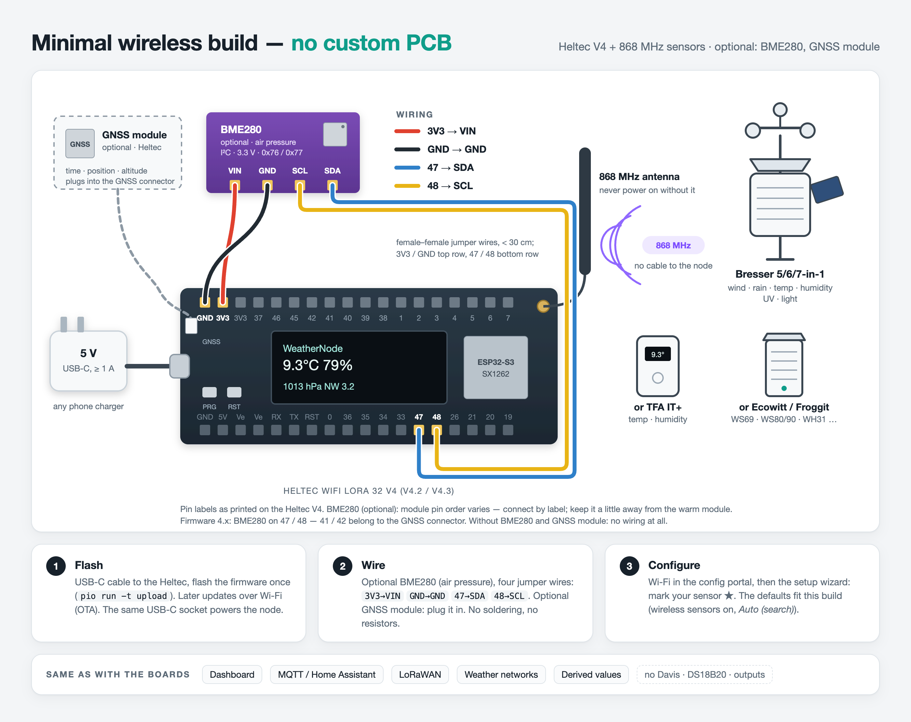
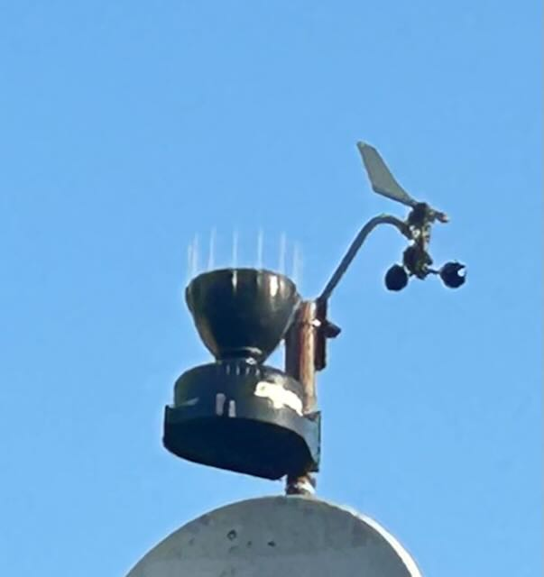

# Universal Weather Node — Wireless Sensor Receiver, Weather Station and Gateway for Bresser, Ecowitt / Froggit, TFA and Davis Sensors

**Turn a €20 ESP32 board into the hub of your weather station.** A **Heltec WiFi LoRa 32 V4** receives your wireless outdoor station **directly on 868 MHz** — no console, no vendor gateway, no Raspberry Pi, no cloud — measures with its own sensors where you add them, computes dew point, trends and rain totals, and passes everything on to **Home Assistant (MQTT)**, **InfluxDB**, **Prometheus**, **Loxone**, its own **web dashboard**, **weather networks** and, optionally, **LoRaWAN**.

<!-- help:skip -->
<p align="center">
  
</p>
<!-- /help:skip -->

## What to Buy

For a wireless station — no soldering, no custom PCB:

| Part | Notes | Approx. price |
|------|-------|---------------|
| **Heltec WiFi LoRa 32 V4** (V4.2 / V4.3, ESP32-S3R2) | The **868 MHz** version (EU). RF front end with a low-noise amplifier (helps with weak or distant sensors), 2 MB PSRAM and 16 MB flash; the firmware detects the front end and switches it itself. For wired sensors (Davis cups and vane, reed switches, DS18B20 …) use one of the custom PCBs: the [Weather Node V4 Full](docs/pcb.md#custom-pcb) (SMD, VIN 6–29 V, heater/fan, AUX, UV, VE.Direct) or the hand-solderable [Weather Node V4 Light](docs/pcb.md#weather-node-v4-light) (through-hole, USB-C power, wind/rain/BME280/1-Wire) — see [Which board?](docs/pcb.md#which-board). **Not supported:** the V4-R8 (ESP32-S3R8). **Heltec V3** (and PCB v2.0 with a V3, Rev 1.2 / 1.3): firmware **2.x** — [release 2.0.0](https://github.com/franzenhof/universal-weather-node/releases/tag/2.0.0), branch `2.x`. | €20–30 |
| **868 MHz antenna** | The small antenna that comes with the board is fine for sensors nearby. For more range, an external 868 MHz antenna with a u.FL/IPEX-to-SMA pigtail (the [enclosure](docs/minimal-build.md) has an SMA bulkhead). **Never power the board without an antenna.** | €0–15 |
| **USB-C power supply** 5 V, ≥ 1 A, with cable | any phone charger | €5–10 |
| **BME280 module** (I²C, 3.3 V) — *recommended* | Adds the air pressure (pressure trend, weather networks); four jumper wires, see [Minimal Wireless Build](docs/minimal-build.md). Must be a BME280, not a BMP280. Not needed if an Ecowitt WS69 pressure module or a WN32P already sends pressure. | €5–10 |
| **Enclosure** — optional | 3D-printable case with a separate ventilated BME280 chamber in [`3dprint/`](3dprint/README.md) (drawn for the V4, not printed yet — check the fit), or any small box in a dry, sheltered place | – |
| **Your wireless sensors** | 868 MHz versions of Bresser 5/6/7-in-1 and other Bresser sensors, Ecowitt / Froggit, TFA / LaCrosse IT+; Davis Vantage Pro2 / Vue EU (experimental) | – |

Complete example setups with prices — Davis wired, Ecowitt, Bresser 7-in-1: [Example Setups](docs/example-setups.md). Prices are rough guides and vary by shop. For the installation you need a computer with **Chrome or Edge** once.

## Quick Start (wireless station, about 15 minutes)

**You need:** the parts from [What to Buy](#what-to-buy) — a **Heltec WiFi LoRa 32 V4** (see [installation](docs/installation.md#installing-the-firmware-browser-no-software)) with its **868 MHz antenna**, a USB-C power supply, and a wireless outdoor station — **Bresser** 5/6/7-in-1, **Ecowitt / Froggit** (WS69, WS80, WS85, WS90, WH31, WN34, WH51, WH57, air quality, leak …) or **TFA / LaCrosse IT+**. Recommended: a **BME280** module for the air pressure (four jumper wires, see [Minimal Wireless Build](docs/minimal-build.md)).

1. **Install the firmware in the browser** — Chrome/Edge, [web.esphome.io](https://web.esphome.io), the `-factory.bin` from [`firmware/`](firmware/). Step by step: [Installing the Firmware](docs/installation.md#installing-the-firmware-browser-no-software).
2. **Connect your phone** to the Wi-Fi **`WeatherNode`** and open **http://192.168.4.1** (opens by itself on most phones).
3. **Choose your Wi-Fi** (*Configure WiFi*), save. The node restarts and joins your network.
4. **Open the IP address shown on the display** (in your own network). The **setup wizard** starts by itself and takes you through language, your wireless station (it searches by itself for Bresser, Ecowitt / Froggit and TFA — mark yours with ★, hide the neighbours'), location and altitude, units, an admin password, and optionally [MQTT for Home Assistant](docs/mqtt-home-assistant.md), [weather networks](docs/weather-networks.md) and Loxone. Every step can be skipped — see [Setup Wizard](docs/installation.md#setup-wizard).
5. **Done.** The dashboard shows live values after one measurement cycle; everything can be changed later under **Settings**.

Wired sensors (Davis, reed switches, DS18B20 …) need one of the custom PCBs — [V4 Full or V4 Light](docs/pcb.md#which-board). [LoRaWAN](docs/lorawan.md) is off by default; switch it on for sites without Wi-Fi.

## Features

- 📻 **Up to 32 wireless sensors received directly** — Bresser 5/6/7-in-1 and other Bresser sensors, Ecowitt / Froggit (Fine Offset) outdoor arrays, thermo-hygro, soil, rain, lightning, air quality (PM2.5, CO₂), leak and leaf-wetness sensors, TFA / LaCrosse IT+, and Davis Vantage Pro2 / Vue (experimental); type detected automatically. Every sensor with all its values in the dashboard, REST API and MQTT; per value you choose the source for the main readings (board or wireless, automatic fallback). *(Confirmed against real sensors, thanks to community testers: WS90, WH31 / WN30, WN34, WN38, WH40, WN20, WH51, WH52, WH55, WH57, WN35, WH45, WN32 / WN32P. A few newer arrays — WS80 / WS85 / WS68, WH65 / WS69 — are decoded from the published protocol and awaiting a live check.)*
- 🌐 **Built-in web dashboard** with live values (pushed the moment they arrive), warnings, rain totals (hour … year), wind rose, sparklines, records, sun & moon, and trend charts with a **long history** (24 h, 7 / 30 days, 1 year, period compare, CSV export; saved on the node every 30 min) — works without internet, installable as a phone app; plus a REST API and Server-Sent Events ([Web Interface](docs/web-dashboard.md), [API](docs/api.md))
- 🏠 **MQTT + Home Assistant** auto-discovery (TLS-capable) — every value, derived value and warning as an entity, plus one HA device per ★ wireless sensor (value groups announced once delivered); **Loxone** via UDP push or HTTP
- 📊 **Prometheus and InfluxDB:** a scrape endpoint `GET /metrics` and an InfluxDB v1 / v2 / VictoriaMetrics push (with a queue for outages) — no MQTT detour ([API](docs/api.md#endpoints), [Configuration](docs/settings.md#settings-reference))
- ☁️ **Direct uploads to weather networks** — AWEKAS, Weather Underground, Weathercloud, Wetternetzwerk.pro, Windy, openSenseMap, Met Office WOW, CWOP — plus your own HTTP uploads with placeholders
- 🔔 **Alarms and push notifications** — rules such as gust, frost, leak, lightning or "sensor silent" to ntfy, Pushover, Telegram, MQTT or a webhook
- 🧭 **Your sensors, your way:** mark yours ★ (**logical sensors** with a custom ID and name that survive a battery change, with a *replaces?* offer), minimum signal per sensor against a neighbour's twin, a reception check per sensor, **custom series** (up to 32, with mean / min / max / sum) for charts, uploads and alarms, optional **network sensors** (MQTT / REST) — [Wireless Sensors](docs/wireless-sensors.md), [Network Sensors](docs/network-sensors.md)
- 📡 **Virtual sensors — the node transmits, too:** its own values as Ecowitt / Fine Offset or LaCrosse / TFA IT+ sensors (WH31, WH40, WN32P, WH65, TX29 / TX35; up to 8, also in Davis mode), e.g. a wired Davis shown as a WH65 at your Ecowitt gateway ([Virtual Sensors](docs/virtual-sensors.md))
- 📶 **Own Wi-Fi access point** for places without Wi-Fi (model airfield): phones join with a QR code from the display, see the dashboard and set the node's clock ([At the Airfield](docs/airfield.md))
- 🔐 **Optional HTTPS** with your own or a self-generated certificate, login brake against password guessing, reset in two steps (*Reset settings* / *Erase everything*) ([Configuration](docs/settings.md#https))
- 🕒 **Time without internet:** the clock follows the best source — NTP, a DCF77 radio-clock sensor, a phone with the dashboard open, LoRaWAN network time, optionally a GNSS module ([Time sources](docs/lorawan.md#time-sources-and-network-time-devicetimereq))
- 🩺 **Diagnostics:** crash report with core dump download, restart history, task watchdogs, radio trace ([Configuration](docs/settings.md#web-settings-page), [Troubleshooting](docs/troubleshooting.md))
- 🖥️ **Display:** live values per received packet, status LED per packet, screensaver with small animations ([Display](docs/settings.md#display))
- 🧮 **Computed on the node:** dew point, feels-like, cloud base, VPD, 3-h pressure tendency with a weather trend, temperature trend, rain last hour / 24 h / today / yesterday / week / month / year, sunshine duration, frost / fog / sultry warnings, WMO wind (3-s gusts, 10-min values)
- 🧩 **Everything runs on the ESP32** — no PC, Raspberry Pi, script or cloud service; sensors are read directly, Wi-Fi is output (network sensors are an explicit opt-in)
- 🔧 **Set up from your phone** — browser installation, config portal, setup wizard, web settings, firmware updates over Wi-Fi; a built-in **radio trace** (diagnostic file) helps us add new sensors; install the dashboard as an **app on the phone's home screen** (offline over HTTPS)
- 📡 **Optional:** LoRaWAN (ChirpStack / TTN) for sites without Wi-Fi, and a custom PCB for Davis and other wired sensors, heater/fan outputs, UV, Victron VE.Direct

<!-- help:skip -->
<p>
  
  
  
  
</p>
<!-- /help:skip -->

| Board | Firmware |
|-------|----------|
| **Heltec WiFi LoRa 32 V4** (V4.2 / V4.3, ESP32-S3**R2**) — **recommended** | **4.x**, all functions (one USB installation with the `-factory.bin`) |
| **Heltec WiFi LoRa 32 V3** — *legacy* | **3.x** (branch `3.x`, continuation of 2.x): bug fixes only, no new functions |
| Heltec V4 with ESP32-S3**R8** | not supported |

> **Buy a V4.** Everything new — the PSRAM features, the own access point, virtual sensors, HTTPS, the long history, InfluxDB / Prometheus — runs on the **V4 only**. The V3 is legacy: it keeps working with firmware 3.x, which gets bug fixes but no new functions.

**New in 4.0.0** (Heltec V4 only; details in the [Changelog](CHANGELOG.md), coming from 2.x: [migration](docs/installation.md#coming-from-2x-or-3x)):
- Runs on Arduino-ESP32 3.3 / ESP-IDF 5 with a new web server (several browser tabs at once, one login) and a 16 MB layout with two 6 MB application slots and its own partition for the chart history, saved every 30 minutes. Tested on a Heltec V4.3.
- Uses the V4's 2 MB PSRAM: device log 64 KB, radio trace 256 KB, up to 32 custom series.
- Prometheus endpoint `GET /metrics` (checked against the exposition format; not yet run against a real Prometheus server) and an InfluxDB / VictoriaMetrics push (tested against VictoriaMetrics, not yet against InfluxDB itself; off by default).
- Long history on the node (hourly values 35 days, daily values 2 years) with zoom, pan and period compare in the dashboard; live push to the dashboard; sparklines, CSV export, a page per wireless sensor.
- ★ sensors as logical sensors (custom ID, name, battery-change re-bind), network sensors (MQTT / REST), up to 32 custom series, reception check, 8 virtual sensors (also IT+ TX29 / TX35, also in Davis mode).
- Own Wi-Fi access point (model airfield), phone time and time sources, optional HTTPS (own or generated certificate), login brake, reset in two steps, crash report with core dump.
- Live values on the display per received packet (not yet checked on the OLED), status LED for received packets, LDS01 distance sensor, the radio trace keeps 64-byte unknown frames, V4 Light board detection (the V4 Full / V4 Light boards themselves are not built yet).

**Current release:** [4.0.0](firmware/universal-weather-node-4.0.0.bin) ([factory image](firmware/universal-weather-node-4.0.0-factory.bin) for the first installation) for the **Heltec V4** — see the [Changelog](CHANGELOG.md#400). For the Heltec V3 (legacy): [3.0.0](https://github.com/franzenhof/universal-weather-node/tree/3.x) on the **`3.x`** branch. Branches: **`main`** = 4.x (Heltec V4 only — what this README describes), **`3.x`** = the legacy line for the V3 (bug fixes only), **`2.x`** = ended with 2.0.5, **`1.x`** = the old 1.x line (archive).

## Documentation

| I want to … | Read |
|-------------|------|
| install the firmware, open the config portal, update over Wi-Fi | [Installation and First Setup](docs/installation.md) |
| receive my Bresser / Ecowitt / Froggit / TFA / Davis sensors, record a radio trace | [Wireless Sensors](docs/wireless-sensors.md) |
| compare example setups (Davis wired, Ecowitt, Bresser 7-in-1) with prices and send intervals | [Example Setups](docs/example-setups.md) |
| build a station without the custom PCB | [Minimal Wireless Build](docs/minimal-build.md) |
| see the dashboard, status page or REST API | [Web Interface](docs/web-dashboard.md) |
| show the dashboard on phones where there is no Wi-Fi (model airfield) | [At the Airfield: the Node's Own Wi-Fi](docs/airfield.md) |
| build my own display / app | [HTTP API for Your Own Display](docs/api.md) — contract, examples, mock server |
| connect Home Assistant (MQTT) | [MQTT and Home Assistant](docs/mqtt-home-assistant.md) |
| upload to AWEKAS, Weather Underground, Windy, CWOP … or any HTTP service | [Weather Networks](docs/weather-networks.md) |
| get a push message (ntfy, Pushover, Telegram), MQTT or webhook alarm | [Alarms and Notifications](docs/alarms.md) |
| show the node's own values (wired Davis, BME280 …) as an Ecowitt sensor at a gateway or console | [Virtual Sensors](docs/virtual-sensors.md) |
| take the values of another station or a home-automation sensor over MQTT / REST as a sensor | [Network Sensors](docs/network-sensors.md) |
| feed a Loxone Miniserver | [Loxone](docs/loxone.md) |
| use LoRaWAN (ChirpStack / TTN), payload formats, low-power mode | [LoRaWAN](docs/lorawan.md) |
| wire Davis and other sensors with the PCB, order the PCB | [Custom PCB and Wired Sensors](docs/pcb.md) |
| understand measurement, derived values and units | [Measurement, Derived Values and Units](docs/values.md) |
| look up all settings and parameter IDs | [Configuration](docs/settings.md) |
| fix a problem | [Troubleshooting](docs/troubleshooting.md) |
| build from source and run the tests | [Developer Notes](docs/development.md) |
| see what changed between versions | [Changelog](CHANGELOG.md) |

---

## How It Fits Together

The node reads every sensor **directly** — 868 MHz radio decoded by its own LoRa chip, or wired inputs, I²C / 1-Wire on the PCB — processes the values itself and **sends** them out. Over Wi-Fi it fetches nothing by default; values from another station or a home-automation system (MQTT / REST) enter only as an explicit, labelled [network sensor](docs/network-sensors.md) you switch on yourself.

```
 Bresser / Ecowitt / TFA / Davis ~ 868 MHz ~┐               ┌─► Wi-Fi ──► Web dashboard / REST API / phone app in your LAN
   (up to 32 wireless sensors)              │               ├─► Wi-Fi ──► MQTT broker ──► Home Assistant, ...
 BME280 (I²C, recommended) ─────────────────┤               ├─► Wi-Fi ──► AWEKAS, Weather Underground, Windy, WOW, CWOP, ...
 PCB only:                                  ├──► Weather ───┼─► Wi-Fi ──► Alarms: ntfy, Pushover, Telegram, MQTT, webhook
   Davis / generic wind + rain ─────────────┤     Node      ├─► Wi-Fi ──► Loxone (UDP / HTTP), your own HTTP uploads
   DS18B20, UV, AUX, Victron ───────────────┘  (Heltec V4)  ├─► OLED display on the board
                                                            └─► LoRaWAN (optional) ──► ChirpStack / TTN ──► Grafana, ...
```

The node runs continuously (no deep sleep). It samples the sensors every few seconds and combines the samples into one measurement per **cycle** (default 30 s); each output — LoRaWAN, MQTT, weather networks, Loxone — sends on its own interval. Alarm rules are checked every 30 s and send their message as soon as a rule fires; MQTT can publish faster than the cycle (down to seconds).

## The Project in Pictures

<!-- help:skip -->
<p align="center">
  
</p>

<table>
  <tr>
    <td align="center" width="25%">
      
      <br><strong>3D-printed case (Rev 1.2)</strong>
    </td>
    <td align="center" width="25%">
      
      <br><strong>Davis rain &amp; wind sensor</strong>
    </td>
    <td align="center" width="50%">
      
      <br><strong>Built-in web dashboard</strong>
    </td>
  </tr>
  <tr>
    <td align="center">
      
      <br><strong>Enclosure for the minimal build</strong>
    </td>
    <td align="center">
      
      <br><strong>Dashboard on the phone (installable as an app)</strong>
    </td>
    <td align="center">
      
      <br><strong>Grafana: wind data via LoRaWAN</strong>
    </td>
  </tr>
</table>
<!-- /help:skip -->

*(Pictures are only shown on the project page, not in the device's built-in help.)*

---

## License

This project is fully open source and dual-licensed:

* **Software / firmware:** [MIT License](LICENSE-SOFTWARE) — use, modify and distribute freely.
* **Hardware (schematics, PCB, 3D files):** [CERN-OHL-P v2](LICENSE-HARDWARE) (permissive) — manufacture, modify and distribute freely.

*Developed with 🚜 and 💻 by Gerhard Massenbichler at Franzenhof.*
