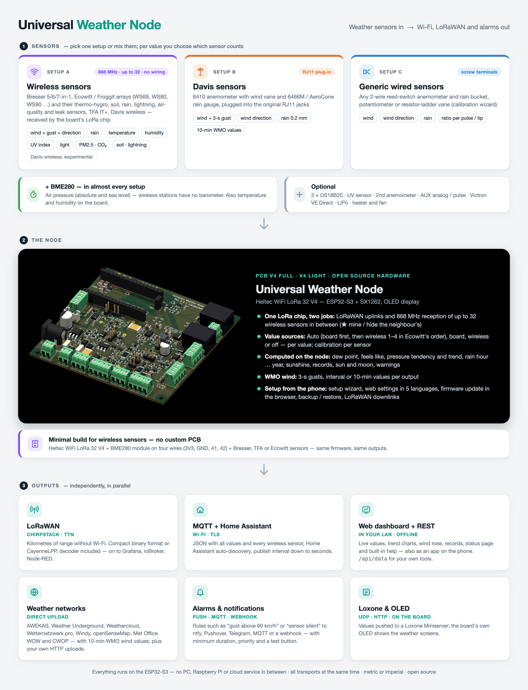
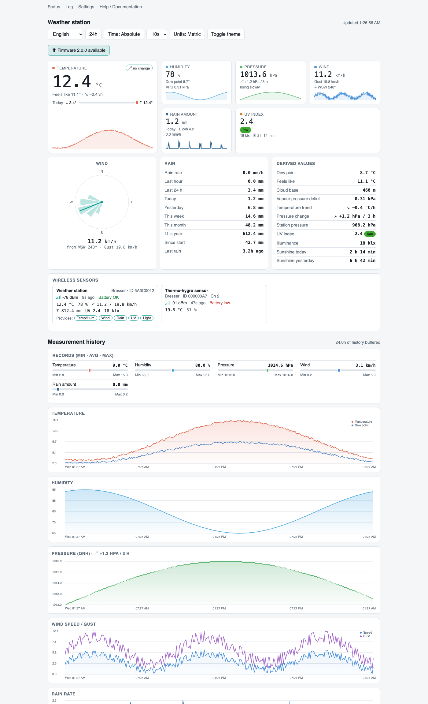
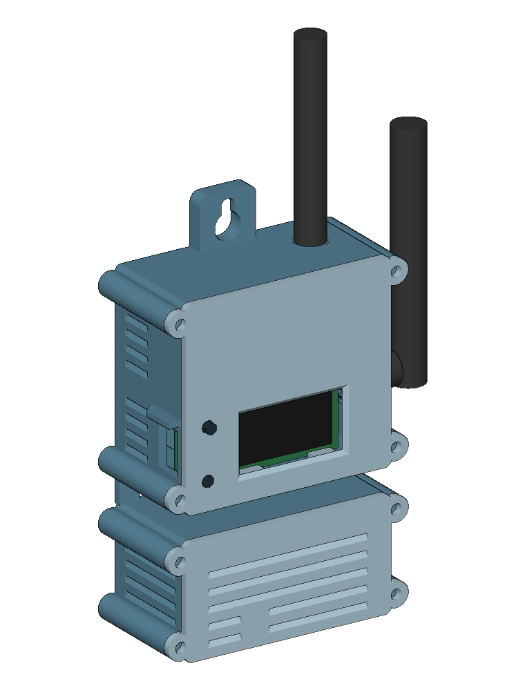
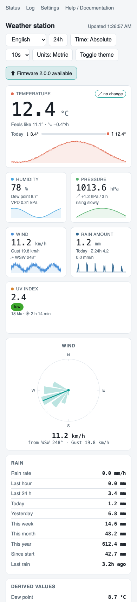

# Universal Weather Node — Wi-Fi Weather Station for Bresser, Ecowitt / Froggit and TFA Sensors

**Turn a €20 ESP32 board into the hub of your weather station.** A **Heltec WiFi LoRa 32 V4** (or V3) receives your wireless outdoor station **directly on 868 MHz** — no console, no gateway, no Raspberry Pi, no cloud — computes dew point, trends and rain totals, and sends everything to **Home Assistant (MQTT)**, its own **web dashboard**, **weather networks** and, optionally, **LoRaWAN**.

<!-- help:skip -->
<p align="center">
  
</p>
<!-- /help:skip -->

## What to Buy

For a wireless station — no soldering, no custom PCB:

| Part | Notes | Approx. price |
|------|-------|---------------|
| **Heltec WiFi LoRa 32 V4** *(recommended)* or **V3 / V3.1 / V3.2** | The **868 MHz** version (EU). The **V4** has an RF front end with a low-noise amplifier (helps with weak or distant sensors) and 2 MB PSRAM (ESP32-S3R2; used for the history, large buffers and HTTPS since 2.0.0-rc.9) plus 16 MB flash; the firmware detects it and switches the front end itself. The V3 works just as well today. For wired sensors (Davis cups and vane, reed switches, DS18B20 …) use the [custom PCB v2.0](docs/pcb.md#custom-pcb): it takes a **V3 or a V4** (one socket set each, see [Heltec V3 or V4 on the PCB](docs/pcb.md#heltec-v3-or-v4-on-the-pcb)); the older Rev 1.2 / 1.3 boards take the V3 only. Not supported: **V4-R8** (ESP32-S3R8): its 8 MB octal PSRAM takes GPIO33–37, which the board and the PCB need — buy the standard V4 with the **ESP32-S3R2**. | €20–30 |
| **868 MHz antenna** | The small antenna that comes with the board is fine for sensors nearby. For more range, an external 868 MHz antenna with a u.FL/IPEX-to-SMA pigtail (the [enclosure](docs/minimal-build.md) has an SMA bulkhead). **Never power the board without an antenna.** | €0–15 |
| **USB-C power supply** 5 V, ≥ 1 A, with cable | any phone charger | €5–10 |
| **BME280 module** (I²C, 3.3 V) — *recommended* | Adds the air pressure (pressure trend, weather networks); four jumper wires, see [Minimal Wireless Build](docs/minimal-build.md). Must be a BME280, not a BMP280. Not needed if an Ecowitt WS69 pressure module or a WN32P already sends pressure. | €5–10 |
| **Enclosure** — optional | 3D-printable case with a separate ventilated BME280 chamber in [`3dprint/`](3dprint/README.md) (designed for the V3 — check the fit for a V4), or any small box in a dry, sheltered place | – |
| **Your wireless sensors** | 868 MHz versions of Bresser 5/6/7-in-1 and other Bresser sensors, Ecowitt / Froggit, TFA / LaCrosse IT+; Davis Vantage Pro2 / Vue EU (experimental) | – |

Prices are rough guides and vary by shop. For the installation you need a computer with **Chrome or Edge** once.

## Quick Start (wireless station, about 15 minutes)

**You need:** the parts from [What to Buy](#what-to-buy) — a **Heltec WiFi LoRa 32 V4 or V3** (see [installation](docs/installation.md#installing-the-firmware-browser-no-software)) with its **868 MHz antenna**, a USB-C power supply, and a wireless outdoor station — **Bresser** 5/6/7-in-1, **Ecowitt / Froggit** (WS69, WS80, WS85, WS90, WH31, WN34, WH51, WH57, air quality, leak …) or **TFA / LaCrosse IT+**. Recommended: a **BME280** module for the air pressure (four jumper wires, see [Minimal Wireless Build](docs/minimal-build.md)).

1. **Install the firmware in the browser** — Chrome/Edge, [web.esphome.io](https://web.esphome.io), the `-factory.bin` from [`firmware/`](firmware/). Step by step: [Installing the Firmware](docs/installation.md#installing-the-firmware-browser-no-software).
2. **Connect your phone** to the Wi-Fi **`WeatherNode`** and open **http://192.168.4.1** (opens by itself on most phones).
3. **Choose your Wi-Fi** (*Configure WiFi*), save. The node restarts and joins your network.
4. **Open the IP address shown on the display** (in your own network). The **setup wizard** starts by itself and takes you through language, your wireless station (it searches by itself for Bresser, Ecowitt / Froggit and TFA — mark yours with ★, hide the neighbours'), location and altitude, units, an admin password, and optionally [MQTT for Home Assistant](docs/mqtt-home-assistant.md), [weather networks](docs/weather-networks.md) and Loxone. Every step can be skipped — see [Setup Wizard](docs/installation.md#setup-wizard).
5. **Done.** The dashboard shows live values after one measurement cycle; everything can be changed later under **Settings**.

Wired sensors (Davis, reed switches, DS18B20 …) need one of the [custom PCBs](docs/pcb.md#custom-pcb) — see [Hardware](docs/pcb.md#hardware). [LoRaWAN](docs/lorawan.md) is off by default; switch it on for sites without Wi-Fi.

## Features

- 📻 **Up to 32 wireless sensors received directly** — Bresser 5/6/7-in-1 and other Bresser sensors, Ecowitt / Froggit (Fine Offset) outdoor arrays, thermo-hygro, soil, rain, lightning, air quality (PM2.5, CO₂), leak and leaf-wetness sensors, TFA / LaCrosse IT+, and Davis Vantage Pro2 / Vue (experimental); type detected automatically. Every sensor with all its values in the dashboard, REST API and MQTT; per value you choose the source for the main readings (board or wireless, automatic fallback). *(First Ecowitt sensors confirmed by a tester; most of the newer types and IT+ not yet tested with real sensors.)*
- 🌐 **Built-in web dashboard** with live values, warnings, rain totals (hour … year), wind rose and trend charts — works without internet; plus a REST API
- 🏠 **MQTT + Home Assistant** auto-discovery (TLS-capable) — every value, derived value and warning as an entity, plus one HA device per listed wireless sensor; **Loxone** via UDP push or HTTP
- ☁️ **Direct uploads to weather networks** — AWEKAS, Weather Underground, Weathercloud, Wetternetzwerk.pro, Windy, openSenseMap, Met Office WOW, CWOP — plus your own HTTP uploads with placeholders
- 🔔 **Alarms and push notifications** — rules such as gust, frost, leak, lightning or "sensor silent" to ntfy, Pushover, Telegram, MQTT or a webhook
- 🧮 **Computed on the node:** dew point, feels-like, cloud base, VPD, 3-h pressure tendency with a weather trend, temperature trend, rain last hour / 24 h / today / yesterday / week / month / year, sunshine duration, frost / fog / sultry warnings, WMO wind (3-s gusts, 10-min values)
- 🧩 **Everything runs on the ESP32** — no PC, Raspberry Pi, script or cloud service; sensors are read directly, Wi-Fi is output only
- 🔧 **Set up from your phone** — browser installation, config portal, web settings, firmware updates over Wi-Fi; a built-in **radio trace** (diagnostic file) helps us add new sensors; install the dashboard as an **app on the phone's home screen** (offline over HTTPS)
- 📡 **Optional:** LoRaWAN (ChirpStack / TTN) for sites without Wi-Fi, and a custom PCB for Davis and other wired sensors, heater/fan outputs, UV, Victron VE.Direct

<!-- help:skip -->
<p>
  
  
  
  
</p>
<!-- /help:skip -->

**Current release:** [2.0.3](firmware/universal-weather-node-2.0.3.bin) ([factory image](firmware/universal-weather-node-2.0.3-factory.bin) for the first installation) — see the [Changelog](CHANGELOG.md#203). Branches: **`2.x`** = the 2.0.x line (fixes for Heltec V3 and V4), **`main`** = the next major version (in development, Heltec V4 only), **`1.x`** = the old 1.x line (archive).

## Documentation

| I want to … | Read |
|-------------|------|
| install the firmware, open the config portal, update over Wi-Fi | [Installation and First Setup](docs/installation.md) |
| receive my Bresser / Ecowitt / Froggit / TFA / Davis sensors, record a radio trace | [Wireless Sensors](docs/wireless-sensors.md) |
| build a station without the custom PCB | [Minimal Wireless Build](docs/minimal-build.md) |
| see the dashboard, status page or REST API | [Web Interface](docs/web-dashboard.md) |
| build my own display / app | [HTTP API for Your Own Display](docs/api.md) — contract, examples, mock server |
| connect Home Assistant (MQTT) | [MQTT and Home Assistant](docs/mqtt-home-assistant.md) |
| upload to AWEKAS, Weather Underground, Windy, CWOP … or any HTTP service | [Weather Networks](docs/weather-networks.md) |
| get a push message (ntfy, Pushover, Telegram), MQTT or webhook alarm | [Alarms and Notifications](docs/alarms.md) |
| feed a Loxone Miniserver | [Loxone](docs/loxone.md) |
| use LoRaWAN (ChirpStack / TTN), payload formats, low-power mode | [LoRaWAN](docs/lorawan.md) |
| wire Davis and other sensors with the PCB, order the PCB | [Custom PCB and Wired Sensors](docs/pcb.md) |
| understand measurement, derived values and units | [Measurement, Derived Values and Units](docs/values.md) |
| look up all settings and parameter IDs | [Configuration](docs/settings.md) |
| fix a problem | [Troubleshooting](docs/troubleshooting.md) |
| build from source and run the tests | [Developer Notes](docs/development.md) |
| see what changed between versions | [Changelog](CHANGELOG.md) |

---

## How It Fits Together

The node reads every sensor **directly** — 868 MHz radio decoded by its own LoRa chip, or wired inputs, I²C / 1-Wire on the PCB — processes the values itself and only **sends** them out. It never fetches or receives sensor data over Wi-Fi.

```
 Bresser / Ecowitt / TFA / Davis ~ 868 MHz ~┐               ┌─► Wi-Fi ──► Web dashboard / REST API / phone app in your LAN
   (up to 32 wireless sensors)              │               ├─► Wi-Fi ──► MQTT broker ──► Home Assistant, ...
 BME280 (I²C, recommended) ─────────────────┤               ├─► Wi-Fi ──► AWEKAS, Weather Underground, Windy, WOW, CWOP, ...
 PCB only:                                  ├──► Weather ───┼─► Wi-Fi ──► Alarms: ntfy, Pushover, Telegram, MQTT, webhook
   Davis / generic wind + rain ─────────────┤     Node      ├─► Wi-Fi ──► Loxone (UDP / HTTP), your own HTTP uploads
   DS18B20, UV, AUX, Victron ───────────────┘  (Heltec V4   ├─► OLED display on the board
                                                  or V3)    └─► LoRaWAN (optional) ──► ChirpStack / TTN ──► Grafana, ...
```

The node runs continuously (no deep sleep). It samples the sensors every few seconds and combines the samples into one measurement per **cycle** (default 300 s), which it then sends out. Alarm rules are checked every 30 s and send their message as soon as a rule fires; MQTT can publish faster than the cycle (down to seconds).

## The Project in Pictures

<!-- help:skip -->
<p align="center">
  
</p>

<table>
  <tr>
    <td align="center" width="25%">
      
      <br><strong>3D-printed case (Rev 1.2)</strong>
    </td>
    <td align="center" width="25%">
      
      <br><strong>Davis rain &amp; wind sensor</strong>
    </td>
    <td align="center" width="50%">
      
      <br><strong>Built-in web dashboard</strong>
    </td>
  </tr>
  <tr>
    <td align="center">
      
      <br><strong>Enclosure for the minimal build</strong>
    </td>
    <td align="center">
      
      <br><strong>Dashboard on the phone (installable as an app)</strong>
    </td>
    <td align="center">
      
      <br><strong>Grafana: wind data via LoRaWAN</strong>
    </td>
  </tr>
</table>
<!-- /help:skip -->

*(Pictures are only shown on the project page, not in the device's built-in help.)*

---

## License

This project is fully open source and dual-licensed:

* **Software / firmware:** [MIT License](LICENSE-SOFTWARE) — use, modify and distribute freely.
* **Hardware (schematics, PCB, 3D files):** [CERN-OHL-P v2](LICENSE-HARDWARE) (permissive) — manufacture, modify and distribute freely.

*Developed with 🚜 and 💻 by Gerhard Massenbichler at Franzenhof.*
