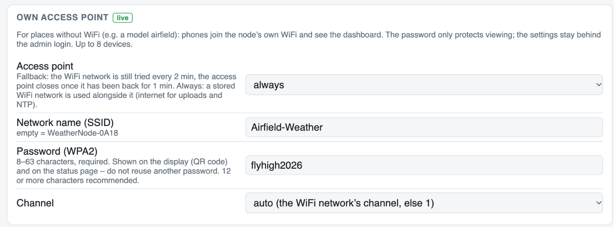

# At the Airfield: the Node's Own Wi-Fi

No Wi-Fi at the site (a model airfield, a camp, a boat)? The node can open a Wi-Fi network of its own. Pilots scan a QR code on the node's display, the phone joins, and the dashboard opens — wind, gusts and direction live, without internet and without an app.

## Set it up (at home)

Both steps need the node's web interface on your home network (admin login). The own access point is not part of the config portal.

1. *Settings → System → Own access point* ([reference](settings.md#own-access-point)):
   - **Access point:** *fallback* if the node also stands where your Wi-Fi reaches (it opens its own network only when that one has been gone for 2 min), *always* if it lives at the field.
   - **Password:** 8–63 characters, required. Everyone who is to see the dashboard gets it (the QR code contains it) — the settings stay behind the admin login.
   - **Network name:** empty gives `WeatherNode-XXXX`; a name of your own, e.g. `Airfield Weather`, is fine. Keep name + password together under about 35 characters: the QR code on the display then stays big (2 pixels per module) and easy to scan.
   
2. *Settings → Display:* keep **Screens → WiFi QR code** ticked (it is by default). Set the display to *always on* if the code should be visible without pressing a button; otherwise a short **PRG** press shows it (it comes first while the access point runs).
3. Save. With *always*, the access point opens right away; the status page shows *Access point* with the address (the QR code only for devices already on the access point — it holds the password in clear).

## At the field

- **Join:** open the phone camera on the QR code on the display (or on the status page of another phone) → *Join network*. Or pick the network by hand and type the password.
- **Dashboard:** most phones open it by themselves in a sign-in sheet. Otherwise type any address — `http://192.168.4.1/`, `weather.local` or even `example.com`: every name leads to the node. Over **http**, not https (an https address can't be redirected without a certificate warning).
- **Several pilots:** up to **8 devices** at once. Three get the live stream (values the moment they arrive), the others refresh at the dashboard's interval (default 10 s).
- **Time:** without internet the node has no NTP. The dashboard sends the phone's clock once per page load, and the node takes it (source *phone* on the status page) — so "today", the records and the history have the right day. A DCF77 radio-clock sensor (WH31 / WN31 DNT) in range, or LoRaWAN network time, works too; their order is in [LoRaWAN → Time sources](lorawan.md#time-sources-and-network-time-devicetimereq).
- **Setup wizard:** a phone on the node's access point never gets it, also not while the setup is not finished — the dashboard opens.
- **Settings** at the field: `http://192.168.4.1/api/settings` with the admin login, as at home.

## Why phones show a sign-in sheet

A phone tests every new Wi-Fi for internet (Android `connectivitycheck.gstatic.com/generate_204`, iPhone `captive.apple.com/hotspot-detect.html`, Windows `msftconnecttest.com/connecttest.txt`). The node answers these checks with a redirect to its dashboard. That has two effects, both wanted:

1. The phone treats the network as one with a sign-in page (like a hotel Wi-Fi) and **shows the dashboard by itself** in its sign-in sheet or a "Sign in to network" notification.
2. The phone knows that this Wi-Fi has **no internet**: it stays connected to it for the node's address but keeps using **mobile data** for everything else — messages, maps and ADS-B apps keep working.

The other way round — answering the checks with "internet OK" — would keep the phone on the Wi-Fi silently, but then the phone would send all its traffic into a network without internet, and other apps would stop working while connected. So the node doesn't.

What the sign-in sheet means per phone (tested 2026-11-28 with one phone: the sheet opened the dashboard, the phone stayed connected without internet, any address led to the node, the node took the phone's time; the details per platform below are the expected behaviour):

- **iPhone / iPad:** the sheet opens with the dashboard. *Done* / *Cancel*: choose **Use Without Internet** (or *Use Other Network* to leave). Later, Safari reaches the node at `http://192.168.4.1/`.
- **Android:** a notification *Sign in to network* (or the sheet opens by itself); tapping it shows the dashboard. Android may ask whether to stay connected to a network without internet — **Yes / Keep**. Chrome then reaches `http://192.168.4.1/`; with mobile data on, a name like `weather.local` may be looked up over mobile data instead — use the address.
- **Windows / macOS laptops:** the browser opens the sign-in page = the dashboard.

## Limits

- The node's own network has no internet: weather networks, MQTT and the update check send nothing, unless (*always* mode) a stored Wi-Fi network is reachable at the same time.
- Station and access point share one radio and one channel. While the node keeps trying an unreachable station network (every 2 min), devices on the access point may see a short gap.
- The display's QR code: up to about 35 characters of name + password at 2 pixels per module; longer ones still fit but at 1 pixel per module (about 6 mm on the display) — then scan from closer, or use the QR code on the status page.
- Internal memory: the access point costs the Wi-Fi driver some internal RAM (more per connected device); the log line `Access point '…' on channel … (internal RAM free … -> … bytes)` shows it on your node.
