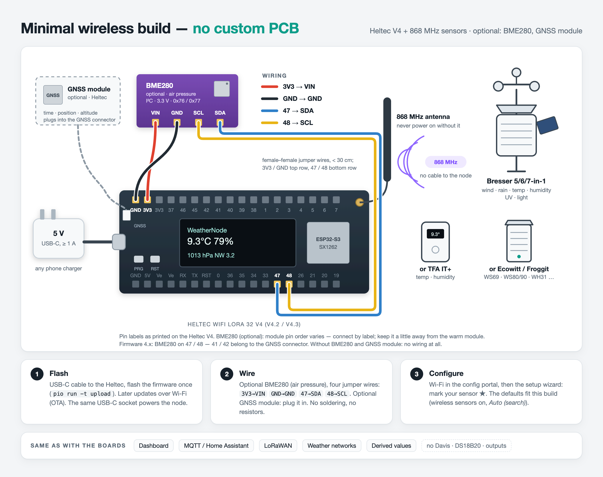
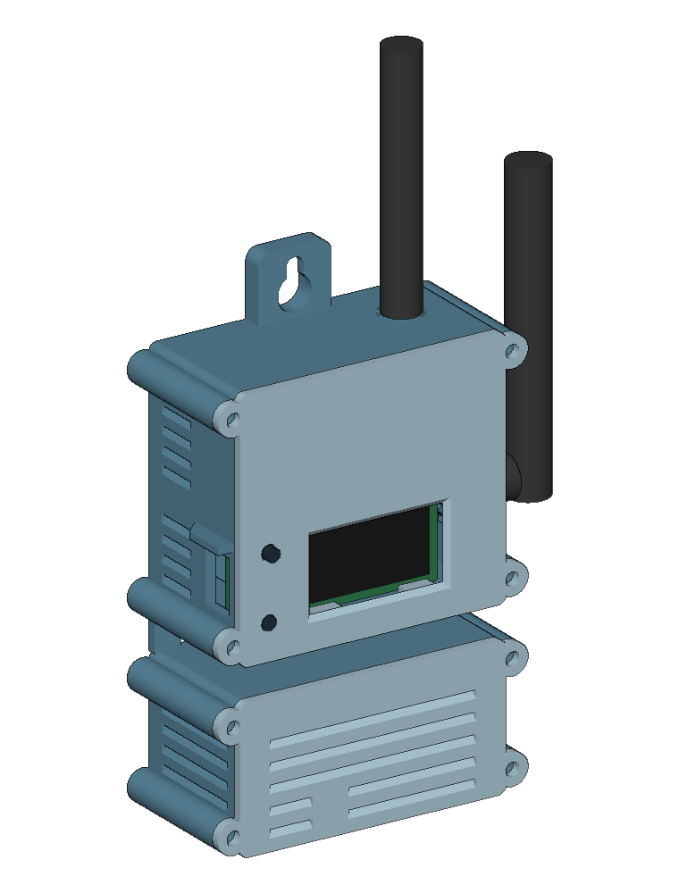

# Minimal Wireless Build (no custom PCB)

A wireless-only station without the custom PCB: a Heltec V4, an optional BME280 on four jumper wires and your Bresser, TFA IT+ or Ecowitt / Froggit sensors.

[← back to README](../README.md)

For a wireless station (Bresser 5/6/7-in-1, TFA / LaCrosse IT+ or Ecowitt / Froggit sensors) the custom PCB is optional: the Heltec module receives the sensors itself, and a **BME280** module adds the air pressure. *Not yet built and tested as described here — the firmware paths are the same as on the boards.*

| Part | Notes |
|------|-------|
| Heltec WiFi LoRa 32 **V4** (not V4-R8; a V3 needs firmware 2.x) | with an **868 MHz** antenna (EU); never power it without the antenna. The V4 works in this build without PCB or on the custom PCB V4 Full / V4 Light (not on Rev 1.2/1.3, where GPIO2/5/7 would hit the V4's RF front end). Optional: a Heltec GNSS module on the V4's GNSS connector, see [GNSS module](#gnss-module-optional) |
| BME280 module (I²C, 3.3 V) — *recommended* | air pressure (+ optionally temperature / humidity); address **0x76** or **0x77** (both are found). Must be a BME280, not a BMP280 (no humidity) |
| USB-C power supply 5 V, ≥ 1 A | the Heltec's own USB-C socket |
| Bresser station, TFA IT+ or Ecowitt / Froggit sensor | see [Wireless Sensors](wireless-sensors.md) |

<!-- help:skip -->

  

<!-- /help:skip -->

**Wiring** (four wires, Heltec pin labels; keep them short, < 30 cm — there is no protection circuitry without the PCB). The BME280 has its own I²C bus; the pins depend on the firmware line:

| BME280 | Heltec V4, firmware **4.x** | Heltec V3, firmware 3.x |
|--------|-----------------------------|-------------------------|
| VIN / VCC | **3V3** (3V3 header) | **3V3** |
| GND | **GND** | **GND** |
| SDA | **47** (5V header, pin 13) | **41** |
| SCL | **48** (5V header, pin 14) | **42** |

On the V4, 3V3 / GND sit on the 3V3 header and 47 / 48 on the opposite (5V) header, so the four wires come from both rows. 41 / 42 belong to the V4's GNSS connector (PPS and the module's reset).

**Old wiring still works:** a V4 with the BME280 on 41/42 (as documented for 2.x) is found when nothing answers on 47/48 and the GNSS module is off; the status page and the log then say *"BME280 on the old pins 41/42 — works; move it to 47/48 for a GNSS module"*. With the GNSS module switched on, 41/42 are never used for I²C.

**Settings:** nothing to change for this build — the defaults are made for it: board wind and rain sensors **off**, *Wireless sensors* **on** with *Wireless sensor type* **Auto (search)**, LoRaWAN **off**, Wi-Fi and the web dashboard **on**. Enter your Wi-Fi in the portal and the node finds the station by itself. Optional, in the web settings:

1. Mark your station ★ *Mine* (status page button or *Settings → Sensors*), and hide (✕) neighbours' stations in range — see [Mine, Received, Hidden](wireless-sensors.md#mine-received-hidden).
2. *Source: temperature / humidity* = **Wireless 1** if the BME280 sits close to the warm module (not needed with the [enclosure](#minimal-wireless-build-no-custom-pcb) below, whose BME280 chamber is thermally separated). The BME280 provides the air pressure (QNH) by default (*Source: pressure* = Auto), which is not affected by its location; without a BME280 an Ecowitt WS69 pressure module or WN32P can provide it.
3. MQTT / weather networks / LoRaWAN as needed.

Everything else — dashboard, Home Assistant, LoRaWAN, weather networks, derived values — works as on the boards. Not available without the PCB: Davis / wired sensors, DS18B20, UV, AUX, heater/fan, Victron, the wide-range and protected power input.

## GNSS module (optional)

Heltec sells a GNSS module for the V4's GNSS connector (UC6580 dual-band; some bundles an L76K). On this build (V4 **without** PCB) it gives the exact time without internet — the best time source, e.g. at the airfield ([airfield.md](airfield.md)) — plus position and altitude. Plug it into the GNSS connector, move the BME280 to **47/48** (above), then switch it on under *Settings → Sensors → GNSS module* (restart). The status page shows fix, satellites, HDOP, position, altitude and when the clock last took the GNSS time; see [Settings → GNSS module](settings.md#gnss-module).

Pins the firmware uses (the V4's GNSS connector, checked on a V4.3 with the Heltec GNSS module): GPIO34 module supply (LOW = on), GPIO39 module TX → ESP RX, GPIO38 ESP TX → module RX, GPIO40 wake (held HIGH), GPIO41 PPS, GPIO42 reset (held HIGH). UART at 9600 / 115200 / 38400 baud, found automatically.

**Never on the V4 Full / V4 Light PCBs:** they use GPIO34 and 38–42 themselves ([pcb.md](pcb.md)); the settings do not offer GNSS there.

**Display:** the Heltec's built-in OLED shows the status screen for 20 s after a press of the PRG button; *Settings → Display* can keep it on (with night-off hours) and rotate through big weather screens — temperature, wind, rain, pressure, status ([Display](settings.md#display)).

**Enclosure:** a 3D-printable wall-mount case for this build is in [`3dprint/`](../3dprint/README.md#minimal-wireless-build-enclosure-bare-heltec-v4--bme280-optional-gnss-no-pcb) (`case_minimal.py`, STL/STEP in `3dprint/minimal/`). The Heltec sits in the upper chamber — no screws through the board, display window, PRG/RST pushers, USB-C opening, an SMA bulkhead for an external 868 MHz antenna, a bay for the optional GNSS module (patch antenna up, only the lid above) and a knock-out in the top wall for an optional R-SMA bulkhead (WiFi antenna). The BME280 has its own louvred chamber below, separated by a double wall with a ventilated air gap so the ESP32's heat does not reach it; the only link is a 12.5 × 4.5 mm cable slot (wide enough for the Dupont plugs), sealed with hot glue after wiring. *Drawn for the V4 and the 4.x wiring (3V3 / GND on one header, 47 / 48 on the other); the GNSS module size, the RST button and the u.FL positions are placeholders.* Print in PETG/ASA without supports; for a sheltered place (under a roof or eave), not waterproof. *Not yet printed — measure your BME280 module and check the fit first.*

<!-- help:skip -->

<!-- /help:skip -->
