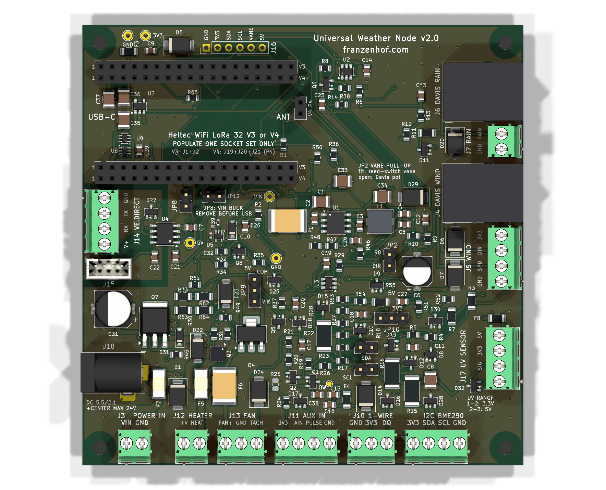
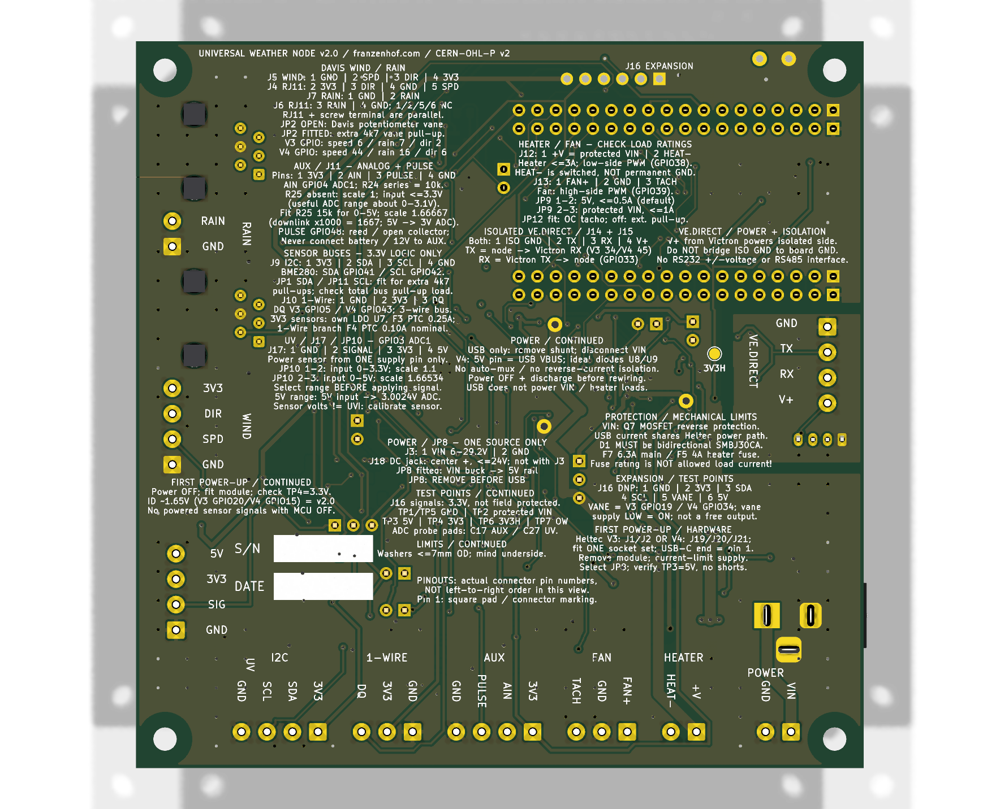
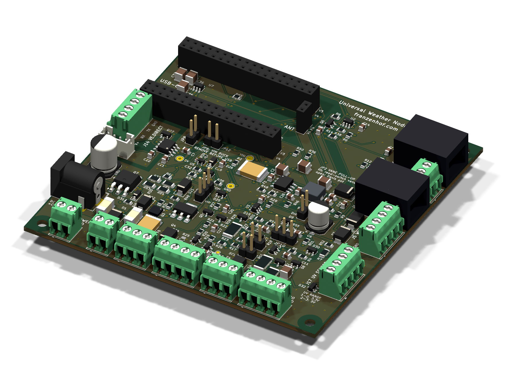

# Custom PCB and Wired Sensors

The optional custom PCB for Davis and other wired sensors: hardware, power, connectors, ordering, the v2.0 inputs and outputs, and sensors from other makers. A wireless-only station does not need it — see [Minimal Wireless Build](minimal-build.md).

[← back to README](../README.md)

## Hardware

| Component | Function |
|-----------|----------|
| Heltec WiFi LoRa 32 V3 or V4 | Microcontroller (ESP32-S3), LoRa SX1262, OLED display 128×64; on the custom PCB v2.0 either module fits (one socket set each, see [Heltec V3 or V4](#heltec-v3-or-v4-on-the-pcb)) |
| Davis 6410 Anemometer (default) | Wind speed (reed switch) + wind direction (potentiometer 20 kΩ) |
| Davis AeroCone / Standard, typically 6466M (default) | Rainfall (reed switch, 0.2 mm/pulse) |
| BME280 | Temperature / humidity / air pressure (I²C 0x76; Cat5 recommended for longer cables, see [Connectors](#connectors)) |
| DS18B20 | Up to 3 temperature probes (1-Wire, external) |
| Bresser 5/6/7-in-1 station, TFA Dostmann / LaCrosse IT+ or Ecowitt / Froggit sensors (optional) | Wireless 868 MHz sensors, received by the Heltec's LoRa chip — no extra hardware; see [Wireless Sensors](wireless-sensors.md) |
| LiPo battery | Optional; voltage measured via voltage divider + ADC |
| Custom PCB **v2.0** or Rev 1.2 / 1.3 — *optional, only for wired sensors* | Connectors plus ESD protection, pull-ups, RC filters, polyfuses; v2.0 also power supply 6–29.2 V / 5 V and a UV input |

> **Other sensors work too.** Rain gauges and anemometers are just reed-switch pulse counters — any similar sensor works after setting its ratio. See [Using Other Sensors](#using-other-sensors). **Without any wiring**, a Bresser 5-in-1 / 6-in-1 / 7-in-1 outdoor station delivers wind, rain, temperature, humidity (and UV / light) over 868 MHz, TFA Dostmann / LaCrosse IT+ sensors temperature and humidity, Ecowitt / Froggit stations (WS69, WS80, WS90 …) all outdoor values — see [Wireless Sensors](wireless-sensors.md); keep the BME280 for the air pressure. A wireless-only station even works **without the custom PCB** — see [Minimal Wireless Build](minimal-build.md).

## Custom PCB

> **PCB v2.0 power safety:** use **one power source at a time**. JP8 is a two-pin manual buck disconnect, not a power mux. Before connecting USB-C, disconnect VIN and remove the JP8 shunt. J3 has VIN and GND only; there is no external 5 V input. Never select PCB revision `20` on a Rev 1.2/1.3 board.

**First setup with a PCB:**

1. Assemble the board (v2.0: follow the [assembly and first-power checklist](../pcb/v2.0/CHECKLIST.md)); connect sensor cables with power off.
2. Install the firmware over USB ([in the browser](installation.md#installing-the-firmware-browser-no-software) or `pio run -t upload`). On v2.0, disconnect external power and remove JP8 first.
3. In the portal (Wi-Fi `WeatherNode`, http://192.168.4.1) select the PCB revision — `12` for Rev 1.2, `13` for Rev 1.3; v2.0 is detected automatically — **switch on the wind and rain sensors you connected** (they are off by default for wireless stations), enter the altitude, and choose the outputs:

| Setup | Enable | Also required |
|-------|--------|---------------|
| Wi-Fi dashboard | Wi-Fi + web API (default) | Your Wi-Fi credentials |
| Wi-Fi + Home Assistant | Wi-Fi + MQTT | MQTT broker and Home Assistant MQTT integration |
| LoRaWAN | LoRaWAN (off by default) | Gateway/network account, matching region, OTAA keys and backend decoder |
| Both transports | LoRaWAN + the desired Wi-Fi services | Both sets of settings above |

For permanent VIN power on v2.0, disconnect USB first, then fit JP8 as described below.

**Hardware v2.0** is the current design — **works with the Heltec WiFi LoRa 32 V3 and V4 (populate one socket set)**: a KiCad/SMD redesign in [`pcb/v2.0/`](../pcb/v2.0/), prepared for JLCPCB SMD assembly. Through-hole connectors/headers, the Heltec module and jumper shunts need separate assembly arrangements. It retains Rev 1.3's main sensor GPIOs and adds its own power supply, screw terminals and AUX/UV inputs. Rev 1.2/1.3's Fritzing design is kept in [`pcb/v1.3/`](../pcb/v1.3/).

<!-- help:skip -->
<table>
  <tr>
    <td width="50%"></td>
    <td width="50%"></td>
  </tr>
  <tr>
    <td colspan="2" align="center"></td>
  </tr>
</table>
<!-- /help:skip -->

**Board:** 100 × 100 mm, 2 layers, four M3 mounting holes on a **92 × 92 mm** pattern (centres 4 mm from adjacent edges). With the component side facing you:

- **Top-left:** Heltec WiFi LoRa 32 **V3** (V3/V3.1/V3.2, sockets J1/J2) **or V4** (V4.2/V4.3, sockets J19/J20 plus the 1×2 socket J21 for its extra pins) — two socket sets, 2.54 mm apart; fit **one** set only. The V3's USB-C connector sits 1.5 mm inside the board edge, the longer V4's reaches the edge.
- **Right:** original Davis RJ11 plugs, each with a parallel 3.5 mm screw terminal below it (J7 rain, J5 wind). J17 UV sits further down this edge, with its wire opening facing right.
- **Bottom:** power, heater, fan, AUX, 1-Wire and I²C terminals.
- **Left:** isolated Victron VE.Direct screw terminal and JST-PH connector; below them, at the lower left corner, the optional **J18 DC jack** (5.5 × 2.1 mm) with its opening at the left edge.

Rev 1.2/1.3's BME280 RJ45 jack is replaced by J9 on v2.0; an existing cable can be wired to J9 or an enclosure-mounted RJ45 keystone. Both sides label connector pins. The back additionally carries a standalone operating reference; see [Connectors](#connectors) for numbered pinouts.

**Power** (manual buck disconnect with JP8):

| Input | Range | Protection | Selection |
|-------|-------|------------|-----------|
| **VIN** (J3, or DC jack J18) | 6–29.2 V, including an 8s LiFePO4 battery at full charge (J18: up to 24 V) | Common fused P-channel reverse-polarity protection (Q7), bidirectional TVS SMBJ30CA, separately fused LMR36520 buck (5 V / 2 A nominal) | JP8 pins 1–2 |
| **USB-C** (Heltec) | Regulated USB 5 V; measurement / bench test / flashing | USB VBUS connects to the module 5 V rail; source/cable/Heltec-path limits apply | JP8 removed; VIN disconnected |

**DC jack J18 (optional, hand-soldered):** a 5.5 × 2.1 mm barrel jack (XKB DC-005-5A-2.0, LCSC C381116, in the THT list) **in parallel with J3**, in front of the fuse F7, so it uses the same reverse-polarity protection, TVS and fuse. **Centre positive** — the usual polarity of 12 V plug-in power supplies; a reversed supply is blocked by Q7. The jack is rated **5 A / 24 V**: fine for 12 V / 24 V supplies and the heater; use J3 for an 8s LiFePO4 battery (up to 29.2 V). Connect **either J3 or J18**, never both. The 3D-printed case has a 0.6 mm knock-out in the left wall in front of the jack.

J3 is a two-pin terminal: **1 VIN, 2 GND**. The external 5 V branch
(F2/D4/Q9/R56/U6/R57–R60/C28–C30) has been removed. JP8 is now a two-pin
disconnect: fitted for VIN operation, **REMOVE BEFORE USB**. Disconnect power
and discharge the rails before changing it. There is no automatic source
isolation. On the unchanged Heltec module, USB VBUS connects to its 5 V pin.
Disconnect VIN and remove the JP8 shunt before USB programming.
The 3.3 V sensor rail has its own LDO (U7, AP2112K-3.3, 600 mA) fed from the
shared 5 V rail, followed by a 250 mA PTC (F3) and a TVS (SMLVT3V3). Cable
faults, sensor inrush and analog sensor load therefore stay off the Heltec 3.3 V
rail, which now powers only the module (ESP32-S3, LoRa, OLED), the HW-ID
divider and the MCU side of the VE.Direct isolator U4 (so a tripped F3 cannot
leave U4 unpowered while GPIO34 still drives its input). C35/C36 (10 µF each) sit directly at the LDO input/output; C37
(22 µF X7R) adds bulk at the Heltec 3.3 V pins J2.2/J2.3.

The 5 V rail is shared by the Heltec, sensors and the optional 5 V fan; the buck's
nominal 2 A rating is **not** spare
fan capacity. The design target is a fan up to 0.5 A at 5 V. Thermal performance and available supply margin should
be checked in the intended enclosure. The reverse-polarity
MOSFET includes a gate-source clamp (D31 12 V with R45 100k: about 0.17 mA
standing current at 29.2 V); it is not an active overvoltage disconnect.

VIN uses a series MOSFET with drain at the input and source at
the protected output. D1 is a **bidirectional** TVS device, so a reversed
input within its normal voltage magnitude does not forward-bias a TVS and force
the fuse to trip. This is
reverse-polarity protection, not reverse-current isolation or a power mux:
disconnect all power and discharge the rails before changing wiring.
Check the reverse-polarity behaviour once during bring-up ([CHECKLIST B](../pcb/v2.0/CHECKLIST.md)).

USB powers the Heltec, the 3.3 V sensor rail (via U7 from the module's 5 V pin), UV and other measurement interfaces.
A 5 V fan is possible with JP9 pins 1–2, subject to the **combined USB and
Heltec-path current budget**, not a guaranteed additional 0.5 A. The 250 mA
sensor PTC is not a guarantee of available Heltec regulator current.
USB does not power the VIN rail: the heater and a VIN-mode fan require VIN.
VE.Direct's isolated side still needs power from the Victron device.

### Heltec V3 or V4 on the PCB

The board carries **two socket sets**; solder **only the set for your module** — an unused socket under the other module collides with its bottom-side parts:

| Module | Sockets to fit | Silkscreen |
|--------|----------------|------------|
| Heltec WiFi LoRa 32 **V3 / V3.1 / V3.2** | **J1 + J2** (2 × 1×18) | rows marked `V3` |
| Heltec WiFi LoRa 32 **V4** (V4.2 / V4.3; not V4-R8) | **J19 + J20** (2 × 1×18) **+ J21** (1×2, the V4's P4 pins GPIO15/16) | rows marked `V4`, J21 `V4 P4` |

The V4 rows sit 2.54 mm further towards the board centre/J1 than the V3 rows (the other direction would put the V4's pin 1 onto the top-left mounting screw). J21 sits one pitch beyond pin 18 at the antenna end, about 0.45 mm off the 2.54 mm grid (position from Heltec's V4 3D model; **check it with a real V4 before soldering**). Pin 1 of every row (GND) is at the USB-C end and marked `1`. The V4 is 51.7 × 25.4 mm (V3 50.2 × 25.5 mm); everything under the module is at most 2.5 mm high, the V4's lowest bottom-side parts (GNSS / battery / solar connectors) stay about 7 mm above the board on 8.5 mm sockets.

Every function reaches the matching GPIO on both sets; the V4 needs other GPIOs because its GPIO2/5/7 (and 46) drive the RF front end and GPIO19/20 are its only USB port:

| Function | V3 GPIO (socket pin) | V4 GPIO (socket pin) |
|----------|----------------------|----------------------|
| Wind direction (ADC1) | 2 (J2.13) | **6** (J20.17) |
| UV analog (ADC1) | 3 (J2.14) | 3 (J20.14) |
| AUX analog (ADC1) | 4 (J2.15) | 4 (J20.15) |
| 1-Wire DQ | 5 (J2.16) | **43** (J19.6) |
| Wind speed (pulse) | 6 (J2.17) | **44** (J19.5) |
| Rain (pulse) | 7 (J2.18) | **16** (J21.2, P4) |
| Heater / fan / tacho | 38 / 39 / 40 (J2.11 / .10 / .9) | 38 / 39 / 40 (J20.11 / .10 / .9) |
| I²C SDA / SCL | 41 / 42 (J2.8 / .7) | 41 / 42 (J20.8 / .7) |
| VE.Direct RX (from Victron) | 33 (J1.12) | 33 (J19.12) |
| VE.Direct TX (to Victron) | 34 (J1.11) | **45** (J20.6) |
| 1-Wire supply switch | 47 (J1.13) | 47 (J19.13) |
| AUX pulse | 48 (J1.14) | 48 (J19.14) |
| Wind-vane supply (`VANE`, LOW = on) | 19 (J1.18) | **34** (J19.11) |
| Hardware revision ID (ADC2) | 20 (J1.17) | **15** (J21.1, P4) |
| 5 V / 3.3 V / GND | J1.2 / J2.2+3 / pin 1 | J19.2 (via ideal diodes U8/U9) / J20.2+3 / pin 1 |

V4 pins left open on purpose: 2, 5, 7, 46 (RF front end), 19 / 20 (USB D− / D+), 26, and as on the V3 0, 1, 21, 35, 36, 37.

- **Revision ID:** the same 1 MΩ / 1 MΩ divider (≈ 1.65 V, net HW_ID) reaches V3 GPIO20 and V4 GPIO15 — both are ADC2 inputs read once before Wi-Fi starts; the firmware reports "PCB v2.0" for either module.
- **VE.Direct TX on the V4 is GPIO45, a strapping pin** (must be LOW at reset for the V4's 3.3 V flash). R65 (100 kΩ) holds the line low at boot in addition to the chip's internal pull-down; the isolator input draws no current. The firmware drives TX HIGH (idle) after boot.
- **5 V and USB on the V4:** the V4's header pin 2 is its USB VBUS **without a diode**. On this board it is connected through two **LM66100 ideal diodes** (U8, U9; 79 mΩ, 1.5 A) wired antiparallel, each with its enable tied to its own output (always-on reverse-current blocking):
  - **VIN only:** U8 feeds the board's 5 V to the V4 with about 0.1 V drop at 1 A (V4 sees ≈ 4.9 V; Heltec specifies 4.7–6 V).
  - **USB only** (JP8 removed): U9 feeds the V4's USB 5 V to the board's 5 V rail, so sensors, UV and a 5 V fan work as with the V3.
  - **Both present:** each diode only conducts while its input is about 0.15 V above its output and switches off as soon as the output side is higher; in between both are off. A **running** computer or charger therefore never receives current from the board unless its VBUS is more than ≈ 0.15 V below the board's 5.0 V (below USB's 4.75 V minimum), and it never powers the board's VIN loads.
  - **What no part on the board can prevent:** a computer that is **switched off** (or a hub without power) looks exactly like "no cable" at the V4's 5 V pin, so in VIN mode the board puts ≈ 4.9 V on the cable. **Rule, unchanged:** for USB work on the bench remove JP8 / disconnect VIN first; with VIN on, only plug the V4 into a running computer or a USB charger. On the **V3** the rule is mandatory as before (its USB VBUS meets the board's 5 V directly).
- **Firmware with a V4 on the PCB:** UART0 (GPIO43/44) carries 1-Wire and wind speed, so the log goes over the V4's native USB; the V4 USB pins are never reconfigured.

### Functions by power source (v2.0)

The table assumes a fitted Heltec, enabled/configured firmware features and
correctly rated sensors/loads. It describes the circuit, not completed hardware
qualification. Use **one power source at a time**.

| Function / connector | USB-C 5 V only | VIN 6–29.2 V only |
|----------------------|---------------|------------------|
| JP8 / source setup | **Remove JP8**, disconnect VIN | **Fit JP8 pins 1–2**, unplug USB-C |
| ESP32, display, Wi-Fi, LoRaWAN, dashboard | Yes (V4: the board's 5 V rail is fed through U9) | Yes, powered through the 5 V buck (V4: through U8) |
| Davis wind / direction (J4/J5) and rain (J6/J7) | Yes | Yes |
| BME280 / 3.3 V I²C sensors (J9) | Yes, within sensor supply budget | Yes, within sensor supply budget |
| DS18B20 / powered 3-wire 1-Wire (J10) | Yes, within sensor supply budget | Yes, within sensor supply budget |
| AUX analog / pulse inputs (J11) | Yes; 3.3 V sensor supply available, observe input limits | Same |
| UV sensor (J17) | Yes; 3.3 V **or** 5 V supply available; set JP10 for signal range | Same |
| 5 V fan (J13), JP9 pins 1–2 | Possible within combined USB/cable/Heltec-path budget; **not a guaranteed extra 0.5 A** | Design target up to 0.5 A; shares buck capacity with Heltec/sensors |
| VIN-voltage fan (J13), JP9 pins 2–3 | **No load power** | Yes, design target up to 1 A; fan must tolerate actual VIN, including battery full-charge voltage |
| Heater (J12) | **No load power**, even though control electronics are powered | Yes, design target up to 3 A; heater voltage is protected VIN, **not regulated 5/12/24 V** |
| Fan tacho input (J13) | Input electronics work; a board-powered fan needs the 5 V selection above | Input electronics work with either fan-supply selection |
| Isolated VE.Direct (J14/J15) | Yes **if the Victron device powers the isolated side** | Same; VIN does not power the isolated side |
| Optional expansion header (J16, DNP) | 3.3 V / 5 V and signals available if fitted, within shared budget | Same |
| Firmware flashing / updates | USB flashing and OTA available | OTA available; for USB flashing, power off, disconnect VIN and remove JP8 first |

The 3.3 V sensor rail is supplied by **its own LDO U7 from the 5 V rail in both
modes** (VIN buck or USB): F3 is a nominal 250 mA PTC, and the 1-Wire branch has
a nominal 100 mA PTC. These are protection ratings, not guaranteed available
currents; U7 dropout (USB 5 V after the module's input path), regulator
temperature and PTC derating still apply. Sensor-rail current is drawn from the
shared 5 V budget. The VIN buck's nominal 2 A is
shared, not an independently available output allowance. Combined-load,
fan-startup, USB-inrush and thermal tests remain required.
Heater and VIN-fan ratings must be checked against the actual supply voltage
and combined VIN load; a 12 V load must not be used directly on a 29.2 V battery.

The fan switch Q4 is DMP6023LE (60 V, SOT-223), with guaranteed maximum 35 mΩ
at −4.5 V gate drive. R32=75k and a 2k-effective resistor bank speed turn-off while retaining gate-drive margin;
verify at least 4.65 V at FAN_SUPPLY under the intended 5 V load and inspect
100 Hz PWM edges/temperature. Fit **JP12** for the R61 10k pull-up to +5V
needed by open-collector PC fan tachometers. Remove JP12 for an externally
pulled-up or push-pull tacho, especially at 12/24 V, to avoid backfeeding +5V.
J13 retains its original pinout; this adds no separate four-wire fan PWM pin.

**Electrical-stability improvements (v2.0):**

1. **U5 local bypass:** C32 adds 100 nF directly beside the heater gate driver,
   with a short ground return.
2. **Buck capacitor reserve:** C1/C33 are two Murata GRM32ER71H106KA12L
   10 µF/50 V X7R 1210 capacitors (the former 100 V part is unavailable).
   Estimated effective capacitance at 29.2 V is roughly **7–8 µF combined**,
   above the LMR36520's 4.7 µF minimum; D1 clamps below their 50 V rating.
   C34 adds a specified Murata 22 µF/25 V 1210 output capacitor, alongside C4/C5.
   These are curve-based estimates, not guaranteed effective capacitances.
3. **Protected VIN buffer:** C31 adds **47 µF/63 V** behind Q7.
   The shared USB-side 100 µF bulk capacitor is unchanged; with JP8 removed,
   USB does not charge the new VIN/buck capacitor bank.
4. **Fan turn-off:** R32=75 kΩ and **(R33 + R62) ∥ (R63 + R64) = 2 kΩ** retain approximately
   **4.527 V** gate drive at an assumed 4.65 V fan rail with resistor tolerances.
   The bounded SPICE cases switch below 10% output within **864 µs** at
   100 Hz / 90% duty. This is not a real-fan or whole-board qualification.
   All four bank resistors are the existing **C17944, 2 kΩ/0.25 W, 1206**:
   no new article/feeder, but three additional placements; actual assembly costs
   depend on the supplier's quote.

The [assembly and bring-up checklist](../pcb/v2.0/CHECKLIST.md#electrical-stability-improvements)
records capacitor sources, temperature/bias limits, inrush and thermal checks.
The bank dissipates an estimated 0.171 W total at maximum normal VIN, at most
**0.043 W per resistor** across all sixteen ±1% resistor corners.
The summed 1 W nameplate rating is not a thermally qualified board rating;
ambient derating, thermal coupling and surge pulses remain to be verified. C31's corrected polarity
was confirmed in the 2026-11-05 11:15:14 UTC JLCPCB preview (plus right,
minus left); recheck the final order. No hardware release is implied.

**Protection and signal conditioning (v2.0)**:

- **TVS diodes** SMLVT3V3 at the wind and rain inputs (one per line, sitting between the RJ11 pin and its screw terminal a few millimetres away, so both connectors are protected equally), the 3.3 V rail and the 1-Wire supply; **PESD5V0S2BT** at the I²C terminal (SDA/SCL), 1-Wire DQ, AUX and VE.Direct data lines, plus the v2.0 UV signal input (D32); bidirectional SMBJ30CA at VIN
- **Series resistors** 330 Ω (wind, rain; 1206, behind the TVS) and 33 Ω (I²C, 1-Wire; 1 W 2512)
- **BAT54S clamps** (one SOT-23 per signal, replacing the BAT43 pairs) before the GPIO pins
- **RC low-pass filters** to debounce the reed switches — wind: 330 Ω + 4.7 kΩ + 100 nF (τ ≈ 0.5–0.9 ms, below the ~1.5 ms minimum contact time at full speed); rain: 330 Ω + 10 kΩ + 1 µF (τ ≈ 10–15 ms); wind direction: 10 kΩ + 1 µF
- **74LVC2G14 Schmitt trigger** on wind speed and rain (inverting, as Rev 1.3)
- **1-Wire supply** switched by GPIO47 (P-MOSFET), 100 mA PTC, 1 µF + 100 nF buffer; C38 (22 µF) at the switch input supplies the switch-on charge so the 3.3 V sensor rail barely dips
- **Extra I²C pull-ups** (4.7 kΩ) for BME280 cables up to 2 m — v2.0: two separate 2-pin headers, **JP1 = SDA** and **JP11 = SCL** (pins 1–2 on each). The rows are 5.08 mm apart, with one empty 2.54 mm grid row between them, preventing a normal 2.54 mm shunt from being fitted across the rows.

**New in v2.0:**

- **Heater**: **J12 HEATER** `+V HEAT-`, design target **3 A**, supplied from protected VIN (up to 29.2 V, not regulated). Low-side AON7264E on GPIO38, with a 5 V 74AHCT1G125 gate driver and a separate **4 A fuse F5**. The fuse rating is not an allowed continuous load current. Select a heater rated for the actual battery voltage, and size supply/wiring for its current.
- **Fan**: **J13 FAN** `FAN+ GND TACH`, high-side switch on GPIO39. **JP9 1–2 = 5 V (default, max 0.5 A design target); JP9 2–3 = protected VIN (max 1 A design target)**. Fit only one shunt and change it with power disconnected. A usual 24 V fan is not automatically suitable for a fully charged 29.2 V battery. Heater and fan are PWM-capable and off at reset; check the current limits thermally in your build.
- **Fan tacho** on GPIO40: transistor level conversion for an open-collector signal or an external pull-up, without feeding that voltage back into the 3.3 V rail; filter and Schmitt trigger follow the transistor
- **Victron VE.Direct** (isolated, ADuM121N): J14 screw terminal and J15 JST-PH; pin 1 = isolated GND, pin 2 = node TX to Victron RX, pin 3 = Victron TX to node RX, pin 4 = Victron-side V+. GPIO33 receives; the unused transmit direction is GPIO34 on a V3 and GPIO45 on a V4 (R65 100 kΩ pull-down keeps the V4 strapping pin low at reset). The MCU side of U4 runs from the Heltec 3.3 V, independent of the fused sensor rail. Never bridge isolated GND to board GND.
- **AUX inputs** (terminal J11: `3V3 AIN PULSE GND`): **AIN** on GPIO4 (ADC1, works while Wi-Fi is on; electrical input limit 3.3 V with R25 absent, useful ADC range approximately 0–3.1 V). Populate **R25 = 15 kΩ** for 0–5 V sensors: with R24 = 10 kΩ, 5 V becomes 3.0 V at the ADC; set the input scale to **1.66667**. **PULSE** on GPIO48 is for a reed switch / open collector (4.7 kΩ pull-up, RC 0.47 ms, Schmitt trigger — inverted like rain and wind), e.g. a second rain gauge or an anemometer
- **UV sensor input** (terminal J17: `GND SIGNAL 3V3 5V`): GPIO3 ADC1 with a connector-side D32 PESD5V0S2BT TVS, a 10 kΩ input resistor, BAT54S rail clamps and range-select divider. JP10 1–2 selects 0–3.3 V (scale 1.10989); 2–3 selects 0–5 V (scale 1.66534). D32 has 5 V standoff, not a 5 V clamp; the resistor/divider and BAT54S remain necessary. The 5 V pin is fed through its own PTC F8 (nominal 100 mA), so a shorted UV cable cannot pull down the shared 5 V rail. Supply the sensor from exactly one voltage pin; the UV index requires separate sensor calibration. This protection does not guarantee survival of sustained overvoltage or prevent backfeeding from an externally powered sensor when the controller is off.
- **Hardware revision ID**: 1 MΩ / 1 MΩ divider on GPIO20 of a V3 / GPIO15 of a V4 (≈ 1.65 V on v2.0, pin open on Rev 1.x; 1.65 µA)
- **Test pads** TP1–TP5 (GND, VIN, 5V, 3V3), plus bare probe pads **TP6** (bottom, 1.5 mm) on the Heltec 3.3 V rail (3V3_HELTEC, also U4 pin 1) and **TP7** (top, 1.0 mm, next to Q1) on the switched 1-Wire supply OW_SW, for scoping the switch-on dip; the heater gate is probed at R31 pad 1. The bottom silkscreen has **S/N and date fields** for marking boards. None of these are BOM/CPL parts. **Expansion header J16** (`GND 3V3 SDA SCL VANE 5V`, 3.3 V logic, unprotected, not populated; `VANE` is the wind-vane supply control — V3 GPIO19 / V4 GPIO34 — not a free GPIO)
- **Wind-vane supply switched** by `VANE` — GPIO19 on a V3, GPIO34 on a V4 (P-MOSFET Q6, LOW = on; TVS SMLVT3V3 on the switched line): J5 `3V3` and the RJ11 3.3 V pin are only powered around each reading in low-power mode — see [Low-Power Mode](lorawan.md#low-power-mode-lora-only). GPIO3 is the UV analog input.
- **Wind-vane pull-up R8** (4.7 kΩ) for reed-switch vanes, activated with jumper **JP2** (Rev 1.3: optional footprint R21)

**Firmware:** the board identifies itself through the revision ID — the firmware switches to v2.0 by itself, nothing to select. It uses the same GPIOs and the same inverting Schmitt trigger as Rev 1.3 for wind, rain and 1-Wire. The new I/Os (AUX inputs, heater/fan outputs, tacho, VE.Direct) are **all off by default** and are switched on individually — see [Inputs and Outputs (PCB v2.0)](#inputs-and-outputs-pcb-v20).

**Outdoor use:** the board is not protected against condensation by itself. Spray a conformal coating (acrylic or silicone, e.g. PLASTIK 70 / SK 22 — keep it off the terminals, jacks, sockets and jumpers) and give the case a pressure-compensation vent (membrane valve, e.g. M12) so humid air is not pumped in and out with every temperature change; cable glands at the bottom, a drip loop on every cable.

**Energy budget (autonomous PV + LiFePO4):** rough planning assumptions, **not v2.0 measurements**: 0.25 W in LoRa-only mode means 6 Wh/day; 0.6–0.7 W with Wi-Fi means about 15–17 Wh/day. A nominal 20 Ah 4s LiFePO4 battery (256 Wh) would give about 40 days at 6 Wh/day before accounting for usable capacity, cold weather, conversion losses and peripherals. PV sizing depends on local winter sunlight and shading; 30–50 W is a starting estimate, not a year-round guarantee. Measure the actual installation, including fan/heater consumption. [Low-power savings](lorawan.md#low-power-mode-lora-only) remain unmeasured; limit heater use with the power settings and [battery interlock](#inputs-and-outputs-pcb-v20).

**Manufacturing:** exports were refreshed on **2026-11-03** from the verified current PCB, including the revised protection, buck/fuse/output-diode corrections, mounting keepouts and 0.8 mm back-side operating reference:

| File | Use |
|------|-----|
| [Gerber/drill ZIP](../pcb/v2.0/production/universal-weather-node-v2.0-gerber.zip) | Board fabrication: copper, mask, silkscreen, paste, outline and holes |
| [JLCPCB BOM](../pcb/v2.0/production/universal-weather-node-v2.0-bom-jlcpcb.csv) | Bill of materials for JLCPCB assembly: 139 SMD references in 48 groups |
| [JLCPCB CPL](../pcb/v2.0/production/universal-weather-node-v2.0-cpl-jlcpcb.csv) | Component placement list: 139 top-side SMD parts, no THT/DNP parts |
| [THT parts (LCSC)](../pcb/v2.0/production/universal-weather-node-v2.0-tht-lcsc.csv) | Through-hole connectors and headers for hand soldering, grouped by LCSC number with quantity per board (jumper shunts not included) |
| [Schematic PDF](../pcb/v2.0/universal-weather-node-v2.0-schematic.pdf) | Circuit reference; editable project in [pcb/v2.0](../pcb/v2.0/) |

DRC: **0 errors, 0 unconnected items, 0 schematic-parity issues**; warnings only: the eleven known terminal silkscreen-edge warnings, two `lib_footprint_mismatch` for J19/J20 (their socket outline is on F.Fab so it does not overlap the V3 rows), and about 16 dangling-via/stub warnings left by the scripted V4 re-route (single-layer junction vias and short stubs; no open or extra connections). The alternative V3/V4 socket courtyards overlap by design (`universal-weather-node.kicad_dru`). These checks do not qualify electrical or thermal performance.

**Before paying:** follow the [assembly and bring-up checklist](../pcb/v2.0/CHECKLIST.md). Check parts availability, polarity/rotation in the manufacturer's preview, the quote and how the through-hole parts will be assembled (the THT list holds both socket sets: 26 references, of which a V3 build fits 23 and a V4 build 24). DNP means **do not populate**; fit optional parts only as instructed. The Heltec module and jumper shunts are separate from the SMD placement file. Pricing has not been re-quoted.

**JLCPCB rotations updated on 2026-11-03:** the regular CPL now includes
the corrections checked step by step against the supplied JLCPCB previews:
U1-U5 and Q3 +270 degrees, article-matched SOT-23 transistors/diodes +180.
Q8 now uses C20526 (Jiangsu Changjing MMBT3904). The production folder contains
only one BOM and one corrected CPL; temporary raw positions are not order files
and are removed by the export.
Recheck the final manufacturer's preview, especially if any selected article
changes; this visual check does not qualify the hardware or approve the order
on your behalf.

The [3D-print files and assembly guide](../3dprint/README.md) include separate cases for
Rev 1.2/1.3 and a new [v2.0 indoor enclosure](../3dprint/v20/) for the
100 × 100 mm PCB. The v2.0 case has a display window, exterior PRG button,
USB/connector openings, optional bottom M12 glands, an SMA opening and wall-mount
ears. STL, STEP, editable CAD source and printing instructions are included.
Its open connector windows are **not weatherproof**; verify fit on the first print,
especially the Heltec header stack, display/button and USB cable.

## Connectors

The following v2.0 pin lists are in **numbered pin order**, not necessarily left-to-right as viewed from the front or back. Use the square pad/pin-1 marking and the labels on the PCB.

**Screw terminals (v2.0, bottom edge, left → right by terminal)**

| Terminal | Pins | Function |
|----------|------|----------|
| J3 POWER IN | 1 VIN · 2 GND | 6–29.2 V only; fit JP8 for VIN, remove before USB |
| J18 DC jack (left edge, optional) | 1 centre = VIN · 2 sleeve / 3 switch = GND | 5.5 × 2.1 mm, centre positive, up to 24 V / 5 A; parallel to J3 — use only one of them |
| J12 HEATER | 1 +V · 2 HEAT- | Load between +V and HEAT-, 3 A design target, runs at VIN voltage; HEAT- is switched, not permanent GND |
| J13 FAN | 1 FAN+ · 2 GND · 3 TACH | JP9 selects 5 V (0.5 A target) or protected VIN (1 A target); tacho input |
| J11 AUX IN | 1 3V3 · 2 AIN · 3 PULSE · 4 GND | Analog 0–3.3 V (GPIO4), or 0–5 V with R25 and matching scale; pulse/reed (GPIO48) |
| J10 1-WIRE | 1 GND · 2 3V3 · 3 DQ | DS18B20, three-wire powered bus; no parasite-power support |
| J9 I2C BME280 | 1 3V3 · 2 SDA · 3 SCL · 4 GND | 3.3 V BME280 at address 0x76 |

**Right edge (top → bottom):** J6 RJ11 rain, J7 RAIN (1 GND, 2 RAIN), J4 RJ11 wind, J5 WIND (1 GND, 2 SPD, 3 DIR, 4 switched 3V3), then J17 UV (1 GND, 2 SIGNAL, 3 3V3, 4 5V). Jack and corresponding wind/rain terminal are in parallel — use either.

**Left edge:** J14 and J15 VE.Direct both use 1 isolated GND, 2 node TX, 3 node RX, 4 Victron-side V+. TX/RX are named from the **node's** perspective, not the Victron's. Verify the original cable's pin numbering; do not rely on wire colors.

**Wind sensor (Davis 6410) – RJ11 6-pin**

| Pin | Color | Function |
|-----|-------|----------|
| 1 | – | n/c |
| 2 | Yellow | VCC 3.3 V (potentiometer supply) |
| 3 | Green | Wind direction (potentiometer wiper → ADC) |
| 4 | Red | GND |
| 5 | Black | Wind speed (reed switch → pulse counter) |
| 6 | – | n/c |

**Rain sensor (Davis 6466M) – RJ11 6-pin**

| Pin | Color | Function |
|-----|-------|----------|
| 3 | Green/Yellow | Reed switch → pulse counter |
| 4 | Red | GND |
| others | – | n/c |

> Wire colors 3 and 4 may be swapped depending on the cable batch — both work, the reed switch has no polarity.

**BME280 – I²C cable**

- **v2.0:** screw terminal J9 `3V3 · SDA · SCL · GND`. With **Cat5**, run SDA and SCL each in its own pair *together with a GND wire* (e.g. orange/white-orange = SCL/GND, blue/white-blue = SDA/GND, brown pair = 3V3/GND) — never SDA and SCL in the same pair. With flat ribbon cable, put GND between the signals (GND – SCL – GND – SDA – GND – 3V3). A 2 m cable is a design target, not a guaranteed I²C distance; test your cable, sensor board and pull-up combination.
- **Rev 1.2 / 1.3:** RJ45 jack — pins 1, 3, 4, 6 GND, 7, 8 VCC 3.3 V, 2 SCL, 5 SDA (each signal twisted with a GND wire in a standard patch cable). To reuse such a cable on v2.0, wire these pins to J9 or use an RJ45 keystone in the case.

> Close jumpers J1 and J2 (v2.0: JP1 for SDA and JP11 for SCL) to enable the extra 4.7 kΩ I²C pull-ups for cables longer than 0.5 m.

## GPIO Pinout

| GPIO | Function | Note |
|------|----------|------|
| **0** | User button | Short press: display on for 20 s · long press (≥ 3 s): config portal |
| **1** | LiPo ADC | Heltec module's battery divider (390 Ω / 100 Ω), not the carrier PCB's R13/R14 |
| **2** | Wind direction ADC | Potentiometer 0–3.3 V → 0–359° |
| **37** | BAT_CTRL | HIGH enables the battery measurement path |
| **41 / 42** | I²C SDA / SCL (BME280) | Wire2, 50 kHz, address 0x76 |
| **47** | 1-Wire power switch | HIGH = bus powered (Rev 1.3+) |
| **4** | AUX analog input (v2.0) | 0–3.3 V, ADC1 |
| **48** | AUX pulse input (v2.0) | Schmitt trigger, inverted (pulse counter unit 2) |
| **20** | Hardware revision ID (v2.0) | 1 MΩ / 1 MΩ divider → ≈ 1.65 V, read once at boot (ADC2, before Wi-Fi) |
| **19** | Wind-vane supply (v2.0) | LOW = on (Q6); off between readings in low-power mode; internal USB PHY disabled before use |
| **3** | UV analog input (v2.0) | ADC1, divided 0–3.3 V / 0–5 V input; never driven as an output. Rev 1.2: wind speed input |
| **33 / 34** | VE.Direct RX / TX (v2.0) | isolated, 19200 Bd (UART1; TX unused, idle high) |
| **38** | Heater output J12 (v2.0) | HIGH = on, 0.1 Hz time-proportional control (10 s cycle, independent timer task) |
| **39** | Fan output J13 (v2.0) | HIGH = on, 100 Hz PWM (LEDC channel 7) |
| **40** | Fan tacho (v2.0) | Schmitt trigger, inverted (pulse counter unit 3) |

The table lists the **Heltec V3**. A **V4 on PCB v2.0** uses GPIO6 (wind direction), 44 (wind speed), 16 (rain), 43 (1-Wire), 34 (vane supply), 15 (revision ID) and 45 (VE.Direct TX) instead — see [Heltec V3 or V4 on the PCB](#heltec-v3-or-v4-on-the-pcb).

| Rev 1.2 | Rev 1.3 / v2.0 | Function |
|:-------:|:-------:|----------|
| **3** | **6** | Wind speed (pulse counter unit 0) |
| **4** | **7** | Rain (pulse counter unit 1) |
| **5** | **5** | 1-Wire bus (DS18B20, up to 3 probes) |
| – | **3, 4** | Rev 1.3: free. v2.0: GPIO3 = UV analog input, GPIO4 = AUX analog input |

## PCB Revisions

**v2.0** (KiCad, SMD, [`pcb/v2.0/`](../pcb/v2.0/)) is the current hardware design, see [Custom PCB](#custom-pcb). The firmware recognises it by the revision ID (GPIO20 on a V3, GPIO15 on a V4) and runs as revision `20`. Without this ID, the stored revision applies (default `13`): **select `12` manually for Rev 1.2**. Only use the manual `20` override on an actual v2.0 board if its ID cannot be read; it enables GPIOs used differently on older boards. **Rev 1.3** is kept in [`pcb/v1.3/`](../pcb/v1.3/); the board photos in the [README](../README.md#the-project-in-pictures) show **Rev 1.2**.

> **Rev 1.2 / 1.3 power:** the 5 V input feeds the Heltec's 5 V pin directly — **never connect USB-C and the 5 V input at the same time**, otherwise the power supply back-feeds into the computer's USB port. Use a regulated 5 V supply (a 12 V supply needs an external converter). The 3.3 V sensor rail comes from the Heltec's regulator through a 170 mA PTC.

Rev 1.2 / 1.3 protect every external interface with TVS diodes (SMLVT3V3) at the connectors, BAT43 clamps before the GPIO pins, 330 Ω / 1 kΩ series resistors, the RC filters listed above, polyfuses F1 (900 mA, 5 V input, with D13/SMBJ5.0A) and F2 (170 mA, 3.3 V sensor supply) and the I²C pull-up jumpers J1/J2.

Changes in Rev 1.3:

- TVS diode (SMLVT3V3 / U4) added at the rain connector
- Second 1-Wire bus removed (the firmware uses only one bus on both revisions)
- Wind speed and rain moved from GPIO 3/4 to GPIO 6/7 (GPIO 3 is a strapping pin)
- 74LVC2G14 Schmitt trigger on wind speed and rain — it inverts, so the firmware counts falling edges on Rev 1.3
- 5 V input connects directly to the Heltec's 5 V pin (J2 pin 2)
- Optional footprint R21 (4.7 kΩ) for non-Davis wind vanes (see [Using Other Sensors](#using-other-sensors))

## Ordering the PCB (JLCPCB)

The board is open hardware: everyone orders it for their own use. The SMD parts (0805, SOT-23, SOIC with exposed pad, DFN) are meant for **JLCPCB assembly**; the through-hole parts are soldered by hand. Everything needed is in [`pcb/v2.0/production/`](../pcb/v2.0/production/):

| File | Use |
|------|-----|
| [`universal-weather-node-v2.0-gerber.zip`](../pcb/v2.0/production/universal-weather-node-v2.0-gerber.zip) | Board (Gerber + drill) |
| [`universal-weather-node-v2.0-bom-jlcpcb.csv`](../pcb/v2.0/production/universal-weather-node-v2.0-bom-jlcpcb.csv) | SMD bill of materials with LCSC numbers (assembly) |
| [`universal-weather-node-v2.0-cpl-jlcpcb.csv`](../pcb/v2.0/production/universal-weather-node-v2.0-cpl-jlcpcb.csv) | SMD positions and rotations, already corrected for JLC's library |
| [`universal-weather-node-v2.0-tht-lcsc.csv`](../pcb/v2.0/production/universal-weather-node-v2.0-tht-lcsc.csv) | Through-hole parts to order at LCSC (quantity per board) |

**1. Board** — upload the Gerber ZIP at [jlcpcb.com](https://jlcpcb.com) (*Order now*). Size (100 × 100 mm) and layers (2) are detected. Choose:

| Option | Setting | Why |
|--------|---------|-----|
| PCB thickness | **1.6 mm** | the 3D-printed case is built for it |
| Surface finish | **LeadFree HASL** or ENIG | lead-free (RoHS); ENIG is flatter for the fine-pitch parts but costs more |
| Outer copper weight | **1 oz** | the power traces are dimensioned for it |
| Quantity | 5 (minimum) | — |
| Everything else | default | colour is free choice; the order number is printed somewhere unless you pay to remove it |

**2. Assembly** — switch on *PCB Assembly*:

| Option | Setting |
|--------|---------|
| PCBA type | *Economic* if offered for this order, otherwise *Standard* |
| Assembly side | **Top side** (all 139 SMD placements are on top) |
| PCBA quantity | 2 or 5 (fixed costs per order; see the cost note below) |
| Tooling holes | added by JLCPCB |
| Confirm parts placement | **yes** — you get a placement preview to approve before production |

**3. Parts** — upload the BOM and CPL. All 48 lines should be matched to their LCSC numbers; R25, J16 and TP1–TP7 are intentionally not populated (DNP) and not in the BOM. If a part is out of stock, pick a replacement with the **same value, voltage/current rating and package** — never replace **D1 (SMBJ30CA)** by a unidirectional *A* type, and keep the ratings of F5/F7, Q3/Q4/Q7, U1 and L1 (see [`CHECKLIST.md`](../pcb/v2.0/CHECKLIST.md#a-jlcpcb-assembly-preview-before-paying)).

**4. Placement preview** — check every polarised part against [CHECKLIST A](../pcb/v2.0/CHECKLIST.md#a-jlcpcb-assembly-preview-before-paying) (diodes, transistors, ICs, C6/C31). The CPL already contains the corrections found in earlier previews; still look at each one before approving.

**5. Through-hole parts** — order the [THT list](../pcb/v2.0/production/universal-weather-node-v2.0-tht-lcsc.csv) at [lcsc.com](https://www.lcsc.com) (multiply by your number of boards), plus:

- 2.54 mm **jumper shunts** (at least JP8, JP9, JP10; JP1/JP11/JP2/JP12 as needed),
- the **Heltec WiFi LoRa 32 V3 / V3.2 or V4** with an **868 MHz** antenna (EU) — the THT list contains the sockets for **both** (J1/J2 for a V3; J19/J20 + J21 for a V4); order and solder only the set for your module,
- a **BME280** module (I²C, 3.3 V) and your sensors.

J18 (DC jack) is optional. Solder from low to high: the pin sockets of **one** set — J1/J2 (V3) or J19/J20/J21 (V4) — fitted onto the Heltec while soldering so they line up, headers, JST, screw terminals, RJ11 jacks, DC jack. Use **lead-free solder**. Then follow [CHECKLIST B](../pcb/v2.0/CHECKLIST.md#b-bring-up-of-the-first-boards) for the first power-up.

**Costs:** set-up, stencil and a per-type fee for every *extended* part are charged per order, so 2–5 assembled boards cost considerably more per board than a large batch; JLC's calculator shows the actual price, VAT and shipping before payment. A **group order** spreads these fixed costs: one person orders on behalf of and at the expense of the participants and the costs are split without a mark-up. Selling assembled boards is a different matter (CE, RoHS, WEEE obligations).

## Inputs and Outputs (PCB v2.0)

The v2.0 board adds optional I/O. **AUX, UV, wind 2, heater/fan, tacho and VE.Direct are off by default**. Enable them in the portal, the web settings page (*Inputs & outputs*) or by MQTT/LoRaWAN (IDs 15–30, 33–40). The main wind-vane supply and hardware ID are still managed on v2.0 even with optional I/O disabled. Do not enable v2.0 functions on Rev 1.2/1.3.

**Board detection:** at boot the firmware reads the revision ID divider on GPIO20 (before Wi-Fi starts, it is on ADC2). ≈ 1.65 V = v2.0; the board then always runs as PCB revision `20`, whatever is stored. Without an ID (Rev 1.x) the stored revision applies; `20` can also be set by hand there as an override. The status page shows *v2.0 (detected)* or *(set manually)*; the log shows the measured voltage.

| Function | Terminal | What the firmware does |
|----------|----------|------------------------|
| **AUX analog** | J11 `AIN` | Averages the voltage over every cycle (8 ADC readings per sub-sample), multiplied by the **scale** — `1` with R25 absent (useful ADC range approximately 0–3.1 V; 3.3 V electrical limit), `1.66667` with R25 = 15 kΩ populated (0–5 V). Existing settings are not automatically changed; older boards fitted with 20 kΩ still require their own scale/calibration. Value in V |
| **UV analog** | Separate UV terminal | Averages 8 calibrated ADC readings per sub-sample over each cycle, scales to terminal volts; optionally calculates a sensor-specific calibrated UV index. Independent of AUX and the second wind sensor |
| **AUX pulse** | J11 `PULSE` | Counts pulses (reed switch / open collector): per cycle and a **total since power-on** that survives restarts like the rain total (reset: downlink `0x06`, MQTT `resetAuxPulses`). Raw counts — scale them in your backend |
| **2nd wind sensor** | J11 `PULSE` (+ `AIN`) | Instead of the AUX counter / analog input: a second anemometer (and vane) — see [Second Wind Sensor](#second-wind-sensor-pcb-v20) |
| **Heater** | J12 `+V HEAT-` | **Off / on / auto**, max 3 A design target. *On:* fixed average power (1–100 %, 0.1 Hz / 10 s cycle; 30 % = 3 s on / 7 s off; 100 % = steady on). *Auto:* on below the switch-on temperature (default 4.0 °C) with the start power (default 10 %), rising linearly to the set power at the full-power temperature (default −10.0 °C) and below — e.g. 55 % at −3 °C; off again 1 K above the switch-on temperature |
| **Fan** | J13 `FAN+ GND TACH` | **Off / on / auto.** Auto: on from the threshold (default 15.0 °C), off 1 K below it — optionally only while the PV array delivers at least *minimum PV power* (VE.Direct), i.e. while the sun shines and the radiation error matters. Speed 1–100 % |
| **Fan tacho** | J13 `TACH` | Speed in rpm (cycle average, *pulses per revolution*, PC fans: 2). Fan at 100 % for a whole cycle without a single pulse → **stalled** flag (payload, status page in red, MQTT) |
| **Victron VE.Direct** | J14 / J15 | Reads the text protocol (19200 Bd, checksum-verified, receive only): battery voltage and current, PV voltage and power, yield today, charge state, error code, state of charge (BMV/SmartShunt), load output current (MPPT with load output — the node's own consumption when it is powered from there). Data older than 10 s counts as *no data* |

- **Temperature for the auto modes:** BME280, else DS18B20 probe 0; without either (or before the first reading after boot) the auto modes stay off. Thresholds are always in °C.
- **Battery lockout:** with *minimum battery voltage* set (e.g. 12.4 V for a 4s LiFePO4), heater and fan stay off below it and start again 0.2 V above it — in every mode, also *on*. Missing/invalid/stale voltage or **disabled VE.Direct also keeps the outputs off**. Set the limit to `0` explicitly to disable this interlock.
- **Fan PV interlock:** in auto mode, a nonzero *minimum PV power* requires enabled VE.Direct, a valid frame and a finite PV power reading at or above the limit. Missing or stale data does not grant permission to run. This PV condition does not apply to manual *on* mode.
- **PWM and the tacho:** a 2-wire fan on PWM has no usable tacho signal while its supply is switched off — rpm and the stall check are only meaningful at 100 %.
- **Outputs at reset/boot:** off (gate pull-downs on the board, firmware drives them low before switching anything on). They follow the settings within one sample interval after boot.
- **Heater timing:** a separate timer task maintains the 10 s cycle during blocking sensor/LoRa calls, with 100 ms timing steps (1 %). Duty changes retain the cycle phase; enabling from off starts a new cycle. The configured percentage remains the requested average power, not the instantaneous GPIO state. The heater still draws its full on-current during each pulse; match the foil to the maximum VIN and provide appropriate temperature protection. Fan PWM stays at 100 Hz.
- **Config portal / OTA:** entering the portal immediately stops the heater timer, detaches fan PWM and drives both outputs LOW, latched until restart. Saved output modes are retained; they are not operated without the normal monitoring loop.
- **Supply:** the heater always needs protected VIN. The fan uses the supply selected by JP9: 1–2 = shared 5 V rail (0.5 A design target), 2–3 = protected VIN (1 A design target). With VIN disconnected, only the 5 V fan option can run, within the selected source's remaining power budget. Never combine USB with external power (see [Custom PCB](#custom-pcb)).
- **Payload:** the values are sent only while their function is on — see [CayenneLPP channels](lorawan.md#cayennelpp-channels) Ch 3/5/10/11/20–22/30/31 and [binary bits 20–27, 35–41](lorawan.md#compact-binary-format). The display shows the Victron battery voltage and PV power instead of the LiPo line, plus `H` / `F` while heater / fan run.

**Examples (downlink, FPort 1):** heater auto below 1.5 °C → `10 12 00 02 14 00 0F` · heater curve 20 % at 4 °C to 80 % at −15 °C → `10 1D 00 14 13 00 50 1E FF 6A` · fan on at 60 % → `10 15 00 01 16 00 3C` · VE.Direct on with 12.4 V lockout → `10 1B 00 01 1C 00 7C`.

## Second Wind Sensor (PCB v2.0)

For larger setups (e.g. two mast heights at a wind-turbine site) a second anemometer, optionally with its own vane, can be wired to the AUX terminal J11. Switch it on with *2nd wind sensor* (web settings *Inputs & outputs*, portal, or parameter 33):

| Mode | Wiring at J11 | Measured |
|------|---------------|----------|
| `1` speed | anemometer reed contact between `PULSE` and `GND` | speed (cycle average) and gust |
| `2` speed + direction | additionally the vane potentiometer: ends to `3V3` and `GND`, wiper to `AIN` | plus direction (vector average) |

- Same calibration as the main anemometer (*wind per pulse*, Davis default) and the same plausibility limit (78 m/s); the direction is read linearly 0–3.3 V like an uncalibrated Davis vane, with its own north offset (*2nd wind vane offset*, parameter 34). Leave R25 unpopulated (scale 1).
- The 2nd sensor **takes over the AUX inputs it uses**: mode 1 disables the AUX pulse counter, mode 2 also the AUX analog input.
- The AUX `3V3` pin is not switched: the second vane draws its ~0.17 mA permanently, also in low-power mode.
- Payload: CayenneLPP Ch 2 direction, Ch 6 / 7 speed / gust; binary bits 28–30; JSON/MQTT object `wind2` (`speed`, `gust`, `dirDeg`). Unit as the main wind speed. Dropped before the Victron values when the data rate is too slow.

## Using Other Sensors

The project is built and tested for the **Davis 6410** (wind) and **6466M / AeroCone** (rain), but other sensors work too.

### Rain Gauges and Anemometers

Any **2-wire reed-switch** rain gauge or cup anemometer plugs into the existing connectors without hardware changes — the inputs are plain pull-up + filter + protection, nothing Davis-specific. Just set the sensor's ratio (portal, web settings, downlink or MQTT):

| Setting | Meaning | Davis value |
|---------|---------|-------------|
| Rain per tip (`rainMmPerTip`) | mm of rain per bucket tip | `0.2` |
| Wind per pulse (`windMsPerPps`) | m/s per pulse per second | `1.00584` |

Take the values from the datasheet. Example: the common SparkFun/Argent-style anemometer is about 2.4 km/h per pulse/s → `0.667`; rain buckets vary (`0.2`, `0.2794`, `0.3`, `0.5` mm are common).

> **Not sure?** Turn on debug mode and watch the log while triggering the reed switch a known number of times — it shows the raw pulse counts.

### Wind Vanes

| Type | Examples | What to do |
|------|----------|------------|
| **Potentiometer** (setting `0`) | Davis 6410, Davis-compatible replacements | Nothing — plug in, set the north offset |
| **Reed switches + resistors** (setting `1`) | Most cheaper weather-station kits (8 switches with different resistors) | Add a pull-up resistor and run the calibration wizard once |

**Pull-up resistor** for reed-switch vanes (between RJ11 pin 2 = 3.3 V and pin 3 = direction signal):

- **PCB v2.0:** fit jumper **JP2** (activates the on-board 4.7 kΩ resistor R8).
- **PCB Rev 1.3:** populate the optional **R21 (4.7 kΩ)** footprint.
- **PCB Rev 1.2:** add a 4.7 kΩ resistor inline in the cable near the RJ11 plug.
- Leave it out for a Davis potentiometer vane. Don't use the ESP32's internal pull-up (too weak, ~45 kΩ).
- If neighboring positions read almost the same value during calibration, try another value between 1 and 10 kΩ.

**Calibration wizard** (works with any vane, regardless of brand):

1. Open the config portal and click **Calibrate Wind Direction** (or http://192.168.4.1/calibrate) — or, in normal operation, *Settings → Sensors → Sensor calibration → Calibrate (guided)* in the web interface (`http://<node-ip>/calibrate`, admin login).
2. Choose **8** or **16** positions, matching your vane.
3. For each position, turn the vane to the shown direction and click **Capture**.
4. Click **Save Calibration** — the node switches to the calibrated table automatically.

At runtime each reading is matched to the nearest calibrated value; the north offset is applied on top. This also compensates resistor tolerances and ADC non-linearity.

### Analog UV Sensors

The revised PCB provides a separate four-pin screw terminal **J17** with ground,
an analog signal input and both 3.3 V and 5 V supplies. Connect the sensor's ground and signal, and
**only one** supply matching its datasheet. Never connect the 3.3 V and 5 V
terminals together. This input is for voltage-output modules, not bare
photodiodes, 4–20 mA sensors or RS485 sensors.

Set the input-range jumper **JP10** and matching firmware voltage scale before
connecting the sensor. Pins 1–2 select 0–3.3 V (ADC/input ratio 0.909091,
scale 1.1); pins 2–3 select 0–5 V (ratio 0.600479, scale 1.66534, about
3.0024 V at the ADC for a 5 V input). Fit only one range shunt. The scale
reconstructs the voltage at the connector from the divided ADC voltage; it
does not convert voltage into a UV index.

With UV measurement enabled, the node reports the averaged sensor voltage.
UV-index reporting must be enabled separately and calibrated for the selected
sensor:

```
UV index = slope × sensor voltage + offset
```

Use the manufacturer's transfer function or two known calibration points to
determine the slope and offset. There is no universal volts-to-UV-index ratio:
some modules report UV irradiance rather than the erythemally weighted UV index,
and some need nonlinear or temperature-dependent correction. Leave UV-index
reporting disabled for those sensors until a suitable conversion is available.
A negative result is limited to zero; this is not a substitute for calibration.

The firmware setting names are `uvEn`, `uvAinScale`, `uvIndexEn`,
`uvCalibrated`, `uvIndexSlope` and `uvIndexOffset`. MQTT commands use numeric
parameter IDs **35–40**, not these names; for example
`{"params":[{"id":35,"value":1},{"id":36,"value":1665}]}` enables voltage
measurement with the 5 V range scale. Fit JP10 2–3 first, with power off.
The web settings and portal provide the same controls. UV measurement and
UV-index reporting are off by default. Configuration cannot detect a
disconnected analog sensor.

JSON/REST and MQTT expose `uvSensorVolts` (V), `uvEnabled` and
`uvIndexCalibrated`; `uvIndex` is only present for a valid, explicitly enabled
calibration. Voltage and index also appear in the dashboard history and MQTT
Home Assistant discovery. Installing an analog module does not automatically
establish that its output is a valid UV index.

UV values are not yet included in the direct weather-network uploads. LoRaWAN
and MQTT backends can consume them using the supplied decoder and JSON fields.
Wire-format and history values are limited to an index of 327.67; the live
calibration result is not restricted to an arbitrary meteorological threshold.
