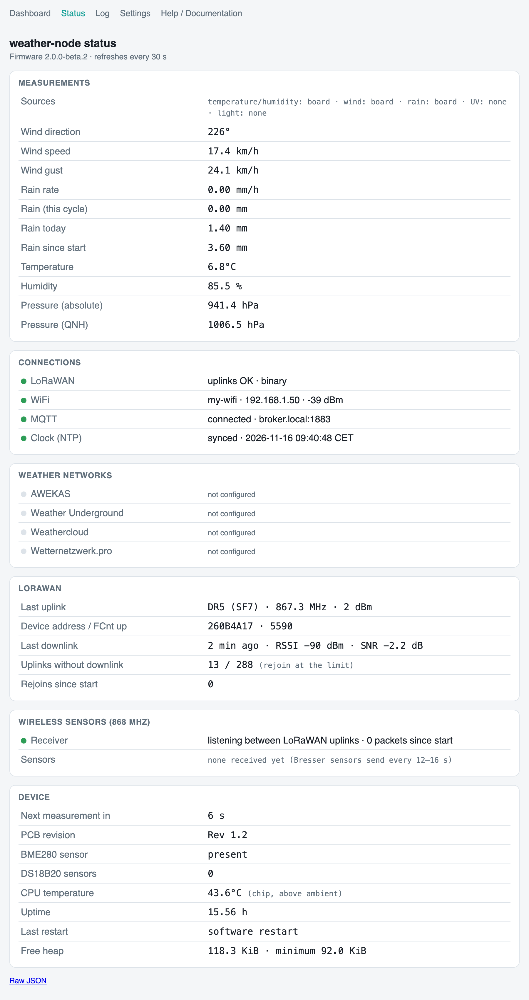
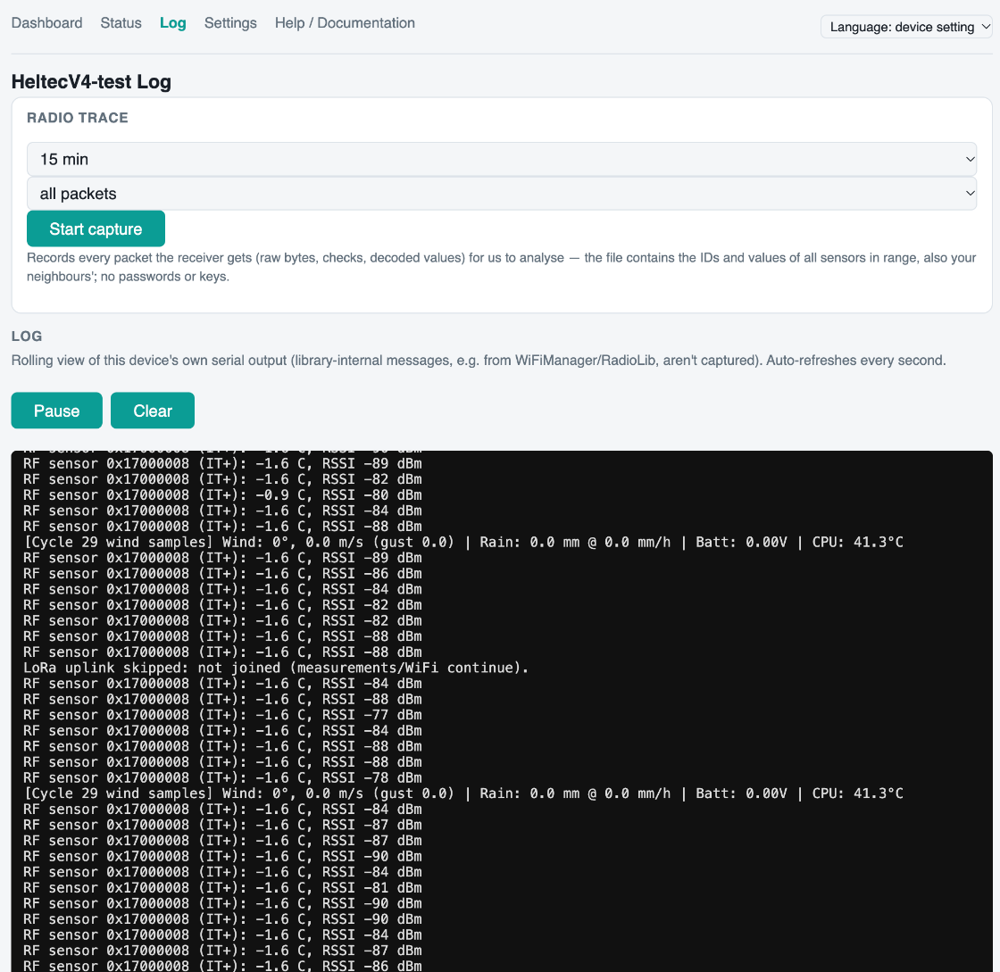
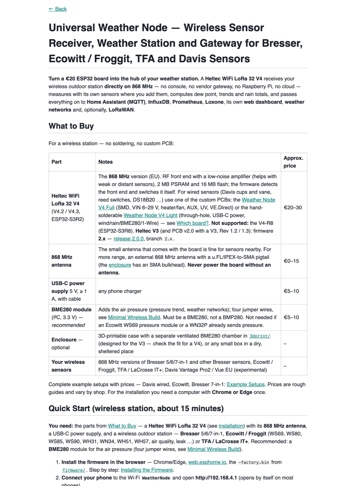

# Web Interface

The node's own web pages — dashboard, status, settings, log and help — and the JSON REST API for scripts and integrations.

[← back to README](../README.md)

With **Wi-Fi** and the **web API** enabled, open the node's IP address in a browser:

| Page | What you get |
|------|--------------|
| **Dashboard** (`/`) | Live values, wind compass and rose, min/avg/max, trend charts for 24 h or 7 days |
| **Status** (`/status`) | Is everything working? A colored dot per connection and weather network |
| **Settings** (`/api/settings`) | All settings — see [Web Settings Page](settings.md#web-settings-page) *(admin password)* |
| **Log** (`/api/log`) | The device's live log output *(admin password)* |
| **Help** (`/help`) | This documentation |

**Dashboard highlights:**

- 🖱️ **Hover over a chart** (or tap/drag on a phone): a crosshair appears in *all* charts at the same moment, with a tooltip showing time, values and wind direction.
- 🌧️ **Rain totals:** the rain tile and the rain amount chart show the sum over the selected range (Σ 24 h or Σ 7 days); after a restart the actually buffered span is named instead (e.g. Σ 5.2h). The tile also shows the last hour and today.
- 🌡️ **Derived values in the tiles:** temperature with *feels like* and dew point, pressure with the 3-h tendency (↗ / → / ↘).
- 🌍 5 languages (English, German, French, Spanish, Portuguese), light/dark theme, Metric/Imperial — saved in your browser only, the device settings stay untouched.
- 🔄 Auto-refresh from 1 s to 1 min, or off.
- 🙈 Sensors without data (e.g. no BME280 connected) are hidden automatically.
- ✈️ Works without internet — no external scripts or fonts.

**Status page:** one line per connection — 🟢 working, 🟡 waiting, 🔴 problem, ⚪ off:

| Line | Shows |
|------|-------|
| LoRaWAN | Disabled, not joined/retrying, uplinks OK, send failures, or fields omitted to fit the data rate; "OK" is not proof of application delivery |
| WiFi | Network, IP address, signal strength |
| MQTT | Connected / disconnected, broker |
| Clock (NTP) | Synced time, or "waiting for first sync" |
| Each weather network | Last successful upload, last server reply on errors, ok/failed counters |

It also shows the latest measurements and the [derived values](values.md#derived-values) — rain last hour / 24 h / today / yesterday, last rain, dew point, feels like, cloud base, pressure tendency with the weather trend, temperature trend, sunshine and warnings — and reloads itself every 30 seconds.

| Box | Shows |
|-----|-------|
| LoRaWAN | Data rate / SF, channel and TX power of the last uplink; device address and uplink frame counter (compare with the network server); time, RSSI and SNR of the last downlink; uplinks since the last downlink against the [silent-session rejoin](lorawan.md#join-and-session) limit; rejoins since start |
| Device | Next measurement, PCB revision, sensors, **CPU temperature** (chip, above ambient), uptime, *firmware update* (with the [update check](values.md#firmware-update-check) on), **cause of the last restart** (power-on, watchdog, crash, brownout …), free heap and its minimum since start |

> 🔒 **Security:** the settings page and the log use HTTP Digest authentication (user `admin`), so the password itself is never sent in plain text. The connection is still unencrypted HTTP — anything you *type into* the settings form can be read by someone sniffing your network. Use a strong admin password and never expose the node to the internet. Without an admin password, these pages are disabled.

<!-- help:skip -->
<table>
  <tr>
    <td align="center" width="50%">
      
       <strong>Dashboard (<code>/</code>)</strong>
    </td>
    <td align="center" width="50%">
      
       <strong>Status page (<code>/status</code>)</strong>
    </td>
  </tr>
  <tr>
    <td align="center" width="50%">
      
       <strong>Device log (<code>/api/log</code>)</strong>
    </td>
    <td align="center" width="50%">
      
       <strong>Help (<code>/help</code>)</strong>
    </td>
  </tr>
</table>
<!-- /help:skip -->

For scripts, integrations and your own displays there is also a JSON API — see [REST API Endpoints](#rest-api-endpoints) and the [developer guide](api.md).

## Built-in Help Page

A snapshot of this documentation from **build time** — the README, the pages in `docs/` and the changelog, combined into one page — is embedded in the firmware: **Help / Documentation** in the portal (http://192.168.4.1/help) or web interface (`/help`). Its text and section links work offline; pictures are omitted. Repository files and external websites are not stored on the device, so those links require access to the repository or internet. Editing the documentation does not update an already built `.bin`.

## REST API Endpoints

The JSON endpoints are a documented, versioned contract for your own displays and apps — fields, units, polling, CORS and mDNS discovery: **[Building Your Own Display or App](api.md)** (with [OpenAPI file](api/openapi.yaml), JSON Schemas, example responses and a mock server).

| Endpoint | Method | Auth | Purpose |
|----------|--------|------|---------|
| `/api/info` | GET | – | Device description: name, firmware, board, units, available values, sources, cycle (CORS `*`) |
| `/api/data` | GET | – | Current measurement JSON, same as the MQTT data topic (CORS `*`) |
| `/api/history` | GET | – | History JSON — 24 h, or 7 days with `?range=7d` (CORS `*`) |
| `/`, `/status`, `/help`, `/help.md` | GET | – | Dashboard, status page, help page and its Markdown source; `/chart` redirects to `/` |
| `/api/settings` | GET / POST | admin | Settings form / save (POST: same-origin only, fields not sent keep their value) |
| `/api/log`, `/api/log/raw` | GET | admin | Log viewer / log as plain text |
| `/api/log/clear` | POST | admin | Clear the log (same-origin only) |

The node also announces itself as `<hostname>.local` via mDNS (the device name in lower case, other characters as `-`; the same name is its Wi-Fi/DHCP hostname, shown on the status page) — see [Discovery](api.md#discovery-mdns).

<!-- help:skip -->

<!-- /help:skip -->

**How fresh is `/api/data`?** It doesn't trigger a measurement; it returns the latest values. All values are those of the last completed base cycle (see [Measurement and Aggregation](values.md#measurement-and-aggregation)); wind gust is the highest 3-s mean in that cycle. `nextCycleInSec` tells you when the next cycle completes.

Telemetry is not limited to 1,024 JSON bytes: `/api/data` streams a complete
chunked response, and MQTT sizes both its serialization buffer and packet buffer
to the measured payload plus topic/header overhead. Allocation failures are
logged (HTTP returns 500), rather than publishing truncated JSON.

**History buffer:** two in-RAM ring buffers — 288 × 5 min (24 h) and 168 × 1 h (7 days), about 9 KB in total. The buckets are fixed windows (wall clock `:00`, `:05`, … and full hours once the clock is synced, uptime before); each cycle is merged into the bucket of both buffers in which it ends: average for most values, maximum for gust, sum for rain amount. One point per window, so the buffers cover exactly 24 h / 7 days whatever the measurement cycle: 60-s cycles give 5 per 5-min bucket, cycles longer than a bucket leave the windows in between empty. Disabled sensors and empty windows leave gaps instead of zeros. The still-open bucket is included as the newest point, so charts show data right after boot. The buffer is cleared by a restart; for long-term history use Grafana via MQTT/ChirpStack. The dashboard's "now" values come from `/api/data`, not from the history; the rain tile is the exception and shows the sum of the history's rain amounts over the selected range.
