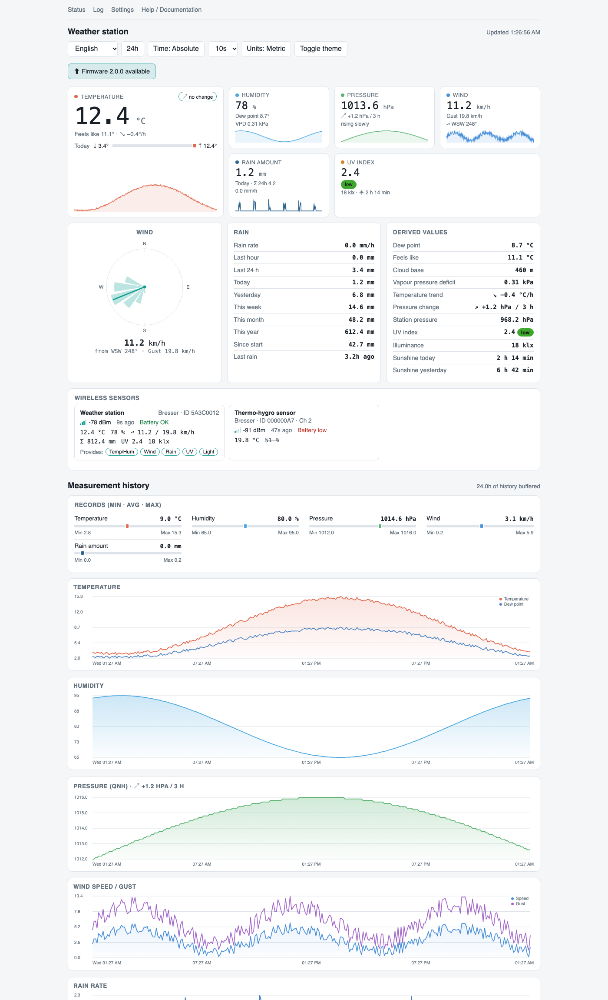
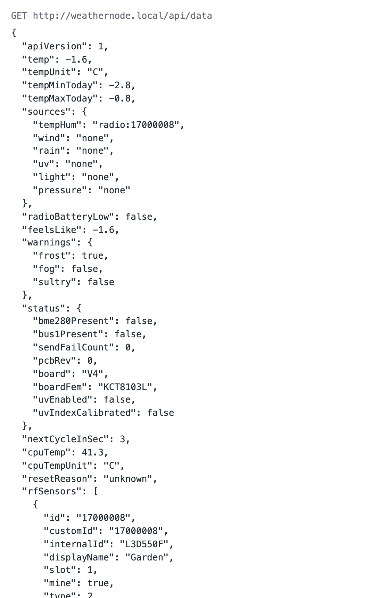

# Web Interface

The node's own web pages — dashboard, status, settings, log and help — and the JSON REST API for scripts and integrations.

[← back to README](../README.md)

With **Wi-Fi** and the **web API** enabled, open the node's IP address in a browser:

| Page | What you get |
|------|--------------|
| **Dashboard** (`/`) | Live values, wind compass and rose, rain, sun & moon, records, min/avg/max of the chart range, trend charts for 24 h, 7 days, 30 days or 1 year (pan back in time, compare with the previous period) |
| **Status** (`/status`) | Is everything working? A colored dot per connection and weather network |
| **Settings** (`/api/settings`) | All settings in the tabs Basics / Sensors / Outputs / Alarms / Display / System, incl. the wireless sensor table — see [Web Settings Page](settings.md#web-settings-page) *(admin password)* |
| **Log** (`/api/log`) | The device's live log output and the [radio trace](wireless-sensors.md#capturing-a-radio-trace-for-us) controls *(admin password)* |
| **Help** (`/help`) | This documentation |
| **Setup wizard** (`/setup`) | First-run guide — opens by itself after the first start, again via *Settings → System*; see [Setup Wizard](installation.md#setup-wizard) |

**Dashboard highlights:**

- 🖱️ **Hover over a chart** (or tap/drag on a phone): a crosshair appears in *all* charts at the same moment, with a tooltip showing time, values and wind direction.
- 📈 **Custom series:** soil moisture, lightning, leaf wetness, PM2.5, CO₂ … get a chart each, titled with the name you gave them — set up under [Settings → Sensors → Custom series](settings.md#custom-series).
- 📈 **Long history (zoom, pan, compare):** the range buttons *24h / 7 days / 30 days / 1 year* (the choice is remembered). *◀ Earlier* / *Later ▶* (or a swipe left / right on the charts) move the window by one range using `/api/history?end=`; *Later* and *Now* are disabled at the present, *Earlier* stops where the node's tiers end (`/api/info` → `history.tiers`, up to 2 years). Past windows never change, so the page fetches each once and keeps it in memory; live updates (SSE / polling) redraw the charts only while the window ends *now*. *Compare with previous period* (off by default, remembered) loads the window one range earlier with the same resolution and draws it shifted onto the current one as a thin dashed line (temperature, humidity, pressure, wind speed) and lighter rain bars, with a small legend; the tooltip shows both values. For 7 days, 30 days and 1 year the temperature, humidity and pressure charts have a light band from the per-bucket minimum to the maximum behind the mean line (tooltip: *Min–max* min…max). The x axis follows the range (hours, weekdays, dates, months); rain is drawn per hour (24 h) or per day; gaps stay gaps. A firmware without `history.tiers` shows only 24 h / 7 days.
- 🌧️ **Rain totals:** the rain tile and the rain amount chart show the sum over the selected range (e.g. Σ 24 h, Σ 7 days); after a restart the actually buffered span is named instead (e.g. Σ 5.2h). The tile also shows the last hour and today.
- 🌡️ **Derived values in the tiles:** temperature with *feels like* and dew point, pressure with the 3-h tendency (↗ / → / ↘).
- 🌍 5 languages (English, German, French, Spanish, Portuguese) — like every page of the node (status, settings, log): the device's *Language* setting ([Settings → Basics](settings.md#web-settings-page)), and a per-browser choice in the language menu that the dashboard and the other pages share. Light/dark theme and Metric/Imperial are saved in your browser only, the device settings stay untouched.
- 📈 **Sparklines:** every value tile has a small line of the last 24 hours, drawn from the history the page already loaded (no extra request; with the 7 day / 30 day / 1 year range the last 24 hours of that window). It uses the tile's colour, follows the light / dark theme and is hidden (the space stays) when there are fewer than two points.
- 💾 **CSV export:** *Export CSV* in the toolbar downloads the window currently shown (range and *Earlier / Later* position) as `uwn-<host>-<range>-<YYYYMMDD-HHMM>.csv`, built in the browser from the loaded history: `time_local` (ISO 8601 with offset), `epoch_utc`, then one column per series with data, unit in the header (`Temperature [°C]`), empty cells for gaps; values are in the unit system chosen with the *Units* button; UTF-8 with BOM, comma separated, point as decimal mark. The resolution is the range's (5 min / 1 h / 1 day); the compare line is not exported.
- 🏆 **Records:** minimum / maximum of temperature, humidity and pressure, maximum gust, rain rate and daily rain for today, yesterday, this month, this year and all time (hover a value for its time) — from `/api/records`, see [Records](values.md#records). The panel below the history (*Chart range*) is the min / avg / max of the shown chart range.
- 🌅 **Sun & moon:** sunrise / sunset, civil twilight, day length, solar noon, sun elevation, moonrise / moonset / highest point, moon phase and illumination — computed on the node ([Sun and Moon](values.md#sun-and-moon)); without latitude / longitude the panel says where to set them.
- 🔔 **Alarms:** active [alarm rules](alarms.md) appear as badges next to the frost / fog / storm warnings.
- 🔄 Auto-refresh from 1 s to 1 min, or off.
- 🙈 Sensors without data (e.g. no BME280 connected) are hidden automatically.
- 📡 **Wireless sensors:** one card per received sensor (up to 32) with its number (`#n`: ★ *Mine* sensors first), kind (e.g. *Temperature probe* for a WN34, *Air quality sensor*, *Leak sensor*, *Leaf wetness sensor*), model, ID, signal, age, battery (and *USB power*) and values — incl. PM1/PM2.5/PM4/PM10, CO₂, leak (*Leak!* / *Dry*), leaf wetness, soil EC and pressure (converted with the unit toggle); values older than 5 min are struck through, and the value groups it currently supplies are marked. Click the sensor's name (or the › on a tile whose value it supplies) to open its **sensor page** (`#sensor=<custom ID or radio ID>` on the same page; *← Dashboard* returns): name, custom ID, radio ID, model / protocol, current values, signal, age and battery (voltage if the sensor sends it), and the history charts of the quantities it supplies as a value source (temperature / humidity, wind, rain, UV, pressure) in the range chosen above. A sensor that feeds no value source has no stored history; the page then points to [Settings → Custom series](settings.md#custom-series), where one of its values can be recorded; a custom series that follows this sensor is shown on its page too.
- 🟢 **Live badge, flash, age:** next to *Updated* a green **● Live** shows that values arrive through the event stream (`/api/events`); a grey badge *every 10 s* shows the polling interval (the auto-refresh setting, default 10 s) when the stream is not available (the node already serves 3 dashboards) — nothing with auto-refresh *Off*. *Settings → System → Web UI* has two options (both off by default): **Flash tiles on change** and **Show age of values** ("3 s ago" per tile).
- ✈️ Works without internet — no external scripts or fonts.

**Status page:** one line per connection — 🟢 working, 🟡 waiting, 🔴 problem, ⚪ off:

| Line | Shows |
|------|-------|
| LoRaWAN | Disabled, not joined/retrying, uplinks OK, send failures, or fields omitted to fit the data rate; "OK" is not proof of application delivery |
| WiFi | Network, IP address, signal strength |
| MQTT | Connected / disconnected, broker; below: Home Assistant discovery (last run OK / failed) |
| Clock | Local time, the time source it follows (GNSS, NTP, DCF77 radio-clock sensor, phone, LoRaWAN) and how long ago it last delivered; "running on its own" once that source is older than its freshness window, or "waiting for a time source" ([details](lorawan.md#time-sources-and-network-time-devicetimereq)) |
| Each weather network | Last successful upload, last server reply on errors, ok/failed counters, failures in a row; below them the custom uploads |
| Access point (own access point on) | Name, address, channel, connected devices; the join QR code only for visitors on the access point — see [At the airfield](airfield.md) |
| Alarms (box, with alarm rules defined) | Active rules (since when) and each configured notification channel's last result — see [Alarms](alarms.md) |

Every output line (LoRaWAN, MQTT, Home Assistant discovery, Loxone, each weather network) also shows its **send status since the start**: last success, last error with time, code (HTTP status, client / radio code or MQTT state) and short text, and the failures in a row — the same as `/api/info` `outputs.status` ([API](api.md#sun-and-moon-alarms-send-status)). No URLs or keys.

It also shows the latest measurements and the [derived values](values.md#derived-values) — rain last hour / 24 h / today / yesterday, last rain, dew point, feels like, cloud base, pressure tendency with the weather trend, temperature trend, sunshine and warnings — and reloads itself every 30 seconds.

| Box | Shows |
|-----|-------|
| LoRaWAN | Data rate / SF, channel and TX power of the last uplink; device address and uplink frame counter (compare with the network server); time, RSSI and SNR of the last downlink; uplinks since the last downlink against the [silent-session rejoin](lorawan.md#join-and-session) limit; rejoins since start |
| Wireless sensors (868 MHz) | Receiver state (*listening* — "between LoRaWAN uplinks" only with LoRaWAN on), sensor type, and one line per received sensor (up to 32) as *Wireless n · ID … (type, model)* (★ = Mine) with the buttons **★** (mark as Mine; ☆ = remove from Mine) and **✕** (hide a neighbour's sensor; admin password), a line *n hidden sensors in range*, age, RSSI, battery and values (also PM, CO₂, leak state with raw value and sensitivity, leaf wetness, EC, pressure); with MQTT on, whether Home Assistant gets a device per sensor (only for IDs in the list); **Radio trace**: state and progress of a capture with a link to the log page, where it is started (5 / 15 / 60 min, all / only failed or unknown / one ID), downloaded, stopped or discarded — see [Capturing a radio trace](wireless-sensors.md#capturing-a-radio-trace-for-us) |
| Virtual sensors (box after the wireless sensors, while any is on) | Per virtual sensor the frames sent, when the last one went out and how many were skipped (airtime limit, radio busy, Davis) — see [Virtual Sensors](virtual-sensors.md) |
| Device | Next measurement, PCB revision, sensors, **CPU temperature** (chip, above ambient), uptime, *firmware update* (with the [update check](values.md#firmware-update-check) on), **cause of the last restart** (power-on, watchdog, crash, brownout …, with the reason of a planned restart and how long the node had run), the restarts before it (up to 10), the **last crash** (task, address, panic details or CPU exception), free heap and its minimum since start |

> 🔒 **Security:** the settings page and the log use HTTP Digest authentication (user `admin`), so the password itself is never sent in plain text; wrong passwords are braked (`429 Too Many Requests`, see [Web Settings Page](settings.md#web-settings-page)). The connection is plain HTTP unless you switch on [HTTPS](settings.md#https) — anything you *type into* the settings form can then be read by someone sniffing your network. Use a strong admin password and never expose the node to the internet. Without an admin password, these pages are disabled.

<!-- help:skip -->
<table>
  <tr>
    <td align="center" width="50%">
      
       <strong>Dashboard (<code>/</code>)</strong>
    </td>
    <td align="center" width="50%">
      
       <strong>Status page (<code>/status</code>)</strong>
    </td>
  </tr>
  <tr>
    <td align="center" width="50%">
      
       <strong>Device log (<code>/api/log</code>)</strong>
    </td>
    <td align="center" width="50%">
      
       <strong>Help (<code>/help</code>)</strong>
    </td>
  </tr>
</table>
<!-- /help:skip -->

For scripts, integrations and your own displays there is also a JSON API — see [REST API Endpoints](#rest-api-endpoints) and the [developer guide](api.md).

## Install as an App (Home Screen)

The web interface can be added to the home screen like an app — its own icon, full screen without the browser bars, named after the node (*device name*):

- **iPhone / iPad (Safari):** open the dashboard, *Share* → *Add to Home Screen*.
- **Android (Chrome):** menu → *Install app* (or *Add to home screen*).
- **Desktop (Chrome / Edge):** the install icon in the address bar.

**Offline:** reached over **https** — e.g. behind a reverse proxy such as HAProxy or nginx (`https://weather.example.org/`) — the dashboard also registers a small service worker: the last dashboard and its data stay available without a connection, with an *Offline – last data from …* banner. Settings, setup, log, firmware update and anything you send are never cached. Over plain `http://` (the node in your LAN) browsers allow no service worker: the home-screen icon works, offline does not. The cache is renewed with every firmware update.

Behind a reverse proxy the node must be reachable at the root of the host name (`/`), as the pages use root paths.

## Built-in Help Page

A snapshot of this documentation from **build time** — the README, the pages in `docs/` and the changelog, combined into one page — is embedded in the firmware: **Help / Documentation** in the portal (http://192.168.4.1/help) or web interface (`/help`). Its text and section links work offline; pictures are omitted. Repository files and external websites are not stored on the device, so those links require access to the repository or internet. Editing the documentation does not update an already built `.bin`.

## REST API Endpoints

The JSON endpoints are a documented, versioned contract for your own displays and apps — fields, units, polling, CORS and mDNS discovery: **[Building Your Own Display or App](api.md)** (with [OpenAPI file](api/openapi.yaml), JSON Schemas, example responses and a mock server).

| Endpoint | Method | Auth | Purpose |
|----------|--------|------|---------|
| `/api/info` | GET | – | Device description: name, firmware, board, units, available values, sources, cycle (CORS `*`) |
| `/api/data` | GET | – | Current measurement JSON, same as the MQTT data topic (CORS `*`) |
| `/api/history` | GET | – | History JSON — `?range=24h`, `7d`, `30d` or `1y`, optional `end` / `res` (CORS `*`) |
| `/api/events` | GET | – | Live values as Server-Sent Events, at most 3 streams (CORS `*`) |
| `/metrics` | GET | – | Prometheus text format (CORS `*`) — see [HTTP API](api.md#endpoints) |
| `/api/records`, `/api/alarms` | GET | – | [Records](values.md#records), alarm rules and state (CORS `*`) |
| `/`, `/status`, `/help`, `/help.md` | GET | – | Dashboard, status page, help page and its Markdown source; `/chart` redirects to `/` |
| `/api/settings` | GET / POST | admin | Settings form / save (POST: same-origin only, fields not sent keep their value) |
| `/api/log`, `/api/log/raw` | GET | admin | Log viewer / log as plain text |
| `/api/rf/sensor` | POST | admin | Mark a wireless sensor ★ Mine / ○ Received / ✕ Hidden or move it in the ★ order (`id`, `action`; same-origin only) — see [Mine, Received, Hidden](wireless-sensors.md#mine-received-hidden) |
| `/api/rf/trace` | GET / POST | admin | [Radio trace](wireless-sensors.md#capturing-a-radio-trace-for-us): download the diagnostic file (`?status`: progress JSON) / start, stop, discard (POST: same-origin only) |
| `/api/davis/log` | GET | admin | Davis sniffer capture = the radio trace shown inline (Davis mode starts one; see [Davis wireless](wireless-sensors.md#davis-wireless-experimental)) |
| `/api/log/clear` | POST | admin | Clear the log (same-origin only) |
| `/api/diag/coredump` | GET | admin | Core dump of the last crash (raw, decode with that build's `firmware.elf`) — see [Crash report](design/storage-layout.md#crash-report) |
| `/api/diag/crash` | POST | admin | Deliberate crash to test the crash report (`kind` = `panic` / `watchdog`, `confirm=CRASH`; same-origin only) |
| `/api/system/reset` | POST | admin | [Reset settings](settings.md#reset) (`what=settings`, `confirm=RESET`) or erase everything (`what=everything`, `confirm=ERASE`); same-origin only, ends in a restart |

The node also announces itself as `<hostname>.local` via mDNS (the device name in lower case, other characters as `-`; the same name is its Wi-Fi/DHCP hostname, shown on the status page) — see [Discovery](api.md#discovery-mdns).

<!-- help:skip -->

<!-- /help:skip -->

**How fresh is `/api/data`?** It doesn't trigger a measurement; it returns the latest values. All values are those of the last completed base cycle (see [Measurement and Aggregation](values.md#measurement-and-aggregation)); wind gust is the highest 3-s mean in that cycle. `nextCycleInSec` tells you when the next cycle completes.

Telemetry is not limited to 1,024 JSON bytes: `/api/data` streams a complete
chunked response, and MQTT sizes both its serialization buffer and packet buffer
to the measured payload plus topic/header overhead. Allocation failures are
logged (HTTP returns 500), rather than publishing truncated JSON.

**History:** three tiers in the PSRAM — 5-min values for 24 h, hourly values for 35 days and local days for 2 years — saved to the node's own `history` partition every 30 min and before every planned restart, so a power cut loses at most 30 min; the dashboard's 24 h / 7 d / 30 d / 1 year charts read them. Buckets are fixed windows on the wall clock (the daily tier needs a synced clock); empty windows are gaps, not zeros. Details, units and aggregation: [History Ranges and Buckets](api.md#history-ranges-and-buckets). Long-term storage beyond 2 years is a job for Grafana via MQTT, InfluxDB or Prometheus. The dashboard's "now" values come from `/api/data`, not from the history; the rain tile is the exception and shows the sum of the history's rain amounts over the selected range.
